# Samsung Cloud Platform Hands-on Lab V - Observability

### 학습 목표

본 핸즈온 랩은 Samsung Cloud Platform(SCP) 환경에서 클라우드 인프라, 컨테이너, 애플리케이션 전 계층에 걸친 **풀스택 관찰 가능성(Full-Stack Observability)** 체계를 구축하는 것을 목표로 합니다.

- **실습 인프라 자동화 (사전 준비)**: Terraform(IaC)과 Docker를 활용하여 SKE(Kubernetes Engine) 클러스터 및 Gateway API 기반의 실습 환경을 신속하게 배포할 수 있습니다.
- **플랫폼 인프라 모니터링 및 경보 구축**: ServiceWatch 콘솔을 통해 Virtual Server, File Storage, DBaaS의 주요 지표를 실시간 수집·시각화하고, 부하 테스트를 통한 임계치 경보(Alert) 상태 전이를 검증할 수 있습니다.
- **Agent 기반 심화 관측 및 실시간 로그 모니터링**: ServiceWatch Agent를 통해 호스트 세부 지표를 수집하고, 애플리케이션/시스템 로그의 실시간 스트림 조회 및 다차원 로그 검색을 수행할 수 있습니다.
- **감사 추적 및 보안 이벤트 대응**: Logging & Audit Trail을 구성하여 감사 로그의 Object Storage 장기 보관과 Digest 무결성 검증을 실습하고, 인프라 변경 이벤트에 대한 실시간 알림 룰을 적용할 수 있습니다.
- **쿠버네티스 전문 모니터링 스택 구축**: SKE 클러스터에 Prometheus와 Grafana를 배포하여 PromQL 기반 컨테이너 메트릭 질의, Alertmanager 경보 라우팅, 커스텀 대시보드 시각화를 구현할 수 있습니다.
- **하이브리드 관제 아키텍처 수립**: 클라우드 네이티브 관리형 관제(ServiceWatch)와 오픈소스 관제(Prometheus/Grafana)의 상호 보완적 역할을 이해하고 최적의 단일 관제 동선을 설계할 수 있습니다.


#### SCP Architecture

- **Web-IDE 환경**: 실습의 일관성과 편의성을 위해 동일한 개발 환경을 제공합니다. SCP 가상서버에 Docker를 설치하고, Terraform, Kubectl, Helm 등 모든 실습 도구가 사전 설치된 `code-server` 컨테이너를 배포하여 구성됩니다. 이를 통해 로컬 PC에 별도의 개발 환경을 구축할 필요 없이 웹 브라우저만으로 실습을 진행할 수 있습니다.

- **클라우드 인프라**: 본 실습에서 구축할 전체 인프라 아키텍처입니다. Terraform을 사용하여 SCP 위에 VPC, Subnet, Kubernetes 클러스터, File Storage 등 기반 인프라를 구축합니다.

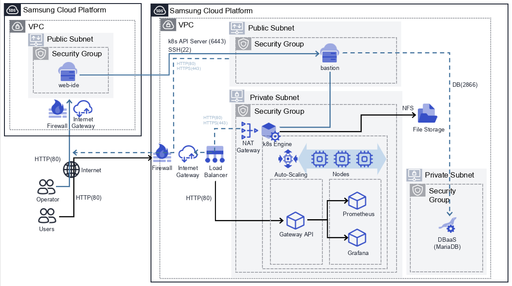


# 목차

1. **실습 개발환경 구성**
2. **Terraform을 활용한 Kubernetes 클러스터 배포**
3. **Gateway API 및 Gateway Controller 배포**
4. **SCP 콘솔 기반 Observability 및 인프라 경보 체계 구축**
5. **ServiceWatch Agent 기반 확장 모니터링 및 파일 로그 수집**
6. **Trail 감사 체계 및 End-to-End 장애 대응 시나리오 실습**
7. **Prometheus와 Grafana를 활용한 Kubernetes Engine 심화 모니터링**
8. **ServiceWatch와 Prometheus의 상호 보완적 활용 전략**
9. **실습 자원 삭제 및 정리**

# 전체 프로세스

1. **실습 개발환경 구성 (준비 과정)**: VPC, Subnet, 방화벽 규칙 등 네트워크 환경을 세팅하고, Web-IDE VM을 띄워 Terraform 및 kubectl 사용을 준비합니다.
2. **Kubernetes 클러스터 배포 (준비 과정)**: SCP API 연동 인증을 구성하고 Terraform을 사용해 K8s 클러스터 프로비저닝을 마칩니다.
3. **Gateway API 및 Controller 배포 (준비 과정)**: Gateway API CRD 및 Envoy Gateway를 설치하여 클러스터 접근용 SCP Load Balancer를 연동합니다.
4. **Observability 실습 수행 (본 실습)**: 콘솔 대시보드 및 인프라 경보 구성, Agent 설치 및 파일 로그 수집, Audit Trail 생성, Prometheus/Grafana 통합 구축 및 자원 정리를 수행합니다.

# 1. 실습 개발환경 구성

## 1.1 학습목표

- Docker를 사용하여 컨테이너 기반의 `web-ide` 개발 환경을 배포할 수 있다.
- `web-ide` 환경에 접속하여 Terraform, Kubectl, Helm 등 사전 설치된 도구를 사용할 수 있다.

## 1.2 들어가기

### 1.2.1 서비스 개념도
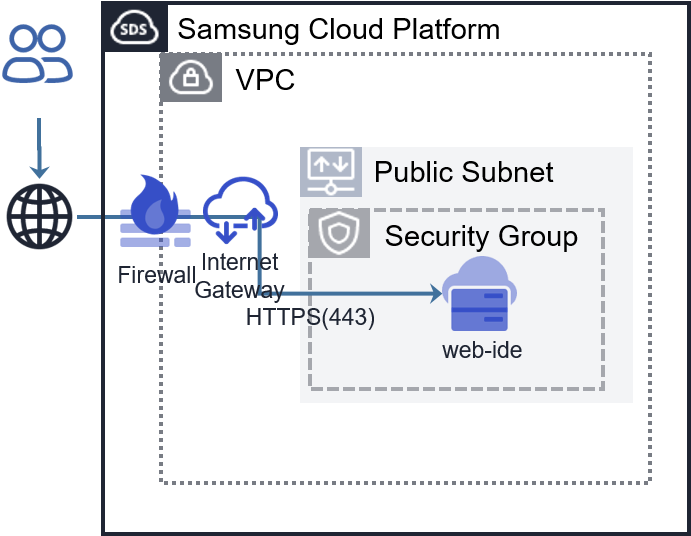

### 1.2.2 관련 용어

| No | 용어 | 설명 |
| --- | --- | --- |
| 1 | Code-Server | VS Code를 웹 브라우저에서 사용할 수 있게 해주는 IDE 서버입니다. 일관된 개발 환경을 제공합니다. |
| 2 | VPC | Virtual Private Cloud의 약자로, 클라우드 환경에서 사용하는 격리된 가상 네트워크입니다. |
| 3 | IGW | Internet Gateway의 약자로, VPC가 인터넷과 통신할 수 있도록 하는 관문 역할을 합니다. |
| 4 | Subnet | VPC 내의 IP 주소 범위로, 네트워크를 더 작은 단위로 분할하여 관리합니다. |
| 5 | Firewall | 네트워크 트래픽을 제어하는 보안 시스템으로, IGW에 적용되어 외부와의 통신을 관리합니다. |
| 6 | Security Group | VM 인스턴스에 적용되는 가상 방화벽으로, 더 세분화된 인바운드/아웃바운드 트래픽 제어를 합니다. |

### 1.2.3 리소스 접근 안내

모든 SCP 서비스 리소스는 다음의 표준화된 방법으로 접근할 수 있습니다.

- **접근 방법:** **콘솔 상단 메뉴의 [서비스] → [해당 서비스 카테고리 (예: Networking, Compute)] → [원하는 리소스 (예: VPC, Virtual Server)]**

    예를 들어, VPC를 생성하라는 가이드가 나오면, `서비스 → Networking → VPC` 경로를 통해 해당 메뉴로 이동하면 됩니다. 

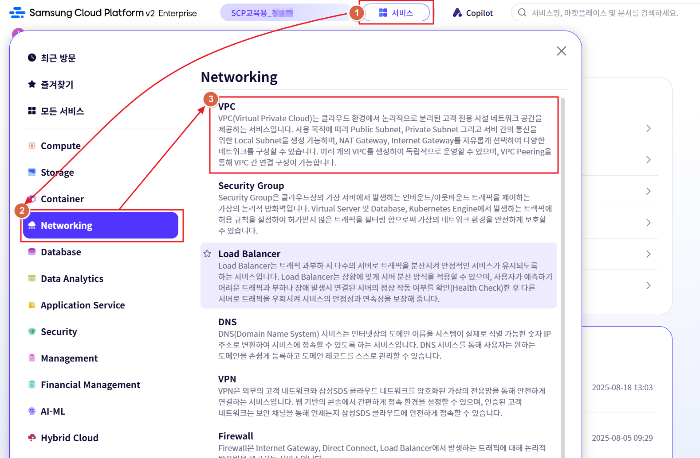

### 1.2.4 내 Public IP 주소 확인 방법

실습 중 방화벽 규칙 등에 자신의 Public IP 주소를 입력하는 설정이 있습니다. 자신의 Public IP 주소는 웹 브라우저를 통해 쉽게 확인할 수 있습니다.

#### 웹 브라우저 사용
- 웹 브라우저 주소창에 아래 URL을 입력하여 접속합니다.

  ```
  https://ifconfig.me
  ```

- 화면에 표시되는 IP 주소가 현재 사용 중인 Public IP 주소입니다.

## 1.3 따라하기

### 1.3.1 VPC 생성

실습에 필요한 리소스들을 생성할 격리된 가상 네트워크 공간(VPC)을 생성합니다.

#### 1. 서비스 경로
- 서비스 → Networking → VPC → `[VPC 생성]`
#### 2. 입력 정보
- VPC명 : `vpc-webide-hol5`
- IP 대역 : `192.168.0.0/16`

### 1.3.2 IGW 생성

생성한 VPC가 외부 인터넷과 통신할 수 있도록 관문 역할을 하는 인터넷 게이트웨이(IGW)를 생성하고 연결합니다.

#### 1. 서비스 경로
- 서비스 → Networking → VPC → Internet Gateway → `[Internet Gateway 생성]` 

#### 2. 입력 정보
- VPC 선택: 방금 생성한 `vpc-webide-hol5`
- 구분: Internet Gateway
- Firewall 사용: 체크
- Firewall 로그 저장 여부: 체크 해제(사용 안함)

### 1.3.3 Subnet 생성

VPC 내부에 VM과 같은 리소스들이 실제로 배치될 네트워크 영역인 서브넷을 생성합니다.

#### 1. 서비스 경로
- 서비스 → Networking → VPC → Subnet → `[Subnet 생성]`

#### 2. 입력 정보
- Subnet 유형: General
- VPC: `vpc-webide-hol5`
- Subnet명: `pubsubhol5`
- IP 대역: `192.168.0.0/24`

### 1.3.4 Firewall 규칙 추가

IGW를 통해 외부와 통신하기 위한 방화벽 규칙을 설정합니다. Inbound는 외부에서 내부로, Outbound는 내부에서 외부로의 통신을 의미합니다.

#### 1. 서비스 경로
- 서비스 → Networking  → Firewall → `FW_IGW_vpc-webide-hol5` → ( [규칙] → [규칙 추가] )


#### 2. 입력 정보
- web-ide접속 규칙
    - 출발지 IP: `my public ip`
    - 목적지 IP: `192.168.0.0/24`
    - 유형 : `TCP`
    - TCP 목적지 포트: `80`
    - 방향: `inbound`
    - **용도:** `80`포트는 HTTP 웹 트래픽을 위한 기본 포트입니다. Web-IDE(code-server)에 접속하고 Let's Encrypt 인증서 발급 과정에서 사용됩니다.

- outbound 외부 인터넷 규칙
    - 출발지 IP: `192.168.0.0/24`
    - 목적지 IP: `0.0.0.0/0`
    - 유형 : `TCP`
    - TCP 목적지 포트: `80, 443, 6443` (6443은 K8s API 서버 통신용)
    - 방향: `outbound`
    - **용도:** `80, 443`포트는 VM에서 외부 인터넷 리소스(패키지 다운로드, 외부 API 호출 등)에 접근하기 위해 필요합니다. `6443`포트는 Kubernetes API 서버와 통신하기 위한 포트로, web-ide의 `kubectl` 및 Prometheus 모니터링 도구가 Kubernetes 클러스터와 통신할 때 사용됩니다.

- Sample Web Application 테스트 포트
    - 출발지 IP: `my public ip`
    - 목적지 IP: `192.168.0.0/24`
    - 유형 : `TCP`
    - TCP 목적지 포트: `3000`
    - 방향: `inbound`
    - **용도:** `3000`포트는 실습에서 개발하는 샘플 웹 애플리케이션의 기본 접속 포트입니다. 이 포트를 통해 개발한 애플리케이션을 외부에서 테스트할 수 있습니다.

| 규칙 이름 | 방향 | 출발지 IP | 목적지 IP | 유형 (포트) | 용도 |
| :--- | :--- | :--- | :--- | :--- | :--- |
| Web-IDE 접속 (HTTP) | `inbound` | `my public ip` | `192.168.0.0/24` | `TCP` (80) | Web-IDE 접속 및 Let's Encrypt 인증서 발급 |
| Outbound 인터넷 | `outbound` | `192.168.0.0/24` | `0.0.0.0/0` | `TCP` (80, 443, 6443) | 외부 인터넷 및 K8s API 서버 통신 |
| 샘플 앱 테스트 | `inbound` | `my public ip` | `192.168.0.0/24` | `TCP` (3000) | 개발 중인 샘플 웹 애플리케이션 테스트 |

### 1.3.5 Security Group 생성 및 규칙 추가

VM에 직접 적용되는 가상 방화벽입니다. 더욱 세분화된 접근 제어가 가능합니다.

#### 1. 서비스 경로
- 서비스 → Networking → Security Group → `[Security Group 생성]`

#### 2. 입력 정보
- Security Group명: `pubsub-sg-hol5`
- 로깅 여부 : `체크 해제(사용 안함)`

#### 3. 규칙 추가

- web-ide 접속 규칙(http)
  - 방향: `inbound`
  - 유형: `HTTP` (80) 선택
  - 대상주소: `<my public ip>`
  - **용도:** Web-IDE(code-server)에 HTTP 프로토콜로 접속하기 위한 규칙입니다.

- outbound 인터넷 접속 규칙(http)
  - 방향: `outbound`
  - 유형: `HTTP` (80) 선택
  - 대상주소: `0.0.0.0/0`
  - **용도:** VM에서 외부 HTTP 리소스(패키지 저장소, 웹 서비스 등)에 접근하기 위한 규칙입니다.

- outbound 인터넷 접속 규칙(https)
  - 방향: `outbound`
  - 유형: `HTTPS` (443) 선택
  - 대상주소: `0.0.0.0/0`
  - **용도:** VM에서 외부 HTTP 리소스(패키지 저장소, 웹 서비스 등)에 접근하기 위한 규칙입니다.

- outbound 인터넷 접속 규칙(k8s)
  - 방향: `outbound`
  - 허용 포트: `사용자 지정 TCP`
  - 포트 범위: `6443` (6443은 K8s API 서버 통신용)
  - 대상주소: `0.0.0.0/0`
  - **용도:** VM에서 외부 Kubernetes API에 안전하게 접근하기 위한 규칙입니다.
  
- Sample Web Application 테스트 포트
  - 방향: `inbound`
  - 허용 포트: `사용자 지정 TCP`
  - 포트 범위: `3000`
  - 대상주소 : `<my public ip>`
  - **용도:** 실습에서 개발하는 샘플 웹 애플리케이션에 접근하기 위한 포트입니다. 개발 중인 애플리케이션을 외부에서 테스트할 때 사용됩니다.


| 규칙 이름 | 방향 | 유형 (허용 포트) | 대상 주소 | 용도 |
| :--- | :--- | :--- | :--- | :--- |
| web-ide 접속 규칙 (http) | `inbound` | `HTTP` (80) | `<my public ip>` | Web-IDE 접속 |
| outbound 인터넷 접속 규칙 (http) | `outbound` | `HTTP` (80) | `0.0.0.0/0` | VM에서 외부 HTTP 리소스 접근 |
| outbound internet 접속 규칙 (https) | `outbound` | `HTTPS` (443) | `0.0.0.0/0` | VM에서 외부 HTTPS 리소스 접근 |
| outbound 인터넷 접속 규칙 (k8s) | `outbound` | `사용자 지정 TCP` (6443) | `0.0.0.0/0` | VM에서 외부 Kubernetes API 접근 |
| Sample Web App 테스트 포트 | `inbound` | `사용자 지정 TCP` (3000) | `<my public ip>` | 샘플 웹 애플리케이션 테스트 접속 |

### 1.3.6 Virtual Server생성(Key pair 생성)

실습을 진행할 개발 환경인 Web-IDE(code-server)를 설치할 가상머신(Virtual Server)을 생성합니다. VM에 안전하게 접속하기 위한 Key pair도 함께 생성합니다.

#### 1. 서비스 경로
- 서비스 → Compute → Virtual Server → `[Virtual Server 생성]`

#### 2. 입력 정보
- 이미지 선택: Custom : `ubuntu 24.04`
- 서비스 정보 입력
  - 서버 수: `1`
  - 상품 유형:
    - 서버타입: `Standard-2/s2v1m2(vCPU 1 | Memory 2G)`
  - Block Storage:
    - 기본 OS: `6` Units
    - Max IOPS: `5000` IOPS
    - Max Throughput: `250` MB/s
  - 필수 정보 입력
    - 서버명 : `web-ide`
    - 네트워크 설정:
      - VPC: `vpc-webide-hol5`
      - 일반 서브넷: `pubsubhol5`
      - Public NAT: `사용 체크` → 신규 생성
        - `Internet Gateway`로 생성하여 Public NAT주소에 적용
      - Security Group: `pubsub-sg-hol5`
    - 서버 Key pair : `mykey-hol5` (신규 생성 후 **pem 키를 반드시 다운로드하여 보관**)
    - **Init script:** 아래 스크립트를 복사하여 붙여넣습니다. 이 스크립트는 web-ide를 설치하고 VirtualServer 생성 시 동적으로 할당되는 Public IP를 설정 파일에 자동으로 업데이트합니다.

```bash
#!/bin/bash
set -e
REPO_URL="https://github.com/cwj3688/init-webide.git"
REPO_DIR="init-webide"
IMAGE_NAME="cwj3688/code-server-hol3"
HOME_DIR="/home/ubuntu"
PROJECT_DIR="${HOME_DIR}/project"
git clone "$REPO_URL"
cd "$REPO_DIR"
git checkout no-tls
chmod +x install_docker.sh
./install_docker.sh
docker pull "$IMAGE_NAME"
mkdir -p "$PROJECT_DIR"
mkdir -p "${HOME_DIR}/.scp" "${HOME_DIR}/.scpconf" "${HOME_DIR}/.kube" "${HOME_DIR}/.config" "${HOME_DIR}/.local"
PASSWORD=$(openssl rand -base64 12)
echo "Your Web-IDE Password: ${PASSWORD}" > "${PROJECT_DIR}/env-info.txt"
DOCKER_GID=$(getent group docker | cut -d: -f3) PASSWORD=${PASSWORD} docker compose up -d
chown -R 1000:1000 "$HOME_DIR"
echo "================================================================"
echo "   A new password for the Web-IDE has been generated."
echo "   Password: ${PASSWORD}"
echo "   It has been saved to: ${PROJECT_DIR}/env-info.txt"
echo "================================================================"
echo "Web-IDE setup is complete!"
```

> **참고:** Virtual Server 생성 및 초기화 스크립트(code-server 구성)가 완료되기까지 **약 10~15분** 정도 소요될 수 있습니다.

### 1.3.7 web-ide 접속

#### 1. 접속 IP 정보 확인
- **생성된 VM의 Public IP 주소를 확인합니다.**
  - SCP 콘솔에 로그인합니다.
  - **경로**: 서비스 → Compute → Virtual Server → `[web-ide]`
  - 생성한 VM (web-ide)을 목록에서 찾아 선택합니다.
  - 상세 정보 화면에서 Public IP 주소를 복사해 둡니다.

#### 2. 패스워드 확인
- VM이 처음 생성될 때 초기화 스크립트(Init Script)가 실행되며, 이 과정에서 web-ide 접속을 위한 임시 비밀번호가 자동으로 생성됩니다. 이 비밀번호는 콘솔 로그에서 확인할 수 있습니다.
  - VM 상세 정보 화면에서 [콘솔 로그] 탭을 클릭합니다.
  - 로그 내용 중에서 아래와 같이 PASSWORD가 포함된 부분을 찾아 비밀번호를 확인하고 복사합니다. 

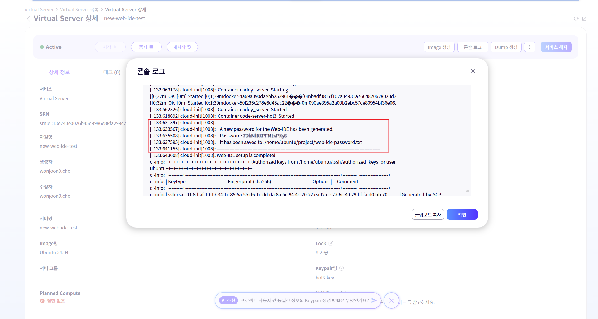

#### 3. web-ide 접속 및 로그인

- 이제 확인한 IP 주소와 비밀번호를 사용하여 웹 브라우저에서 web-ide에 접속합니다.
  - 웹 브라우저를 열고 주소창에 **http://<VM의-Public-IP>.sslip.io** 형식으로 입력합니다.
    (예시: `http://123.45.67.89.sslip.io`)
  - 로그인 화면이 나타나면, 2단계에서 확인한 비밀번호를 입력하여 접속합니다.

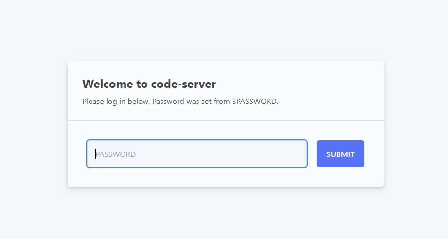


> **sslip.io 란?**
>
> `sslip.io`는 DNS 설정 없이 IP 주소를 기반으로 임시 도메인을 생성해주는 무료 와일드카드 DNS 서비스입니다.
> 예를 들어, VM의 Public IP가 `123.45.67.89` 이라면, 별도의 도메인 구매나 DNS 레코드 설정 없이 `http://123.45.67.89.sslip.io` 와 같은 주소로 즉시 접속할 수 있습니다.
> `sslip.io`는 주소에 포함된 IP 주소를 자동으로 인식하여 해당 IP로 연결해주는 원리로 동작합니다.
> 이번 실습에서는 이 서비스를 활용하여 7장에서 배포할 Grafana, Prometheus, Alertmanager 모니터링 웹 콘솔에 쉽게 접근할 수 있는 도메인을 생성합니다.

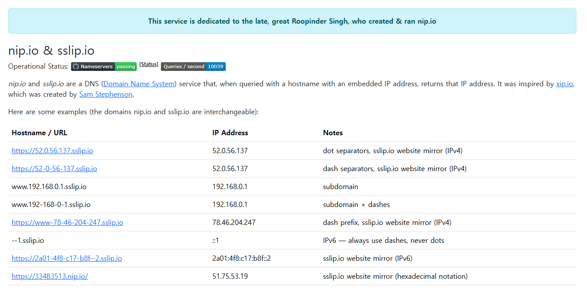


#### 4. 작업 폴더의 파일들을 신뢰하고 모든 기능을 활성화
- 작업 폴더 신뢰하기: 보안 경고창이 나타나면, "Yes, I trust the authors" 버튼을 클릭하여 작업 폴더의 모든 파일을 신뢰하고 web-ide의 전체 기능을 활성화합니다.

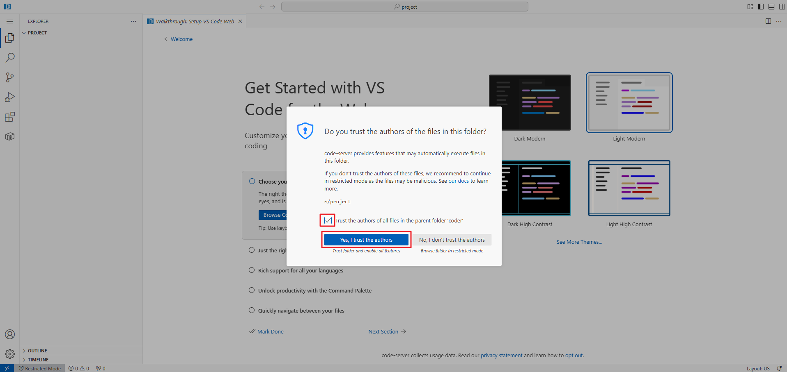

#### 5. 테마 설정(선택 사항)
- 원하는 에디터 테마를 선택합니다. 이 설정은 나중에 언제든지 변경할 수 있습니다.

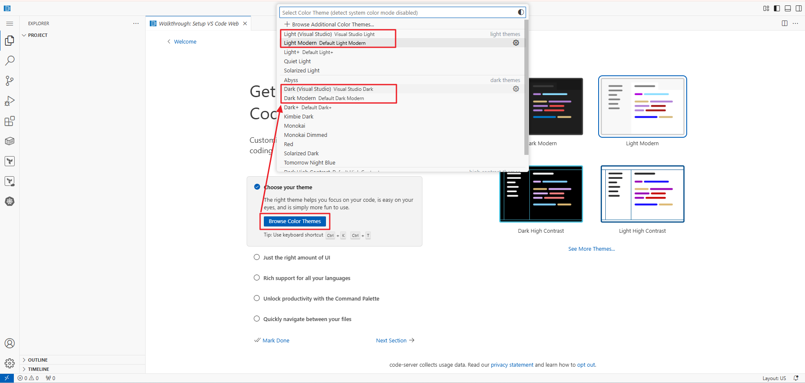


**이제부터 모든 터미널 작업은 이 `web-ide`의 웹 터미널에서 진행합니다.**

### 1.3.8 web-ide 구성 및 명령어 테스트

본 개발 환경은 `code-server`를 기반으로 구성된 표준 클라우드 개발 환경입니다. 운영자나 개발자들이 언제 어디서든 일관된 환경에서 효율적으로 작업할 수 있도록 다양한 도구와 확장이 사전 설치되어 있습니다.

#### 1. 기본 환경 (Base Environment)

본 개발 환경은 `code-server`의 특정 버전을 기반으로 구축되어, 웹 브라우저를 통해 Visual Studio Code의 강력한 기능을 그대로 사용할 수 있습니다.

- **`code-server` 버전:** `4.103.1`
- **기본 OS:** ubuntu 24.04
- **기본 셸:** `bash`

#### 2. 설치된 주요 도구 및 버전

클라우드 네이티브 애플리케이션 개발과 인프라 관리를 위해 다음과 같은 필수 도구들이 설치되어 있습니다.

| 도구 | 버전 | 설명 |
| --- | --- | --- |
| **Terraform** | 최신 안정 버전 | HashiCorp에서 개발한 IaC(Infrastructure as Code) 도구로, 인프라를 코드로 정의하고 프로비저닝합니다. |
| **Docker CLI** | 최신 안정 버전 | 컨테이너를 빌드하고 관리하기 위한 커맨드 라인 인터페이스입니다. (Docker Engine은 포함되지 않음) |
| **OpenJDK** | `17` | Java 애플리케이션 개발 및 실행을 위한 오픈소스 Java Development Kit입니다. |
| **Node.js** | `20.x` | JavaScript 런타임 환경으로, 백엔드 서비스 및 프론트엔드 개발에 사용됩니다. |
| **npm** | 최신 안정 버전 | Node.js 패키지 매니저입니다. |
| **Helm** | 최신 3.x 버전 | 쿠버네티스 패키지 매니저로, 애플리케이션 차트를 관리하고 배포합니다. |
| **Kubectl** | `1.31.8` | 쿠버네티스 클러스터를 제어하기 위한 커맨드 라인 도구입니다. |

#### 3. VS Code 확장 프로그램 (Extensions)

개발 생산성을 극대화하기 위해 다음과 같은 VS Code 확장 프로그램이 기본적으로 설치되어 있습니다.

- **`hashicorp.terraform`**: Terraform 코드의 구문 강조, 자동 완성, 포맷팅 및 유효성 검사 기능을 제공합니다.
- **`ms-azuretools.vscode-docker`**: Dockerfile 및 `docker-compose.yml` 파일 작성 지원, 컨테이너 및 이미지 관리 기능을 제공합니다.
- **`vscjava.vscode-java-pack`**: Java 개발을 위한 필수 확장 기능 모음으로, 코드 탐색, 디버깅, 테스트 등을 지원합니다.
- **`dbaeumer.vscode-eslint`**: JavaScript 및 TypeScript 코드의 정적 분석을 통해 잠재적인 오류와 코드 스타일 문제를 찾아줍니다.
- **`esbenp.prettier-vscode`**: 코드를 일관된 스타일로 자동 포맷팅해주는 포맷터입니다.
- **`ms-kubernetes-tools.vscode-kubernetes-tools`**: 쿠버네티스 매니페스트 파일 작성 지원, 클러스터 리소스 탐색 및 관리 기능을 제공합니다.
- **`redhat.vscode-yaml`**: YAML 파일의 유효성 검사, 구문 강조 및 자동 완성 기능을 제공하여 쿠버네티스 및 Helm 차트 작성을 돕습니다.

#### 4. 셸 환경 및 편의 기능

터미널 사용성을 높이기 위해 `bash` 셸에 다음과 같은 자동 완성 및 단축 명령어(alias)가 설정되어 있습니다.

**자동 완성 (Auto-completion)**

- `kubectl` 명령어 자동 완성이 활성화되어 리소스 이름, 명령어 등을 쉽게 입력할 수 있습니다.
- `helm` 명령어 자동 완성이 활성화되어 차트 및 릴리스 관리가 용이합니다.
- `terraform` 명령어 자동 완성이 활성화되어 있습니다.

**단축 명령어 (Alias)**

| 단축 명령어 | 원본 명령어 | 설명 |
| --- | --- | --- |
| `k` | `kubectl` | `kubectl` 명령어를 간결하게 사용합니다. |
| `h` | `helm` | `helm` 명령어를 간결하게 사용합니다. |
| `tf` | `terraform` | `terraform` 명령어를 간결하게 사용합니다. |
| `ll` | `ls -alF` | 파일의 상세 정보와 숨김 파일을 함께 표시합니다. |
| `la` | `ls -A` | `.`과 `..`을 제외한 모든 파일을 표시합니다. |
| `l` | `ls -CF` | 파일을 보기 쉽게 컬럼 형식으로 표시합니다. |
| `cls` | `clear` | 터미널 화면을 지웁니다. |

이처럼 잘 구성된 개발 환경을 통해 운영자/개발자는 복잡한 설정 과정 없이 즉시 프로젝트에 집중할 수 있습니다.

#### 5. 명령어 테스트 실습

- 터미널 열기
  - 메뉴 → Terminal → New Terminal

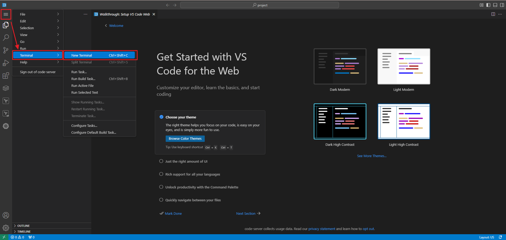


- git command
```bash
git version
```


- terraform command
```bash
terraform version
```


- docker command
```bash
docker --version
```


- java command
```bash
java --version
```


- nodejs command
```bash
node --version
npm --version
```


- helm command
```bash
helm version
```


- kubectl command
```bash
kubectl version
```


## 1.4 정리하기

- **개발 환경 구축 완료:** Docker와 `code-server`를 이용해 웹 기반의 표준 개발 환경을 성공적으로 구축했습니다.
- **네트워크 설정 완료:** 실습에 필요한 VPC, Subnet, IGW, Firewall, Security Group 등 모든 네트워크 리소스를 구성했습니다.
- **VM 및 Code-Server 배포:** Init Script를 활용하여 VM 생성과 동시에 `code-server` 환경이 자동으로 배포되도록 구성했습니다.
- **접속 및 기능 확인:** Public IP와 sslip.io를 이용해 도메인으로 `code-server`에 접속하고, 내장된 각종 개발 도구(Terraform, Kubectl 등)가 정상적으로 동작하는 것을 확인했습니다.

---

# 2. Terraform을 활용한 Kubernetes 클러스터 배포

## 2.1 학습목표

- IaC(Infrastructure as Code)의 개념과 Terraform의 역할을 이해할 수 있다.
- Terraform 코드를 사용하여 SCP(Samsung Cloud Platform)에 Kubernetes 클러스터를 자동으로 프로비저닝할 수 있다.
- `terraform init`, `plan`, `apply` 명령어의 차이점을 알고 인프라를 배포 및 관리할 수 있다.
- 배포된 Kubernetes 클러스터에 `kubectl`을 사용하여 정상적으로 접근하고 상태를 확인할 수 있다.

## 2.2 들어가기

### 2.2.1 서비스 개념도

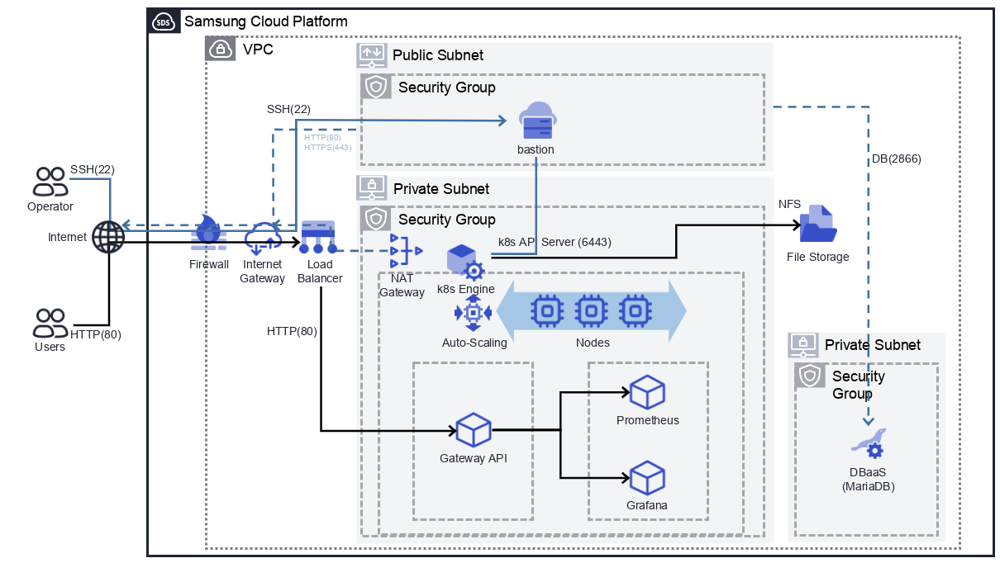

### 2.2.2 관련 용어

| No | 용어 | 설명 |
| --- | --- | --- |
| 1 | IaC (Infrastructure as Code) | 인프라를 수동으로 구성하는 대신 코드로 정의하고 관리하는 방식입니다. 자동화, 일관성, 버전 관리가 가능해집니다. |
| 2 | Terraform | HashiCorp에서 개발한 오픈소스 IaC 도구입니다. HCL이라는 언어를 사용하여 인프라를 선언적으로 정의합니다. |
| 3 | Provider | Terraform이 특정 클라우드(SCP, AWS 등)나 서비스의 API와 통신할 수 있도록 하는 플러그인입니다. |
| 4 | `terraform init` | Terraform 프로젝트를 초기화하는 명령어로, 필요한 Provider를 다운로드합니다. |
| 5 | `terraform plan` | 작성된 코드가 실제 인프라에 어떤 변경을 가져올지 미리 보여주는 명령어입니다. |
| 6 | `terraform apply` | `plan` 단계에서 확인된 변경사항을 실제 인프라에 적용하여 리소스를 생성/수정/삭제하는 명령어입니다. |
| 7 | Kubeconfig | Kubernetes 클러스터에 접근하기 위한 설정 파일입니다. API 서버 주소, 사용자 인증 정보 등이 포함됩니다. |

## 2.3 따라하기

### 2.3.1 Terraform config 파일 설정

- **설명:** web-ide 터미널에서 Terraform이 SCP API를 인증하고 리소스를 생성할 수 있도록 인증 정보를 설정합니다.
- SCP 콘솔의 **[마이페이지] > [인증키 관리]** 에서 `Access Key`와 `Secret Key`를 생성하고 확인합니다.


#### 인증키 생성
- **설명:** Terraform과 같은 외부 도구가 SCP API를 호출하여 리소스를 관리하려면 인증이 필요합니다. 이를 위해 Access Key와 Secret Key로 구성된 인증키를 사용합니다. 이 키는 사용자를 대신하여 API 요청을 인증하는 역할을 합니다.
- **경로:** SCP 콘솔 로그인 → 우측 상단 **[My Info.]** → **[인증키 관리]** → [인증키 생성]
- **입력 정보:**
    - **[인증키 생성]** 버튼을 클릭합니다.
    - 생성된 `Access Key`와 `Secret Key`를 복사하여 사용합니다. 

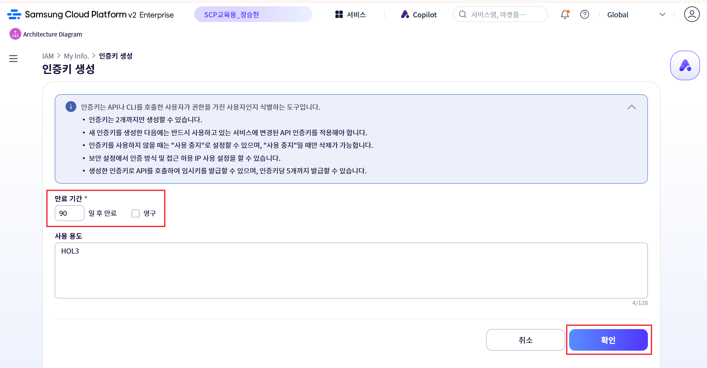

#### 보안 설정
- **인증 방식:** `인증키`를 선택합니다.
- **접근 허용 IP:** `사용`을 선택하고, Web-IDE의 Public IP 주소를 입력한 후 **[추가]** 버튼을 클릭합니다.
    > 💡 **참고:** Web-IDE의 Public IP는 web-ide 터미널에서 `curl ifconfig.me` 명령어로 확인할 수 있습니다. 이 IP 기반 접근 제어는 Terraform 뿐만 아니라, 이후 SCP Open API 및 SDK를 활용하여 리소스를 제어하거나 모니터링 연동을 수행하는 등 인증키를 사용하는 모든 서비스에 동일하게 적용됩니다.

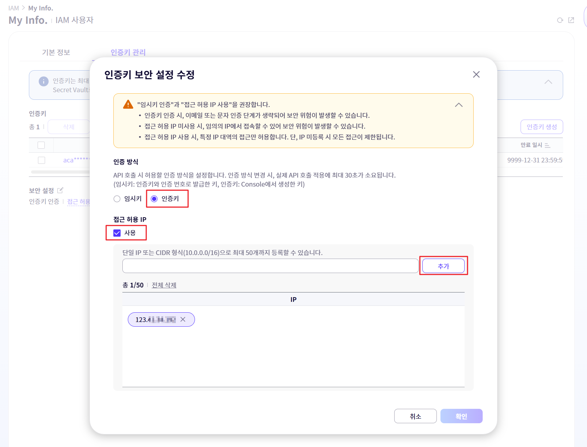


####  설정 디렉토리 생성 `.scpconf`
> 💡 **참고:** web-ide에 이미 디렉토리 생성되어 있어서 Skip 가능
```bash
mkdir -p ~/.scpconf
```

#### config.json 파일 생성

- `~/.scpconf/config.json` 파일을 생성하고 SCP 플랫폼의 인증 URL과 기본 리전 정보를 설정합니다.
- 실습 환경 또는 본인 계정이 할당된 리전에 맞추어 **`kr-west1`** 또는 **`kr-east1`** 중 하나를 선택하여 설정합니다.
```bash
code-server ~/.scpconf/config.json
```

##### [옵션 1] KR-WEST1 설정 (서부 리전)
```json
{
    "auth-url": "https://iam.e.samsungsdscloud.com/v1",
    "default-region": "kr-west1"
}
```

##### [옵션 2] KR-EAST1 설정 (동부 리전)
```json
{
    "auth-url": "https://iam.e.samsungsdscloud.com/v1",
    "default-region": "kr-east1"
}
```


#### credentials.json 파일 생성

- `~/.scpconf/credentials.json` 파일을 생성하고 SCP API 호출에 사용할 개인 인증키를 설정합니다.
- `xxxxxxxxxxxxxx` 부분을 본인의 `Access Key`와 `Secret Key`로 교체해야 합니다.
```bash
code-server ~/.scpconf/credentials.json
```

```json
{
    "access-key": "xxxxxxxxxxxxxx",
    "secret-key": "xxxxxxxxxxxxxx"
}
```

> 💡 **정보: 환경 변수를 사용한 인증**
>
> 파일 대신 환경 변수를 사용하여 인증 정보를 설정할 수도 있습니다.
> - `SCP_TF_ACCESS_KEY`: Access Key
> - `SCP_TF_SECRET_KEY`: Secret Key
> - `SCP_TF_AUTH_URL`: 인증 URL
> - `SCP_TF_DEFAULT_REGION`: 기본 리전


### 2.3.2 Kubernetes 클러스터 배포 실행

이번 단계에서는 미리 준비된 Terraform 프로젝트 코드를 내려받아 쿠버네티스 클러스터를 배포합니다.

1. **Terraform 프로젝트 복제**
Public Git Repository에 저장된 Terraform 코드를 `web-ide` 환경으로 복제합니다.

```bash
git clone https://github.com/cwj3688/scp-v2-terraform-hol4.git
cd scp-v2-terraform-hol4
```

2. **프로젝트 구조 및 기능 이해**
복제된 프로젝트는 다음과 같은 구조와 기능을 가집니다.
    - **주요 파일:** `vpc.tf`, `subnets.tf`, `kubernetes_engine.tf` 등 각 리소스 종류별로 파일이 분리되어 인프라 구성을 쉽게 파악할 수 있습니다.
    - **네트워크 구성:** 실습에 필요한 Public/Private 서브넷, NAT 게이트웨이, 방화벽 규칙 등을 자동으로 구성합니다.
    - **Kubernetes 클러스터:** Kubernetes `v1.31.8` 버전의 클러스터를 생성하며, **워커 노드 3대 (서버 타입: 4 vCPU / 8 GB RAM)** 규모의 Auto-Scaling Node Pool과 **NFS 파일 스토리지**를 포함합니다. (※ SKE 시스템 데몬을 위한 `kube-reserved` 자원 차감을 고려하여, 3장 Envoy Gateway 및 7장 Prometheus/Grafana/Alertmanager 모니터링 스택이 안정적으로 분산 스케줄링될 수 있도록 3대 구성을 기본 제공합니다.)
3. **Terraform 실행**
    
    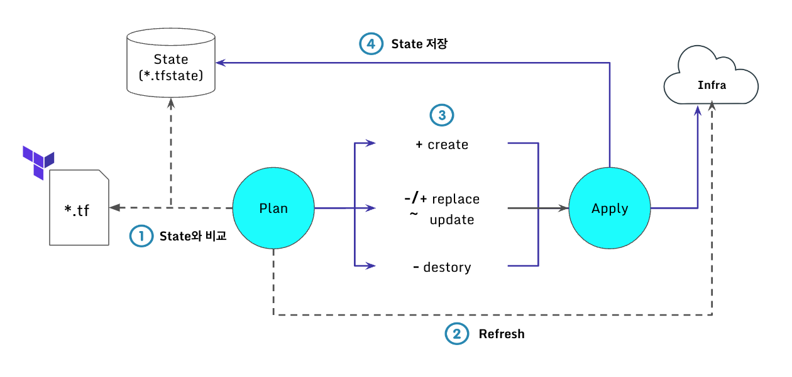
    
    아래 명령어를 순서대로 실행하여 인프라 배포를 진행합니다.
    
- `terraform init`: 현재 프로젝트에 필요한 Provider(samsungcloudplatform, http 등)를 다운로드하고 초기화합니다.
- `terraform plan`: 작성된 코드를 바탕으로 어떤 리소스가 생성/변경/삭제될지 실행 계획을 보여줍니다.
- `terraform apply`: `plan` 단계에서 확인한 계획을 실제로 적용하여 리소스를 생성합니다.


#### terraform init 실행
```bash
# scp-v2-terraform-hol4 디렉토리에서 실행
terraform init
```
결과
```
Initializing the backend...
Initializing provider plugins...
- Finding hashicorp/local versions matching "~> 2.5.2"...
- Finding samsungsdscloud/samsungcloudplatform versions matching "3.8.1"...
- Finding hashicorp/time versions matching "~> 0.13.0"...
- Finding hashicorp/http versions matching "~> 3.4.5"...
(...이하 생략...)

Terraform has been successfully initialized!
```

#### terraform plan 실행
```bash
# scp-v2-terraform-hol4 디렉토리에서 실행
terraform plan
```
결과
```
data.http.my_public_ip: Reading...
data.samsungcloudplatform_project.my_scp_project: Reading...
data.samsungcloudplatform_region.my_region: Reading...
(...이하 생략...)

Plan: 21 to add, 0 to change, 0 to destroy.

Changes to Outputs:
  + file_storage_id                   = (known after apply)
  + kubernetes_engine_id              = (known after apply)
  + kubernetes_engine_kubeconfig      = (sensitive value)
(...이하 생략...)
```

#### terraform apply 실행
```bash
# scp-v2-terraform-hol4 디렉토리에서 실행
terraform apply
```
결과
```
data.samsungcloudplatform_project.my_scp_project: Reading...
data.samsungcloudplatform_region.my_region: Reading...
data.http.my_public_ip: Reading...
(...이하 생략...)

Do you want to perform these actions?
  Terraform will perform the actions described above.
  Only 'yes' will be accepted to approve.

  Enter a value: yes

samsungcloudplatform_file_storage.k8s_file_storage: Creating...
samsungcloudplatform_vpc.my_vpc: Creating...
(...이하 생략...)

Apply complete! Resources: 21 added, 0 changed, 0 destroyed.

Outputs:

file_storage_id = "FILE_STORAGE-lQH0TcxXrliMuKE-8Yxxxx"
kubernetes_engine_id = "HSCLUSTER-HV7J5wZ6qiaMWWxxxxxxxx"
kubernetes_engine_kubeconfig = <sensitive>
kubernetes_engine_public_endpoint = "https://tfk8shol5-xxxxx.ske.kr-west.samsungsdscloud.com:6443"
my_current_public_ip = "123.45.67.89"
my_igw_fw_id = "FIREWALL-gSChaC7NrRjNi9xxxxxxxx"
my_lb_id = "LB-u8uxsq6OqCaO_fi6uxxxxxx"
my_lb_link_ip = "192.168.254.2"
my_region = "KR-WEST-2"
my_scp_project_id = "PROJECT-xeqlQNQJrxdMLxxxxxxxx"
my_scp_project_service_zone_id = "ZONE-lxu6F_ntqxeIMxxxxxxxxI-p"
my_vpc_id = "VPC-7RbOFFdrqYxxxxxxxx_O7h"
```

> apply 진행 중 Do you want to perform these actions? 라는 질문이 나오면 yes를 입력합니다.
> 
> 
> **리소스 생성에 약 10~15분 소요됩니다.**
> 


4. **Kubeconfig 설정 및 클러스터 접속 확인**

Terraform 배포가 완료된 후, 생성된 쿠버네티스 클러스터에 `kubectl` 명령어로 접근하기 위해 `kubeconfig` 파일을 설정해야 합니다. SCP v2 환경에서는 콘솔에서 직접 kubeconfig 정보를 다운로드하여 설정합니다.

#### Kubeconfig 파일 설정 (수동)
- **1. SCP 콘솔 접속:** **[서비스] → [Container] → [Kubernetes Engine]** 메뉴로 이동합니다.
- **2. 클러스터 선택:** 목록에서 방금 생성한 `tfk8shol5` 클러스터를 클릭합니다.
- **3. Kubeconfig 다운로드:** 클러스터 상세 화면에서 **[Kubeconfig 다운로드]** 버튼을 클릭하여 YAML 형식의 설정 파일을 다운로드합니다.
    > ⚠️ **주의:** Kubeconfig 파일은 보안상 **1회만 다운로드**할 수 있습니다. 다운로드 후 반드시 안전한 곳에 저장하고 관리하세요.

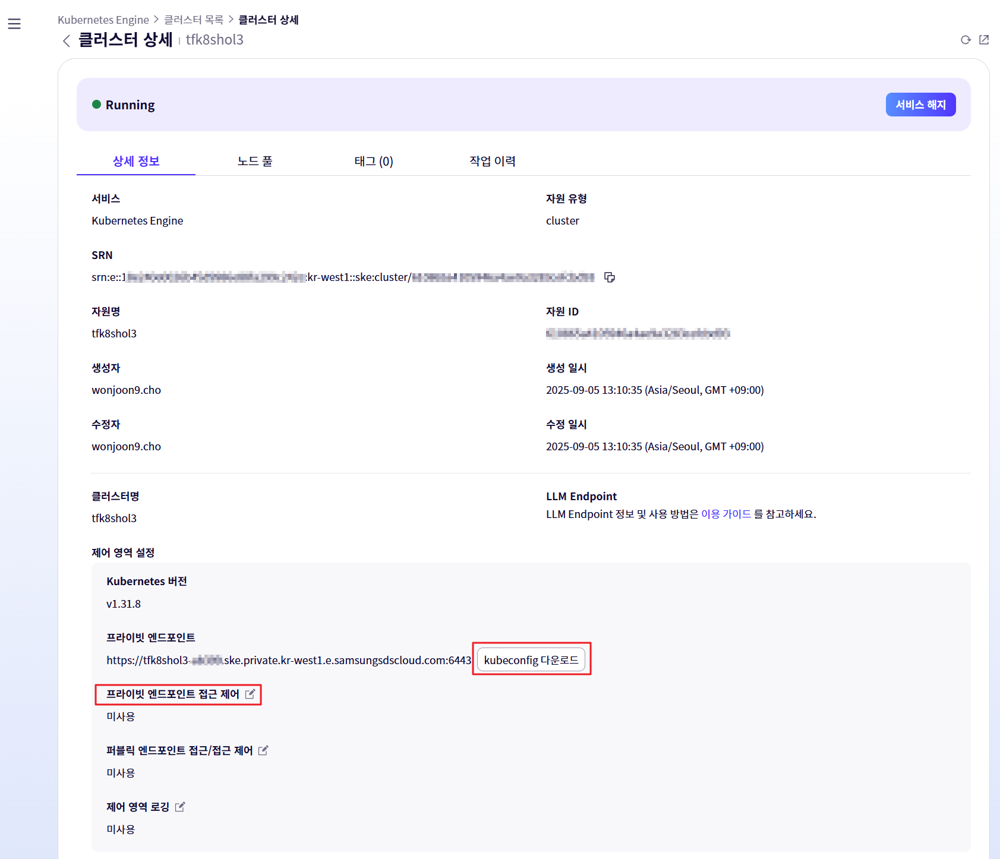

- **4. 프라이빗 엔드포인트 접근 제어 설정:**

  - Kubeconfig 다운로드 후, 동일한 클러스터 상세 페이지에서 [프라이빗 엔드포인트 접근 제어] 설정을 찾습니다.
  - [사용] 옵션에 체크합니다.

  - 접근을 허용할 소스로 virtual server리스트에서 web-ide를 선택하여 추가합니다. 이 설정을 통해 Web-IDE (Code-Server)가 클러스터의 API 서버에 접근할 수 있게 됩니다.

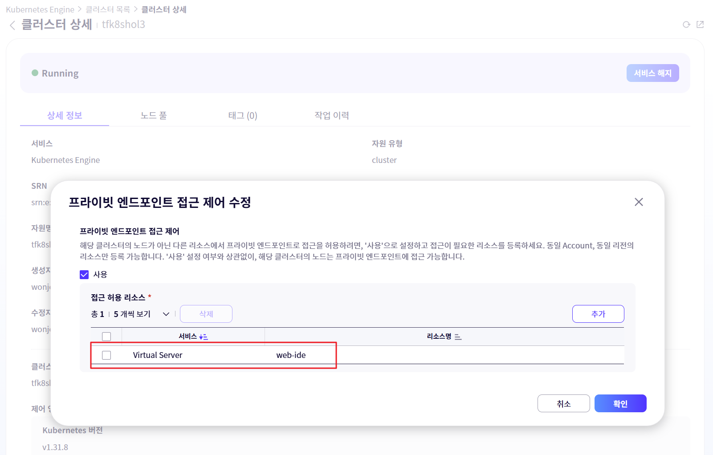


- **5. 설정 파일 복사 및 붙여넣기:**
    - 다운로드한 `kubeconfig` 파일을 텍스트 편집기로 열어 전체 내용을 복사합니다.
    - web-ide 터미널에서, `~/.kube/config` 파일을 생성하고 복사한 내용을 붙여넣습니다.
    - 아래 명령어를 사용하면 web-ide 편집기로 파일을 열 수 있습니다.

```bash
# 먼저 디렉토리가 없으면 생성합니다.
mkdir -p ~/.kube
# vi 편집기로 파일을 엽니다.
code-server ~/.kube/config
```

    - 에디터에서 복사한 kubeconfig 내용을 붙여넣고 저장합니다.

#### 클러스터 접속 테스트
`kubeconfig` 설정이 완료되면, 아래 명령어를 실행하여 클러스터와 정상적으로 통신이 되는지 확인합니다.

#### 버전 확인
```bash
# kubectl 클라이언트(CLI)와 쿠버네티스 서버(API 서버)의 버전을 확인합니다.
# Client Version과 Server Version이 모두 표시되어야 정상입니다.
kubectl version
```
결과
```
Client Version: v1.31.x
Kustomize Version: v5.0.4-0.20230601165947-6ce0bf390ce3
Server Version: v1.31.x-ske.p2
```

#### 클러스터 정보 확인
```bash
# 클러스터의 마스터 주소와 서비스 주소 등 기본 정보를 확인합니다.
kubectl cluster-info
```
결과
```
Kubernetes control plane is running at https://tfk8shol5-xxxxx.ske.kr-west.samsungsdscloud.com:6443
CoreDNS is running at https://tfk8shol5-xxxxx.ske.kr-west.samsungsdscloud.com:6443/api/v1/namespaces/kube-system/services/kube-dns:dns/proxy

To further debug and diagnose cluster problems, use 'kubectl cluster-info dump'.
```

#### 노드 정보 확인

```bash
# 클러스터에 포함된 워커 노드들의 목록과 상태(STATUS)를 확인합니다.
# 모든 노드의 상태가 'Ready'로 표시되어야 정상입니다.
kubectl get nodes
```
결과
```
NAME                             STATUS   ROLES    AGE     VERSION
ske-tfnodepoolhol5-2qz6c-kq7vh   Ready    <none>   3m21s   v1.31.8-ske.p2
```

## 2.4 정리하기

- **인프라 자동화:** Terraform 코드를 사용하여 SCP에 Kubernetes 클러스터 및 관련 네트워크 리소스를 성공적으로 자동 배포했습니다.
- **IaC 워크플로우:** `init`, `plan`, `apply` 명령어를 통해 IaC의 기본 워크플로우를 경험하고, 코드 기반으로 인프라를 관리하는 방법을 학습했습니다.
- **클러스터 상태 확인:** `kubectl` 명령어를 사용하여 배포된 클러스터의 버전, 정보, 노드 상태를 확인함으로써 클러스터가 정상적으로 동작함을 검증했습니다.

# 3. Gateway API 및 Gateway Controller 배포

## 3.1 학습목표

- Gateway API의 핵심 개념(GatewayClass, Gateway, HTTPRoute)을 이해할 수 있다.
- 기존 Ingress Controller의 EOS(End Of Service)에 따른 Gateway API로의 마이그레이션 필요성을 이해한다.
- Kubernetes 표준 Gateway API CRD를 클러스터에 설치할 수 있다.
- Helm을 사용하여 클라우드 네이티브 표준인 **Envoy Gateway**를 배포하고 Gateway 리소스를 생성할 수 있다.
- Gateway 리소스가 SCP Load Balancer와 연동되는 과정을 이해하고, 할당된 공인 IP를 확인할 수 있다.

## 3.2 들어가기

### 3.2.1 서비스 개념도 (마이그레이션 배경)

쿠버네티스 커뮤니티에서는 기존의 Ingress API가 가진 한계를 극복하고, 보다 정교하고 역할 중심적인(Role-oriented) 트래픽 관리를 위해 **Gateway API**를 표준으로 채택하였습니다. 특히 기존에 널리 사용되던 많은 Ingress Controller들이 **EOS(End Of Service)** 됨에 따라, 최신 환경에서는 Gateway API로의 전환이 필수적입니다.

Gateway API는 인프라 설정(Gateway)과 서비스 네트워킹 규칙(HTTPRoute)을 분리하여 관리 효율성을 높였으며, 기존 Ingress 대비 훨씬 더 풍부한 기능을 표준으로 제공합니다. 본 실습에서는 CNCF 프로젝트이자 클라우드 네이티브 표준으로 자리 잡고 있는 **Envoy Gateway**를 사용합니다.

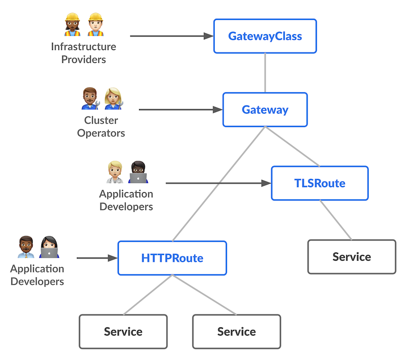

**Gateway API 리소스 모델 및 권한 체계:**
Gateway API는 위 다이어그램과 같이 세 가지 주요 페르소나(Persona)와 이에 대응하는 리소스로 구성되어 있습니다.

1. **Infrastructure Provider (인프라 제공자)**: 클러스터에 실제 게이트웨이 서비스(NGINX, Envoy 등)를 제공하며 `GatewayClass`를 통해 그 종류와 설정을 정의합니다. 
2. **Cluster Operator (클러스터 운영자)**: `Gateway` 리소스를 생성하여 실제 인프라 엔드포인트(Load Balancer 등)를 배포하고, 어떤 네임스페이스의 트래픽이 인입될 수 있는지 보안과 정책을 관리합니다.
3. **Application Developer (애플리케이션 개발자)**: 본인이 관리하는 서비스에 대해 `HTTPRoute`를 작성하여 `Gateway`에 연결함으로써 구체적인 라우팅 규칙(경로, 호스트 등)을 정의합니다.

이러한 **관심사 분리(Separation of Concerns)**를 통해 인프라 담당자와 서비스 개발자가 서로의 영역을 침범하지 않고 독립적이고 안전하게 트래픽을 관리할 수 있습니다.

#### [참고] Ingress vs. Gateway API 비교

| 구분 | Ingress | Gateway API |
| :--- | :--- | :--- |
| **리소스 모델** | 단일 리소스 (`Ingress`)에 관리자/개발자 설정 혼재 | `GatewayClass`, `Gateway`, `HTTPRoute` 등으로 역할 분리 |
| **확장성** | 기능 확장을 위해 주로 비표준 `Annotation` 사용 | 표준 `Filter` 및 `Extension`을 통해 공식 기능 확장 지원 |
| **프로토콜 지원** | 주로 HTTP/HTTPS에 국한 | HTTP 외 TCP, UDP, gRPC 등 멀티 프로토콜 표준 지원 |
| **관리 주체** | 클러스터 관리자와 개발자가 동일한 리소스 공유 | 인프라 관리자(인프라), 운영자(진입점), 개발자(라우팅) 간 명확한 분리 |
| **주요 장점** | 단순하고 익숙함 | 고도로 정교하고 유연하며 역할 중심적인 관리 가능 |

### 3.2.2 관련 용어

| No | 용어 | 설명 |
| --- | --- | --- |
| 1 | Gateway API | Ingress를 대체하는 차세대 쿠버네티스 서비스 네트워킹 표준 인터페이스입니다. |
| 2 | GatewayClass | 클러스터 운영자가 정의하는 템플릿으로, 사용할 컨트롤러(예: Envoy Gateway)를 지정합니다. |
| 3 | Gateway | 인프라 수준의 엔드포인트를 정의합니다. 이 리소스가 생성되면 SCP의 Load Balancer가 실제로 생성됩니다. |
| 4 | HTTPRoute | 개발자가 정의하는 라우팅 규칙으로, 특정 호스트나 경로를 어떤 서비스로 보낼지 결정합니다. (Ingress의 역할을 분담) |
| 5 | Envoy Gateway | Envoy 프록시를 기반으로 Gateway API를 구현한 클라우드 네이티브 표준 컨트롤러입니다. |

## 3.3 따라하기

### 3.3.1 작업 디렉토리 준비
**설명:** Gateway API 배포에 필요한 설정 파일들을 저장할 작업 디렉토리를 생성하고 이동합니다.

```bash
mkdir gateway
cd gateway
```

### 3.3.2 Gateway API 표준 CRD 설치

**설명:** Gateway API는 쿠버네티스 기본 API에 포함되지 않은 확장 API이므로, 컨트롤러를 설치하기 전에 표준 CRD를 먼저 클러스터에 설치해야 합니다.

```bash
kubectl apply -f https://github.com/kubernetes-sigs/gateway-api/releases/download/v1.1.0/standard-install.yaml
```

### 3.3.3 Envoy Gateway 설치

**설명:** Helm을 사용하여 Envoy Gateway를 설치합니다. Envoy Gateway는 OCI 기반의 Helm 차트를 제공합니다.

```bash
# Envoy Gateway 및 Gateway API CRD 설치
helm install eg oci://docker.io/envoyproxy/gateway-helm \
  --version v1.7.1 \
  -n envoy-gateway-system \
  --create-namespace
```

**설치 확인:** 컨트롤러 포드가 `Running` 상태가 될 때까지 기다립니다.
```bash
kubectl wait --timeout=5m -n envoy-gateway-system deployment/envoy-gateway --for=condition=Available
```

### 3.3.4 Subnet 및 Security Group ID 확인
설명: Envoy Gateway와 연동할 Load Balancer가 생성될 Subnet과 적용할 Security Group의 ID를 SCP 콘솔에서 미리 확인해야 합니다.

- Subnet ID 확인 경로:
  - SCP 콘솔 접속 → 서비스 → Networking → VPC
  - Load Balancer용 Public Subnet인 `tfPUBSUBhol5`를 선택하고 ID 복사.

- Security Group ID 확인 경로:
  - SCP 콘솔 접속 → 서비스 → Networking → Security Group
  - Kubernetes Engine용 `tf-k8s-SG-hol5` 보안 그룹 상세 정보에서 ID 복사.

### 3.3.5 Gateway 리소스 생성 및 SCP Load Balancer 연동

Gateway API의 핵심 개념인 '역할 분리(Separation of Concerns)'를 명확히 이해하기 위해, 리소스를 3개의 개별 YAML 파일로 분리하여 작성합니다. 본격적인 실습에 앞서 각 리소스의 역할을 이해하는 것이 중요합니다.

#### 1. 핵심 리소스 개념 이해
- **EnvoyProxy (인프라 설정)**: 실제 프록시 엔진인 Envoy의 세부 설정을 담당합니다. 이번 실습에서는 SCP의 로드밸런서와 연동하기 위한 다양한 어노테이션(Public IP 사용 여부, 서브넷 ID 등)을 이 리소스에서 정의합니다. 하드웨어/인프라 수준의 구성을 코드로 관리하는 영역입니다.
- **GatewayClass (게이트웨이 템플릿)**: 클러스터 내에서 게이트웨이를 생성하기 위한 '설계도' 또는 '템플릿' 역할을 합니다. 어떤 컨트롤러(여기서는 `gateway.envoyproxy.io`)가 관리를 맡을지 결정하고, 위에서 만든 `EnvoyProxy` 설정을 참조하여 기본 인프라 설정을 상속받습니다.
- **Gateway (실제 진입점)**: 실제 트래픽이 들어오는 '문'을 정의합니다. 포트(80, 443 등), 프로토콜(HTTP, TCP 등), 그리고 어떤 라우팅 규칙들을 허용할지 결정합니다. 이 리소스가 클러스터에 적용되는 순간, SCP 상에서 실제 Load Balancer 인스턴스가 생성됩니다.

#### 2. SCP Load Balancer 어노테이션 설명
| 어노테이션 키 | 설명 |
| :--- | :--- |
| `service.beta.kubernetes.io/scp-load-balancer-public-ip-enabled` | 생성되는 Load Balancer에 공인 IP(`PUBLIC NAT IP`)를 할당하도록 설정합니다. (`true`) |
| `service.beta.kubernetes.io/scp-load-balancer-subnet-id` | Load Balancer가 생성될 서브넷의 고유 ID를 지정합니다. |
| `service.beta.kubernetes.io/scp-load-balancer-security-group-id` | Kubernetes Engine에 적용할 보안 그룹의 고유 ID를 지정합니다. |
| `service.beta.kubernetes.io/scp-load-balancer-source-ranges-firewall-rules` | 서비스의 `loadBalancerSourceRanges` 필드에 지정된 IP 대역에 대한 방화벽 규칙을 자동으로 생성합니다. |
| `service.beta.kubernetes.io/scp-load-balancer-snat-healthcheck-firewall-rules` | 방화벽 규칙( LB Source NAT IP, HealthCheck IP → 멤버 IP:Port )을 자동으로 추가합니다.  |

#### 3. EnvoyProxy 생성 (인프라 설정)
**인프라 전용 어노테이션(SCP Load Balancer 연동)을 정의합니다.**

```bash
code-server envoyproxy.yaml
```

> ⚠️ **필수 수정:** `<여기에_Subnet_ID를_입력하세요>`와 `<여기에_Security_Group_ID를_입력하세요>`를 앞서 3.3.4 단계에서 복사한 값으로 변경하세요.

```yaml
apiVersion: gateway.envoyproxy.io/v1alpha1
kind: EnvoyProxy
metadata:
  name: scp-envoy-proxy
  namespace: envoy-gateway-system
spec:
  provider:
    type: Kubernetes
    kubernetes:
      envoyService:
        type: LoadBalancer
        annotations:
          # SCP Load Balancer 연동을 위한 어노테이션
          service.beta.kubernetes.io/scp-load-balancer-public-ip-enabled: "true"
          service.beta.kubernetes.io/scp-load-balancer-subnet-id: "<여기에_Subnet_ID를_입력하세요>" 
          service.beta.kubernetes.io/scp-load-balancer-security-group-id: "<여기에_Security_Group_ID를_입력하세요>" 
```

#### 4. GatewayClass 생성 (게이트웨이 템플릿)
**위에서 만든 EnvoyProxy 설정을 참조하는 템플릿을 정의합니다.**

```bash
code-server gatewayclass.yaml
```

```yaml
apiVersion: gateway.networking.k8s.io/v1
kind: GatewayClass
metadata:
  name: scp-gateway-class
spec:
  controllerName: gateway.envoyproxy.io/gatewayclass-controller
  parametersRef:
    group: gateway.envoyproxy.io
    kind: EnvoyProxy
    name: scp-envoy-proxy
    namespace: envoy-gateway-system
```

#### 5. Gateway 생성 (실제 라우팅 진입점)
**실제 로드밸런서 생성을 트리거하는 인프라 진입점을 정의합니다.**

```bash
code-server gateway.yaml
```

```yaml
apiVersion: gateway.networking.k8s.io/v1
kind: Gateway
metadata:
  name: hol5-main-gateway
  namespace: envoy-gateway-system
spec:
  gatewayClassName: scp-gateway-class
  listeners:
  - name: http
    protocol: HTTP
    port: 80
    allowedRoutes:
      namespaces:
        from: All
```

#### 6. 리소스 일괄 적용
**작성한 3개의 파일을 클러스터에 적용합니다.**

```bash
kubectl apply -f envoyproxy.yaml
kubectl apply -f gatewayclass.yaml
kubectl apply -f gateway.yaml
```


### 3.3.6 Gateway API 배포 확인

**설명:** `envoy-gateway-system` 네임스페이스의 관련 리소스들이 정상적으로 생성되고 `Running` 상태인지 확인합니다. 특히 `envoy-gateway-system` 서비스의 `TYPE`이 `LoadBalancer`로 되어 있는지 확인해야 합니다.

```bash
kubectl get all -n envoy-gateway-system 
```
결과
```bash
NAME                                                                  READY   STATUS    RESTARTS        AGE
pod/envoy-envoy-gateway-system-hol5-main-gateway-cf4604c8-7c56nhj7p   2/2     Running   0               29m
pod/envoy-gateway-58f7cb84b5-4lnks                                    1/1     Running   1 (3h23m ago)   18h

NAME                                                            TYPE           CLUSTER-IP      EXTERNAL-IP                  PORT(S)                                            AGE
service/envoy-envoy-gateway-system-hol5-main-gateway-cf4604c8   LoadBalancer   172.20.82.157   123.41.32.219,192.168.0.60   80:30856/TCP                                       29m
service/envoy-gateway                                           ClusterIP      172.20.99.33    <none>                       18000/TCP,18001/TCP,18002/TCP,19001/TCP,9443/TCP   18h

NAME                                                                    READY   UP-TO-DATE   AVAILABLE   AGE
deployment.apps/envoy-envoy-gateway-system-hol5-main-gateway-cf4604c8   1/1     1            1           29m
deployment.apps/envoy-gateway                                           1/1     1            1           18h

NAME                                                                               DESIRED   CURRENT   READY   AGE
replicaset.apps/envoy-envoy-gateway-system-hol5-main-gateway-cf4604c8-7c5667db9b   1         1         1       29m
replicaset.apps/envoy-gateway-58f7cb84b5                                           1         1         1       18h

```

### 3.3.7 Load Balancer 연동 확인 및 PUBLIC NAT IP 확인

**설명:** SCP v2 환경에서는 쿠버네티스에서 `EnvoyProxy`의 `Type: LoadBalancer`로 서비스를 배포하면, SCP가 이를 감지하여 자동으로 **Load Balancer 리소스와 리스너를 생성**하고 서비스에 연결합니다. 이 과정을 통해 외부 트래픽이 클러스터 내부의 서비스로 전달될 수 있습니다. 이제 Envoy Gateway 서비스에 의해 생성된 Load Balancer와 접속에 필요한 공인 IP(`PUBLIC NAT IP`)를 확인합니다.

#### 1. 서비스 경로
- 서비스 → **Networking** → **Load Balancer**

#### 2. **확인 절차:**

1. **Load Balancer 목록 확인:** Load Balancer 메뉴로 이동하면 `envoy-gateway-system` 서비스에 의해 자동으로 생성된 Load Balancer 항목을 찾을 수 있습니다. 이 Load Balancer는 쿠버네티스 서비스에 의해 동적으로 생성된 것입니다.

2. **리스너 확인:** 생성된 Load Balancer를 클릭하여 상세 정보로 이동한 후, **[연결된 자원]** 탭을 선택합니다. Gateway API가 사용하는 포트(일반적으로 80, 443)에 대한 리스너가 자동으로 생성되어 있는지 확인합니다.

3. **공인 IP(PUBLIC NAT IP) 확인:** Load Balancer 목록 또는 상세 정보에서 **`PUBLIC NAT IP`** 주소를 확인하고 반드시 메모해 둡니다. 이 IP 주소는 앞으로 7장에서 배포할 Grafana, Prometheus, Alertmanager 웹 UI에 접근하기 위한 공용 주소로 계속 사용됩니다.

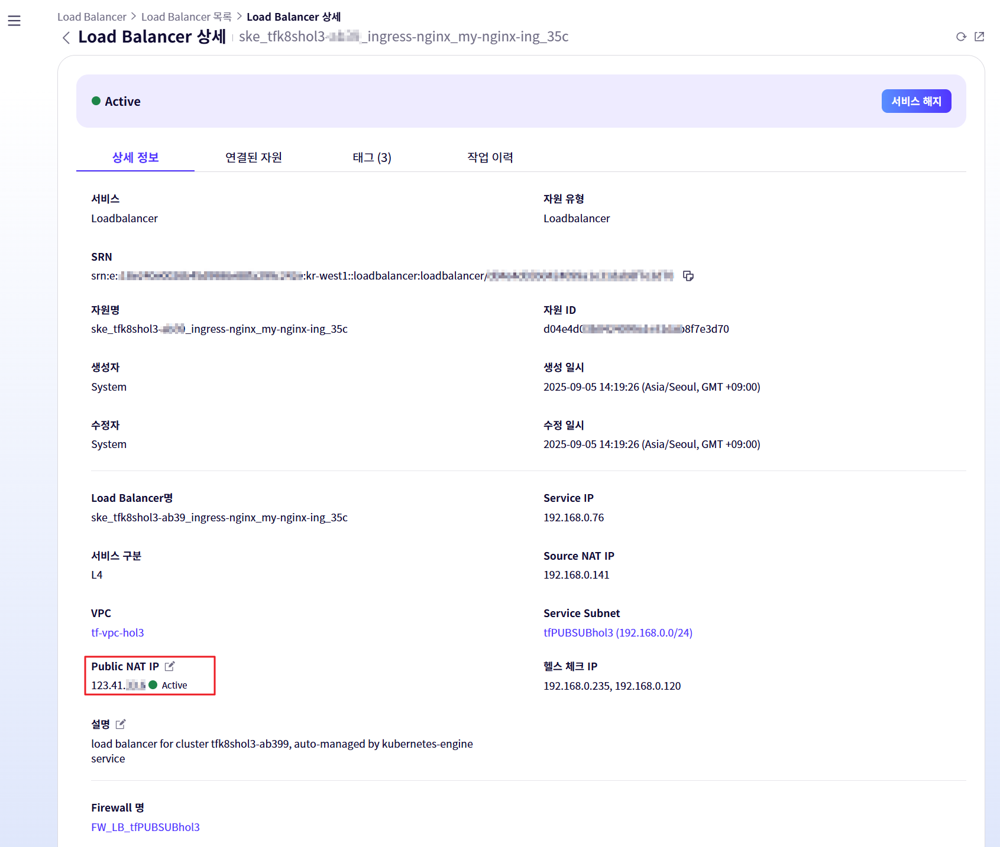

> 💡 **sslip.io와 함께 사용:** 이 공인 IP 주소는 `sslip.io`와 같은 와일드카드 DNS 서비스와 결합하여 `grafana.123.45.67.89.sslip.io` 와 같은 도메인을 즉시 만들어 사용하는 데 활용됩니다.

> ⚠️ **중요:** 이 `PUBLIC NAT IP` 주소는 실습 전반에 걸쳐 사용되므로, 정확히 확인하고 메모해두는 것이 매우 중요합니다.


### 3.3.8 로드밸런서용 자동 생성 Firewall 미사용 처리

LoadBalancer 타입의 서비스를 생성하면 해당 LoadBalancer용 Firewall(`FW_LB_tfPUBSUBhol5`)이 자동으로 생성됩니다. Internet Gateway에 이미 Firewall이 설정되어 있으므로, Load Balancer에 Firewall을 이중으로 설정하면 보안은 강화되지만 설정 복잡도가 높아집니다.

따라서 본 실습에서는 Terraform으로 생성한 Security Group으로만 접근을 제어하기 위해 Load Balancer용 Firewall은 미사용으로 설정합니다.

- **경로:** 서비스 → Networking → Firewall 목록
- **설정:** 목록에서 `FW_LB_tfPUBSUBhol5` Firewall을 찾아 **[미사용]** 으로 설정합니다.

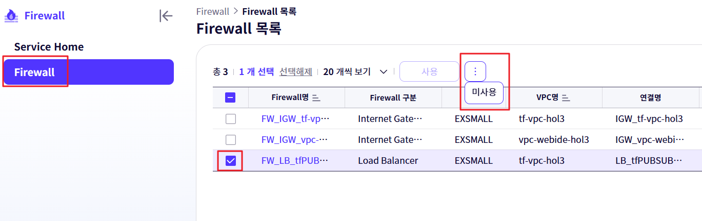


### 3.3.9 로드밸런서 헬스체크 확인

`3.3.8` 단계에서 Load Balancer용 Firewall을 미사용으로 처리한 후, 로드밸런서의 헬스체크 상태가 Unhealthy에서 Healthy로 정상 변경되는지 확인합니다.

#### 1. 서비스 경로
- 서비스 → Networking → Load Balancer → LB 서버 그룹
#### 2. 확인 절차
1. LB 서버 그룹 목록에서 Envoy Gateway에 의해 생성된 서버 그룹을 선택합니다.
2. **[연결된 자원]** 탭을 클릭합니다.
3. 등록된 Worker Node들의 **헬스 체크 상태** 가 **Healthy** 로 표시되는 것을 최종적으로 확인합니다. 처음에는 Unhealthy 상태였다가, Firewall 정책이 적용된 후 Healthy로 변경됩니다.

이 과정을 통해 Envoy Gateway와 Load Balancer가 정상적으로 연동되었음을 검증할 수 있습니다.

### 3.3.10 Gateway API 동작 확인 (curl)

이제 Load Balancer의 Public IP로 직접 HTTP 요청을 보내 Gateway API가 정상적으로 응답하는지 확인합니다. 아직 아무런 Gateway 규칙을 설정하지 않았기 때문에 `404 Not Found` 응답이 오는 것이 정상입니다. 중요한 것은 외부 요청이 Envoy Gateway까지 도달하여 정상적으로 수신되는지(`server: envoy` 헤더) 확인하는 것입니다.

1. web-ide 터미널을 엽니다.
2. `3.3.7` 단계에서 확인한 Load Balancer의 **PUBLIC NAT IP** 를 사용하여 아래 `curl` 명령어를 실행합니다. (`-I` 옵션을 사용하여 응답 헤더 정보만 확인합니다.)

```bash
curl -I http://<PUBLIC-NAT-IP>.sslip.io
```

**정상 응답 예시:**

아래와 같이 `server: envoy` 헤더가 표시되고 `404 Not Found` 상태 코드가 반환되면 Gateway API가 외부 요청을 정상적으로 수신하고 있는 것입니다.

```text
HTTP/1.1 404 Not Found
server: envoy
date: Tue, 07 Apr 2026 01:09:16 GMT
content-length: 0
```

만약 응답이 없거나(Timeout) 다른 오류가 발생하면, Load Balancer, Security Group, Firewall 설정을 다시 한번 확인해야 합니다.

- **확장성 확보:** 앞으로 7장에서 배포될 모니터링 도구들(Grafana, Prometheus, Alertmanager)은 이 `hol5-main-gateway`를 통해 단일 공인 IP로 서비스될 수 있는 기반을 갖추었습니다.

## 3.4 정리하기
- Kubernetes 표준 차세대 트래픽 인그레스 규격인 Gateway API 표준 CRD와 Envoy Gateway 컨트롤러를 클러스터에 배포했습니다.
- SCP Load Balancer 연동 어노테이션을 적용한 EnvoyProxy, GatewayClass, Gateway 매니페스트를 배포하여 SCP 플랫폼 수준의 Load Balancer와 공인 IP(PUBLIC NAT IP)를 자동으로 프로비저닝했습니다.
- 자동 생성된 로드밸런서 방화벽 규칙과 헬스체크 정상 동작을 확인하고 curl 테스트를 통해 외부 트래픽 인입 통로를 검증했습니다.
- 이를 통해 7장에서 배포할 모니터링 도구들(Grafana, Prometheus, Alertmanager)이 추가 Load Balancer 생성 없이 단일 공인 IP와 sslip.io 도메인 체계로 통합 서비스될 수 있는 기반을 완성했습니다.

---

# 4. SCP 콘솔 기반 Observability 및 인프라 경보 체계 구축

## 4.1 학습목표
- SCP(Samsung Cloud Platform)의 Observability 구현 3대 축인 **지표(Metric)**, **로그(Log)**, **이벤트(Event)** 의 흐름과 아키텍처를 이해할 수 있다.
- ServiceWatch 콘솔에서 사용자 정의 대시보드를 구축하고 자원별 성능 지표 위젯을 구성할 수 있다.
- Virtual Server의 세부 모니터링 주기를 설정하고 File Storage, DBaaS(MariaDB) 등 주요 인프라 자원의 실시간 경보(Alert) 정책을 구성할 수 있다.
- 리눅스 부하 도구(`stress`), 임시 Pod 더미 파일 생성, DB 벤치마크 쿼리를 통해 인프라 경보의 실시간 상태 전이(`Normal` → `Alert`) 및 이메일 알림 발화를 실증 검증할 수 있다.

## 4.2 들어가기

### 4.2.1 Observability(관찰 가능성) 아키텍처

**모니터링과 Observability의 차이**
- **모니터링(Monitoring)**: 기정의된 지표 임곗값 기반의 장애 감지 및 상태 확인 ("무엇이 고장 났는가?")
- **Observability(관찰 가능성)**: 지표·로그·이벤트의 다차원 상관관계 분석을 통한 미지의 원인 규명 ("왜 장애가 발생했는가?")

| 구분 | 전통적 모니터링 | Observability |
| :--- | :--- | :--- |
| 목적 | 사전에 정의한 임곗값 초과 여부 감시 | 예측하지 못한 문제의 근본 원인 추적 |
| 대표 질문 | "CPU가 80%를 넘었는가?" | "왜 CPU가 80%를 넘었고, 어떤 로그/이벤트가 동시에 발생했는가?" |
| 데이터 | 단일 지표 위주 | 지표+로그+이벤트를 상호 연관 분석 |
| SCP 대응 서비스 | (단순 임계값 감시만 필요할 때) | ServiceWatch + Logging & Audit 통합 활용 |

SCP Observability는 아래 3가지 데이터를 하나의 서비스(ServiceWatch)로 수집·연계합니다.

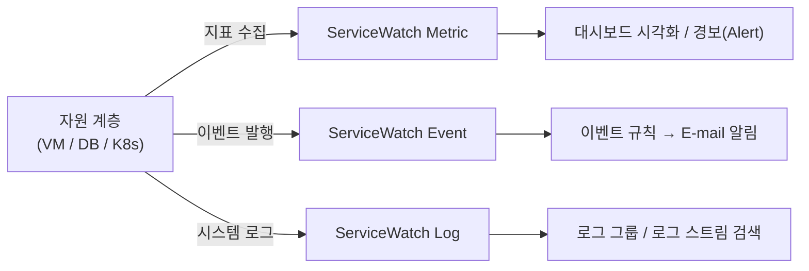

- **지표(Metric)**: 1분/5분 단위 시계열 수치형 데이터 (예: `CPU Usage`, `Disk IOPS`, `Network Packet Dropped`)
- **로그(Log)**: 비정형/반정형 텍스트 이벤트 정보로, ServiceWatch 상의 로그 그룹 및 로그 스트림 단위로 분류 보관됩니다.
- **이벤트(Event)**: 자원의 상태 천이(State Transition) 및 API 실행 결과에 따라 비동기적으로 발행되는 이벤트 객체입니다.

> 🔑 **핵심 구분 팁**: "지금 값이 얼마인가?"는 지표, "무슨 일이 있었는가?"는 로그, "무엇이 바뀌었는가?"는 이벤트로 기억하면 셋을 헷갈리지 않습니다.

### 4.2.2 ServiceWatch 서비스 제약 사항 및 지표 보관 주기
실제 대규모 클러스터 운영을 계획할 때 다음 제약 한계치 및 과금/보관 기준을 숙지해야 합니다.

- **지표 보관 및 다운샘플링(Downsampling) 주기**: 
  ServiceWatch의 모든 지표 데이터 포인트는 장기 분석을 위해 **최대 15개월(455일)** 동안 보관됩니다. 짧은 수집 주기로 수집된 데이터는 데이터가 삭제되는 것이 아니라, 저장 효율을 위해 시간 경과에 따라 조회 해상도(단위)가 단계별로 **다운샘플링(재집계)**되어 유지됩니다.

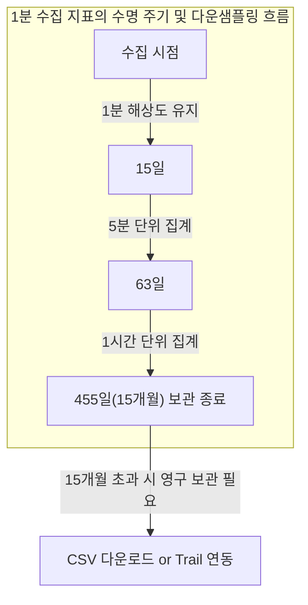

| 구분 | 1분 수집 지표 | 5분 수집 지표 | 1시간 수집 지표 |
| :--- | :--- | :--- | :--- |
| **최초 해상도 유지 기간** | 수집 후 **15일까지** (1분 단위) | 수집 후 **63일까지** (5분 단위) | **455일까지** (1시간 단위) |
| **1차 다운샘플링** | 16일 ~ 63일 (5분 단위 재집계) | 64일 ~ 455일 (1시간 단위 재집계) | - |
| **최종 다운샘플링** | 64일 ~ 455일 (1시간 단위 재집계) | - | - |
| **최대 보관 기간** | **455일 (15개월)** | **455일 (15개월)** | **455일 (15개월)** |

  - **1분(60초) 수집 지표**: 수집 후 **15일까지 `1분` 단위**로 조회 $\rightarrow$ 이후 **63일까지 `5분` 단위**로 다운샘플링 $\rightarrow$ 이후 **455일까지 `1시간` 단위**로 재집계되어 보관 (최근 장애 정밀 분석부터 연간 트렌드 분석까지 지원)
  - **5분(300초) 수집 지표**: 수집 후 **63일까지 `5분` 단위**로 조회 $\rightarrow$ 이후 **455일까지 `1시간` 단위**로 다운샘플링되어 보관
  - **1시간(3600초) 수집 지표**: **455일(15개월)** 동안 `1시간` 단위로 보관
  > 💡 **455일 초과 장기 보관 팁**: 15개월을 초과하여 장기 보존이나 규제 준수(컴플라이언스)가 필요한 경우, 콘솔에서 지표 데이터를 CSV 파일로 다운로드하거나 6장의 Trail/Object Storage 연동을 통해 영구 보관합니다.
- **콘솔 주요 한도**: 대시보드당 위젯 최대 500개, 위젯당 지표 최대 500개, 대시보드 전체 참조 지표 2,500개, 계정/리전당 경보 정책 최대 5,000개 (이메일 알림 수신자는 정책당 최대 100명).

### 4.2.3 모니터링 주기 변경과 경보 판정 원리
- **기본 모니터링(5분 주기)**: 인프라의 전반적인 일일 트렌드를 분석하는 데 유리하며 비용이 발생하지 않습니다.
- **세부 모니터링(1분 주기)**: Auto-Scaling 제어 및 순간적인 스파이크성 장애 상황(CPU Throttling 등)에 신속히 대처할 수 있도록 지원하며 과금이 발생합니다.
  ```text
  [기본 모니터링: 5분 주기]
  시간:  0분 ------------ 5분 ------------ 10분
  데이터: ●                ●                 ●    (데이터 포인트 총 3개)
  → 순간적인 1~2분 스파이크 부하가 5분 평균에 희석되어 감지되지 않음

  [세부 모니터링: 1분 주기]
  시간:  0분 - 1분 - 2분 - 3분 - 4분 - 5분 ...
  데이터: ●    ●    ●    ●    ●    ●           (5분 동안 데이터 포인트 5개 축적)
  → 1분 단위 스파이크와 자원 급증 현상을 고해상도로 정밀하게 포착
  ```
  > 💡 **서비스별 기본 수집 주기 차이**: 세부 모니터링(5분→1분 전환)은 **Virtual Server 등 일부 서비스에서만 제공**됩니다. File Storage 및 MariaDB(DBaaS) 등은 **기본 모니터링이 이미 1분(60초) 주기**로 수집되므로 별도의 세부 모니터링 전환 메뉴가 존재하지 않습니다.
- **경보 판정 원리: 평가 범위 · 평가 횟수 · 위반 횟수**:
  - **경보 평가 간격 공식**: $\text{경보 평가 간격(전체 관찰 시간)} = \text{경보 평가 범위(초)} \times \text{경보 평가 횟수}$
  - **평가 범위(Evaluation Period)**: 경보 평가 1회가 지표를 집계하여 바라보는 **단위 시간 창의 길이** (SCP 콘솔 기준 최소 `300초(5분)`부터 600초, 900초 등 5분 단위 지원)
    > 💡 **세부 모니터링과 경보 평가 범위의 관계**: 세부 모니터링은 지표 수집 주기(해상도)를 1분으로 단축하는 기능이며, ServiceWatch 경보 엔진의 최소 집계 평가 창은 플랫폼 사양상 **300초(5분)**로 제공됩니다. 세부 모니터링 활성화 시 300초 평가 창 내에 1분 단위 데이터 포인트 5개가 집계되어 훨씬 정밀한 평균/최댓값 평가가 가능해집니다.
  - **평가 횟수(Evaluation Count)**: 단위 평가 창을 연속으로 몇 개 이어 붙여 관찰할 것인지의 **창 개수($N$)**
  - **위반 횟수(Breach Count / Datapoints to Alarm)**: $N$개의 평가 창 중 조건을 만족해야 하는 **위반 창의 개수($M$)** ($M \le N$, 기본값: 1)

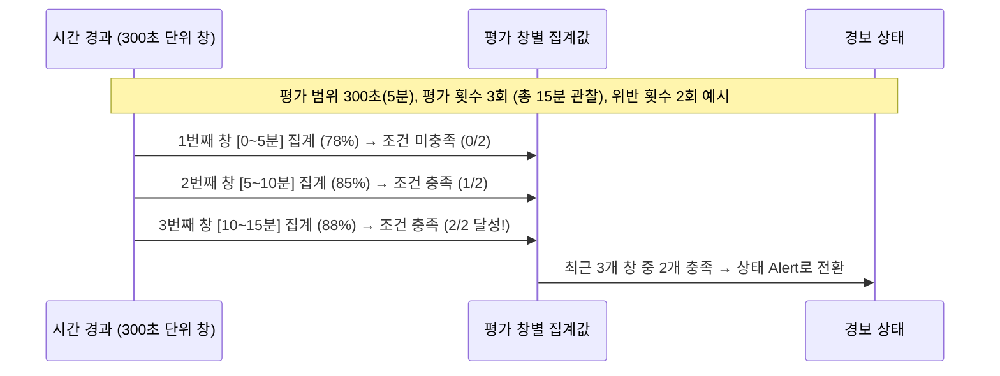

> 🔑 **개념 정리**: "경보 평가 간격은 `평가 범위 × 평가 횟수`"입니다. 실습 시 "300초(5분) 단위 창 1개(평가 횟수 1회 / 위반 횟수 1회)"로 구성하면 약 5~7분의 부하 유지로 경보 발화를 신속히 검증할 수 있습니다.

## 4.3 따라하기

> 📋 **사전 준비**
> - 1장에서 생성한 `web-ide` Virtual Server가 정상 기동 중이어야 합니다.
> - 2장에서 Terraform으로 배포한 Kubernetes / Virtual Server 리소스가 준비되어 있어야 합니다.

### 4.3.1 ServiceWatch 콘솔 인터페이스 및 지표 집계 분석
1. **SCP 콘솔 접속**: 브라우저에서 SCP 로그인 후 **서비스 → Management → ServiceWatch**로 진입합니다.
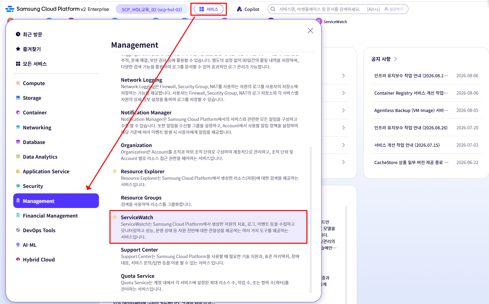

2. **Service Home 분석**: 
   - 현재 리전의 전체 경보 현황, 즐겨찾는 대시보드, 서비스별 사전 정의 대시보드를 확인합니다.
3. **지표 차트 집계 분석**:
   - `Virtual Server` 자동 대시보드로 이동합니다.
   - 특정 VM의 CPU Usage 차트 우측 상단의 **[확대 보기]** 아이콘을 클릭합니다.
   - 집계 기준(**평균, 최소, 최대, 합계**)과 주기(**1분, 5분, 15분, 1시간**)를 다르게 설정하여 그래프의 해상도 변화를 관찰합니다.

### 4.3.2 [콘솔 실습 1] 사용자 정의 대시보드 생성 및 핵심 자원 위젯 구성

ServiceWatch에서는 주요 인프라 자원의 핵심 성능 지표를 한눈에 모니터링할 수 있도록 사용자 정의 대시보드를 직접 생성하고 지표 위젯을 구성합니다.

#### 1. 대시보드 생성
1. **서비스 경로**: **서비스 → Management → ServiceWatch → 대시보드 목록** 메뉴로 이동합니다.
2. **[대시보드 생성]** 버튼을 클릭합니다.
3. **입력 정보**:
   - **대시보드명**: `hol5-custom-dashboard`
4. **[저장]** 버튼을 클릭하여 새로운 빈 대시보드를 생성합니다.


#### 2. 모니터링 대상 자원별 지표 위젯 추가
생성한 `hol5-custom-dashboard` 화면 우측 상단의 **[위젯 추가]** 버튼을 클릭하고 **[다중 위젯 추가]**를 선택합니다.
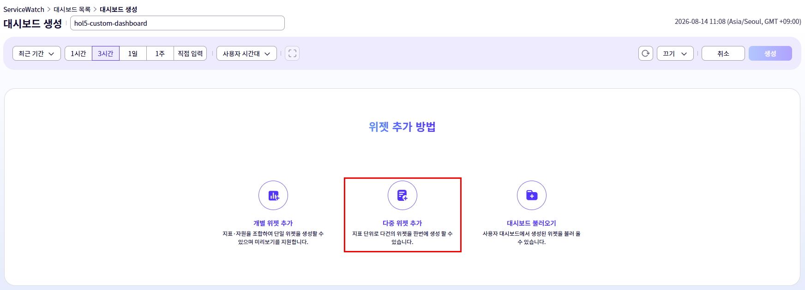

> 💡 **위젯 추가 방식 비교 (개별 위젯 추가 vs 다중 위젯 추가)**
> - **개별 위젯 추가**: 특정 자원과 지표를 조합하여 단일 위젯을 정밀하게 생성하는 방식입니다. (미리보기 지원)
> - **다중 위젯 추가**: 선택한 지표 단위로 다건의 위젯을 한 번에 일괄 생성하는 방식입니다. 본 실습에서는 **다중 위젯 추가**를 통해 핵심 인프라 지표들을 신속하게 대시보드에 배치합니다.

##### 📋 다중 위젯 추가 기본 입력 순서
1. **지표 선택**: 좌측 트리 목록에서 수집할 지표를 체크합니다. (상단 검색창에서 `virtual`, `file`, `mariadb` 또는 노드명으로 지표 필터링 가능)
2. **자원 선택**: 우측 **[선택]** 버튼을 클릭하여 해당 지표를 수집할 대상 자원(인스턴스 등)을 지정합니다. (※ 복수 지표를 체크한 경우, 중앙 [선택 지표] 목록의 각 지표를 차례로 클릭하여 자원을 각각 지정해야 합니다.)
3. **통계 및 집계 기간 확인**: 상단 옵션에서 **통계: `평균`**, **집계 기간: `5분`**을 지정합니다.
4. **[완료] 버튼 클릭**: 우측 하단의 **[완료]** 버튼을 눌러 대시보드에 위젯을 일괄 추가합니다.

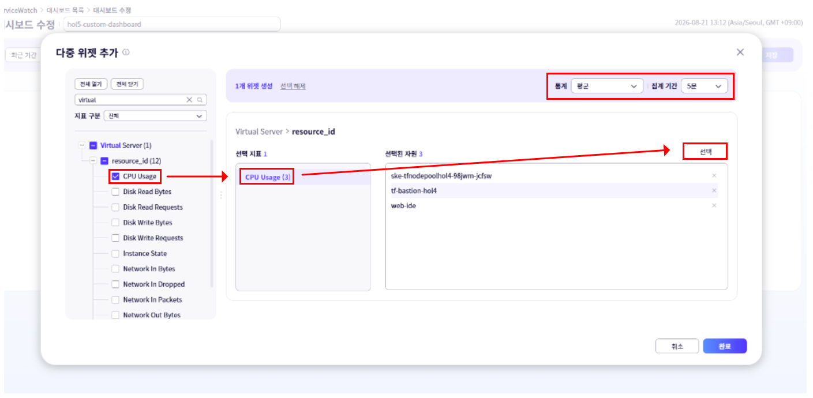

##### 📊 자원별 지표 위젯 추가 가이드

- **1) Virtual Server CPU 사용률**
  - **지표 선택**: 좌측 트리에서 `Virtual Server > resource_id > CPU Usage` 체크 (검색창에 `virtual` 또는 노드명 입력)
  - **자원 선택**: 우측 `[선택]` 버튼 클릭 후 모니터링할 인스턴스(`web-ide`, `ske-tfnodepool...`, `tf-bastion...`) 선택
  - **통계 / 집계 기간**: `평균` / `5분`
  - **[완료]** 버튼 클릭 → `Virtual Server | CPU Usage` 위젯 생성

- **2) File Storage 용량 모니터링**
  - **지표 선택**: 좌측 트리에서 `File Storage > total_byte` 체크 (검색창에 `file` 입력)
  - **자원 선택**: 우측 `[선택]` 버튼 클릭 후 2장에서 생성한 File Storage NFS 볼륨 선택
  - **통계 / 집계 기간**: `평균` (또는 `최대`) / `5분`
  - **[완료]** 버튼 클릭 → `File Storage | total_byte` 위젯 생성

- **3) MariaDB (DBaaS) CPU 사용률 & 커넥션 사용률**
  - **지표 선택**: 좌측 트리에서 `MariaDB > CPU Usage`, `Connection usage` 2개 지표 체크 (검색창에 `mariadb` 입력)
  - **자원 선택 (※ 지표별 각각 선택 필수)**:
    - 중앙 [선택 지표] 목록에서 **`CPU Usage`** 클릭 → 우측 **[선택]** 버튼을 눌러 대상 MariaDB 인스턴스(`mdb`) 선택
    - 이어서 중앙 [선택 지표] 목록에서 **`Connection usage`** 클릭 → 우측 **[선택]** 버튼을 눌러 대상 MariaDB 인스턴스(`mdb`)를 각각 다시 선택
  - **통계 / 집계 기간**: `평균` / `5분`
  - **[완료]** 버튼 클릭 → `MariaDB | CPU Usage`, `MariaDB | Connection usage` 위젯 2개가 생성됨

3. **대시보드 저장**:
   - 위젯 배치가 완료되면 화면 우측 상단의 **[생성]**을 클릭하여 배치를 완료합니다.
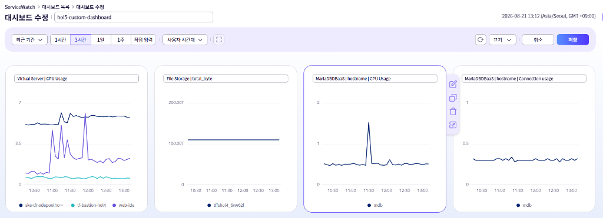

### 4.3.3 [콘솔 실습 2] Virtual Server 세부 모니터링 전환, CPU 경보 설정 및 stress 부하 검증

1. **VM 세부 모니터링 전환**:
   - **서비스 → Compute → Virtual Server**로 이동하여 준비한 `web-ide` 인스턴스를 선택합니다.
   - [상세 정보] 하단의 모니터링 항목에서 **[세부 모니터링 변경]**을 누르고 활성화합니다. (수집 주기가 5분에서 1분으로 변경되며 과금이 시작됩니다.)  
   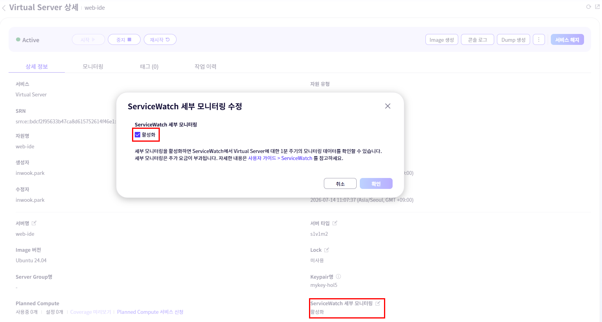


2. **CPU 경보 정책 구성**:
   - **메뉴 이동**: **서비스 → Management → ServiceWatch → 경보 정책 목록** (좌측 LNB: `경보` → `경보 정책 목록`)으로 이동 후 화면 우측 상단의 **[경보 정책 생성]** 버튼을 클릭합니다.
   - **기본 정보 입력**:
     - **경보 정책명**: `vm-cpu-high-alert` 입력 (최대 63자)
     - **설명**: (선택 사항, 비워둡니다)
     - **지표**: **[지표 선택]** 버튼을 클릭합니다.
   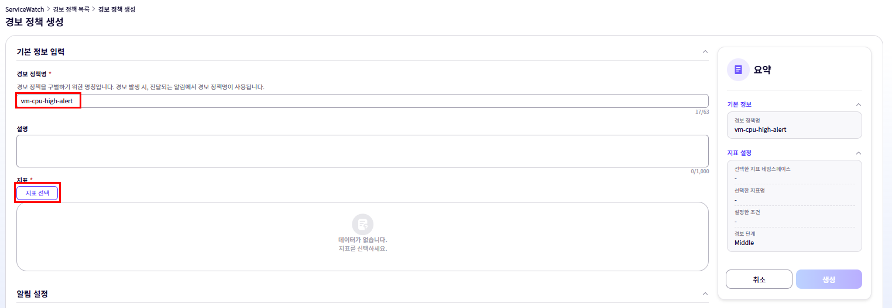

   - **지표 선택 (모달 창)**:
     - 좌측 서비스 목록에서 **`Virtual Server`** 옆의 `+`를 클릭하고 하위 차원명 `resource_id`를 클릭합니다.
     - 표시되는 자원별 지표 목록에서 지표명 `CPU Usage` 및 자원명 `web-ide` 행의 체크박스를 선택합니다. (하단 `선택된 지표 (1)`에 실시간 지표 그래프 프리뷰 표시 확인)
       *(또는 우측 [검색 필터]에서 네임스페이스-차원명: `Virtual Server`, 지표명: `CPU Usage`, 자원명: `web-ide` 입력 후 [필터 적용] 클릭)*
     - 하단의 **[확인]** 버튼을 클릭합니다.
   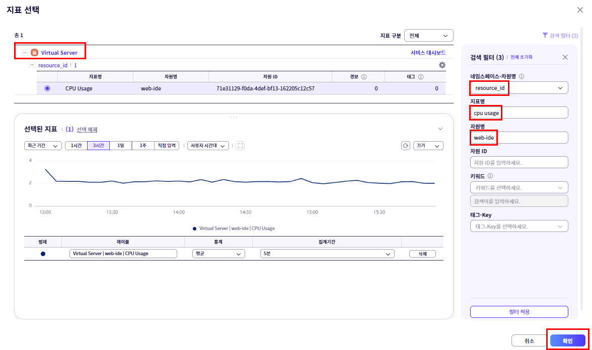

   - **지표 및 조건 설정**:
     - **[지표 정보]**:
       - **네임스페이스 / 지표명 / 단위**: `Virtual Server` / `CPU Usage` / `Percent` (자동 반영 확인)
       - **평가 범위 \***: `300` (초 단위, 기본값 300초 = 5분 유지)
       - **통계 \***: `평균` 선택 (기본값)
       - **추가 구분**: `[ ] 사용` (체크 해제 상태 유지)
     - **[조건 설정]**:
       - **조건 연산자 \***: 드롭다운에서 `>=` 선택
       - **임곗값 \***: `80` 입력 (하단 조건 요약에 `>= 80%` 확인)
     - **[경보 단계]**: `High` (또는 기본값 `Middle` 유지)
       > 💡 **경보 상태 판정 기준**: 평가 범위(300초/5분) 동안 집계된 평균 CPU 사용률이 임곗값 80% 이상 지속될 경우 경보 상태(`Alert`)가 트리거됩니다.
   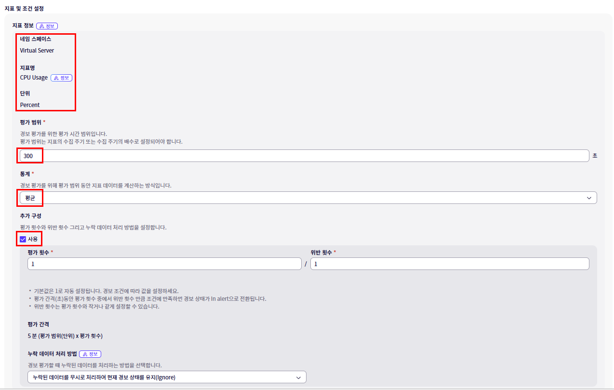
   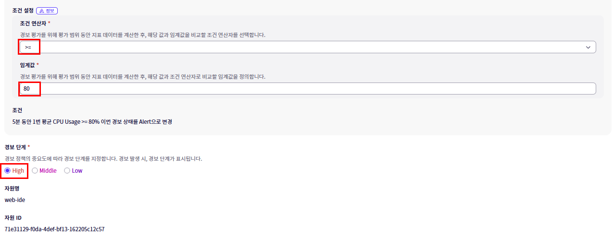
   - **알림 설정**:
     - 하단의 **[알림 설정]** 섹션에서 **알림 수신자** 목록을 확인합니다.
     - 사용자 목록 테이블에서 본인의 **`사용자 ID` 앞 체크박스를 선택**합니다. (상단 검색창에 본인 계정 ID를 입력하여 빠르게 검색 가능, 정책당 최대 100명)
       > 💡 **참고**: 알림 수신 방식(E-mail 또는 SMS)은 SCP 콘솔의 [알림 설정] 메뉴에서 전역으로 관리되므로, 본 화면에서는 알림을 수신할 사용자 ID만 체크박스로 지정합니다.
   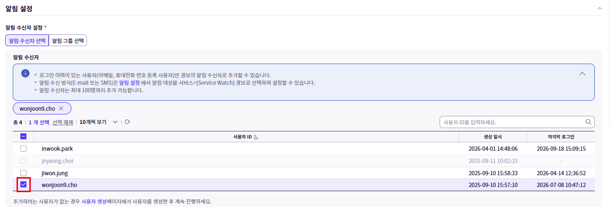

   - **추가 정보 입력 & 정책 생성 완료**:
     - **태그**: (선택 사항, 비워둡니다)
     - 화면 우측 **[요약]** 패널에서 설정 내용(기본 정보, 네임스페이스, 지표명, 조건, 경보 단계)을 최종 확인한 후 하단의 **[생성]** 버튼을 클릭합니다.
3. **stress 툴 부하 유발 및 경보 발화 확인**:
   ```bash
   # 1) stress 툴 설치 (Ubuntu 환경)
   sudo apt-get update && sudo apt-get install -y stress

   # 2) CPU 코어 1개에 대해 7분(420초) 동안 100% 부하 생성 (420초 경과 시 자동 종료)
   stress --cpu 1 --timeout 420s
   ```
   > 💡 **경보 발화 대기 팁**: 300초(5분) 단위 집계 창의 평균 CPU가 80% 이상을 안정적으로 달성하기 위해 최소 5분 이상의 지속 부하가 필요합니다. 420초(7분) 부하 실행 시 약 5~6분 경과 시점에 정상 발화합니다.
   - 부하 실행 중 **ServiceWatch → 지표**에서 `web-ide`의 `CPU Usage`가 80% 이상으로 올라가는지 실시간으로 관찰합니다. (세부 모니터링이 켜져 있으므로 1분 단위 그래프로 상승세를 확인할 수 있습니다.)
   - 5~6분 경과 후 **ServiceWatch → 경보 정책 목록**에서 `vm-cpu-high-alert` 상태가 `Normal` → `Alert`로 전이되고 이메일 알림이 도착하는지 확인합니다.
   - 420초 후 `stress`가 자동 종료되면 CPU 사용률이 감소하여 경보 상태가 다시 `Normal`로 복구되는 것을 확인합니다.


#### 콘솔 실습 체크포인트
- [ ] 사용자 정의 대시보드 (`hol5-custom-dashboard`)가 정상 생성되고 지표 위젯이 등록되었는가?
- [ ] Virtual Server에 대한 경보 정책이 생성되고 부하 시뮬레이션을 통해 `Alert` 전이가 검증되었는가?

## 4.4 정리하기
- SCP ServiceWatch 콘솔 인터페이스를 통해 지표 집계 방식을 분석하고, 주요 인프라 자원 통합 대시보드를 생성했습니다.
- 인프라 자원의 모니터링 특성을 이해하고 임곗값 감지 경보(Alert) 정책을 수립한 뒤, 실질적 부하 테스트를 통해 경보 라이프사이클을 실증했습니다.

---

# 5. ServiceWatch Agent 기반 확장 모니터링 및 파일 로그 수집

## 5.1 학습목표
- OpenTelemetry 기반의 ServiceWatch Agent 설치 메커니즘과 IAM 인증 체계를 이해할 수 있다.
- Ubuntu Virtual Server(`web-ide`)에 ServiceWatch Agent를 배포하여 시스템 커스텀 지표를 수집할 수 있다.
- Ubuntu 애플리케이션 파일 로그(`/var/log/hol5-webapp.log`)를 ServiceWatch 로그 그룹으로 연동하여 실시간 수집할 수 있다.
- ServiceWatch 콘솔에서 실시간 로그 스트림 모니터링, 키워드 검색, 다차원 필터링 및 로그 이벤트 상세 분석을 수행할 수 있다.

## 5.2 들어가기

### 5.2.1 ServiceWatch Agent 아키텍처
ServiceWatch Agent는 내부적으로 오픈소스 **OpenTelemetry Collector**(`otelcontribcol`)와 이를 관리하는 **ServiceWatch Agent Manager**로 구성되며, 필요에 따라 Prometheus Exporter를 함께 배포하여 상세 메트릭 및 로그를 전송합니다.

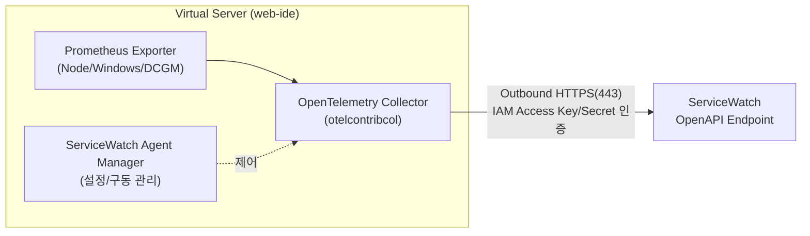

플랫폼 기본/세부 모니터링은 하이퍼바이저 수준의 표준 지표만 수집하지만, **ServiceWatch Agent**는 VM 내부의 임의의 프로세스, OS 커널 상태, 그리고 지정된 시스템/애플리케이션 파일 로그 경로를 모니터링하여 ServiceWatch 콘솔로 전송할 수 있습니다.

### 5.2.2 ServiceWatch 로그 관리 체계: 로그 그룹, 로그 스트림, 실시간 로그 이벤트 조회의 원리

ServiceWatch로 전송된 로그는 시스템 단위의 최상위 컨테이너인 **로그 그룹(Log Group)**과 개별 인스턴스/소스 단위의 **로그 스트림(Log Stream)**, 그리고 개별 레코드인 **로그 이벤트(Log Event)**의 3단계 계층 구조로 체계적으로 관리됩니다.

```text
[ServiceWatch 로그 계층 아키텍처]
ServiceWatch Log
 └── 로그 그룹 (Log Group) : hol5-vm-applog-group (시스템/서비스 단위의 최상위 컨테이너)
      ├── 로그 스트림 1 (Log Stream) : web-ide-instance-1 (특정 서버 인스턴스 소스)
      │    ├── [2026-09-15 14:00:01] INFO  User login success
      │    └── [2026-09-15 14:00:03] ERROR Database connection timeout (이벤트 데이터)
      └── 로그 스트림 2 (Log Stream) : web-ide-instance-2
```

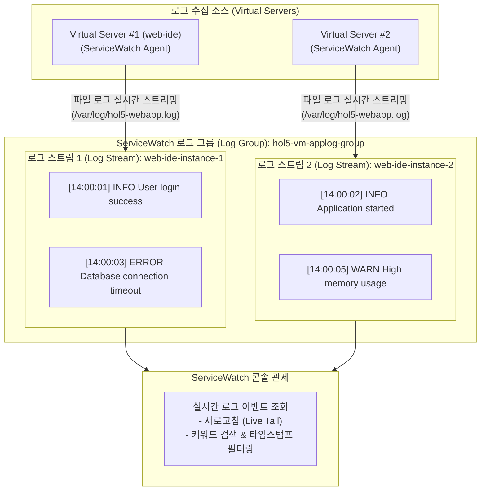

- **로그 그룹(Log Group)**: 동일한 성격이나 시스템의 로그 스트림들을 묶어 보관하는 최상위 관리 단위입니다.
- **로그 스트림(Log Stream)**: 특정 인스턴스(VM) 또는 소스로부터 발생하는 순차적인 로그 이벤트의 흐름입니다.
- **실시간 로그 이벤트 조회(새로고침 & 검색)**: 서버에 직접 SSH 접속하지 않고도 콘솔 화면에서 로그 스트림 새로고침 및 타임스탬프 필터를 통해 인입되는 로그 이벤트를 즉각 관찰하고 분석할 수 있는 기능입니다.

## 5.3 따라하기

> 📋 **사전 준비**
> - 1장에서 생성한 `web-ide` Virtual Server가 정상 기동 중이어야 합니다.
> - 2.3.1에서 발급받은 IAM Access Key / Secret Key 정보가 준비되어 있어야 합니다. (※ 2.3.1에서 `web-ide`의 Public IP가 "접근 허용 IP"로 등록되어 있으므로 `web-ide`에서 정상 인증됩니다.)

### 5.3.1 [Agent 배포] ServiceWatch Agent 설치 및 IAM 준비
1. **에이전트 통신 요건 확인**:
   - 에이전트에서 SCP의 OpenAPI Endpoint로 Outbound HTTPS(TCP 443) 통신이 허용되어 있어야 합니다.
   - KR-WEST-1 리전 Endpoint: `https://servicewatch.kr-west1.e.samsungsdscloud.com`
   - KR-EAST-1 리전 Endpoint: `https://servicewatch.kr-east1.e.samsungsdscloud.com`
2. **인증키 준비**:
   - 2.3.1에서 발급받은 SCP **IAM Access Key / Secret Key**를 준비합니다.
3. **로그 그룹 및 로그 스트림 생성**:
   - **ServiceWatch → 로그 → 로그 그룹** 메뉴로 이동합니다.
   - **[로그 그룹 생성]** 클릭: 로그그룹명 `hol5-vm-applog-group`
   - 생성된 그룹 상세 화면에서 **[로그 스트림 생성]** 클릭: 로그스트림명 `agentlogstream`
4. **Linux 환경 에이전트 설치**:
   - **콘솔 다운로드 경로**: **서비스 → Management → ServiceWatch → 에이전트 관리** 화면에서 Linux(x86_64)용 에이전트 다운로드 링크를 확인합니다.
    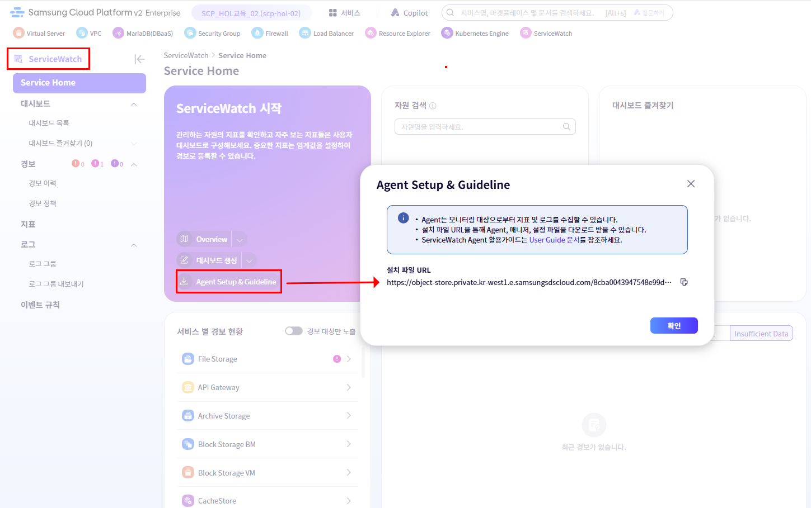

   - `web-ide` 터미널에서 설치 패키지를 다운로드하고 압축을 해제한 뒤 실행 권한을 부여합니다:

     ```bash
     # 콘솔 ServiceWatch > Agent 관리에서 확인한 다운로드 URL로 패키지 다운로드
     wget <콘솔에서 복사한 ServiceWatch Agent 다운로드 URL>
     unzip ServiceWatch_Agent.zip -d agent
     cd agent
     chmod +x otelcontribcol_linux_amd64
     chmod +x servicewatch-agent-manager-linux-amd64
     ```
     
   - 설정 파일 `agent.json`을 작성하여 네임스페이스, 인증 정보, 대상 리소스 ID, Endpoint를 지정합니다.
     > 💡 **리소스 ID 확인**: **서비스 → Compute → Virtual Server**에서 `web-ide` 인스턴스를 클릭하고 상세 정보에 표시된 **서버 ID(Resource ID)**를 복사하여 `resourceId` 값에 입력합니다.
     ```bash
     code-server agent.json
     ```
     ##### [옵션 1] KR-WEST1 설정 (서부 리전)
     ```json
     {
       "namespace": "hol5-vm-agent",
       "accessKey": "<MY_ACCESS_KEY>",
       "accessSecret": "<MY_SECRET_KEY>",
       "resourceId": "<web-ide 서버 ID>",
       "openApiEndpoint": "https://servicewatch.kr-west1.e.samsungsdscloud.com",
       "telemetryPort": 8888
     }
     ```
     
     ##### [옵션 2] KR-EAST1 설정 (동부 리전)
     ```json
     {
       "namespace": "hol5-vm-agent",
       "accessKey": "<MY_ACCESS_KEY>",
       "accessSecret": "<MY_SECRET_KEY>",
       "resourceId": "<web-ide 서버 ID>",
       "openApiEndpoint": "https://servicewatch.kr-east1.e.samsungsdscloud.com",
       "telemetryPort": 8888
     }
     ```
     > 💡 **네트워크 통신 및 `telemetryPort(8888)` 포트 요건**:
     > - **Outbound(아웃바운드 통신)**: 에이전트가 지표 및 로그를 전송하는 SCP OpenAPI Endpoint는 **HTTPS `TCP 443`** 포트를 사용하므로, 외부 통신은 **`443` 포트 Outbound만 허용**되어 있으면 정상 수집됩니다.
     > - **`telemetryPort (8888)`**: 에이전트(OpenTelemetry Collector) 내부의 헬스체크 및 자체 상태 진단 메트릭을 제공하는 **로컬 바인딩(Localhost) 전용 포트**입니다. 외부로 나가는 통신이 아니므로 **방화벽이나 보안그룹의 Outbound 포트 추가 설정이 전혀 필요하지 않습니다.**
   - 로그 수집 설정 파일 `log.json`을 작성하여 수집할 **로그 파일 절대 경로, 파싱 정규식, 로그그룹명 및 로그스트림명**을 지정합니다.
     > 💡 **타임스탬프 포맷 매칭 원리 (Syslog 수집 주의)**: 
     > `operators`의 `regex`와 `timestamp` 레이아웃은 수집 대상 로그의 실제 날짜 포맷과 완벽히 일치해야 합니다. 본 실습의 웹 애플리케이션 로그는 공백 없는 ISO8601 형식(`2026-08-13T...`)이므로 `(?P<timestamp>\S+)` 및 `layout: 2006-01-02T15:04:05.000000Z07:00`을 적용합니다. 
     > *(참고: 만약 Linux 전통 표준 `/var/log/syslog`(예: `Aug 13 13:25:01` - 공백 포함)를 수집하려면 정규식을 타임스탬프 공백 매칭으로 변경하고 레이아웃을 `"Jan 2 15:04:05"`로 지정해야 정상 파싱됩니다.)*
     ```bash
     code-server log.json
     ```
     ```json
     {
       "fileLog": {
           "include": [
             "/var/log/hol5-webapp.log"
           ],
           "operators": {
             "regex": "^(?P<timestamp>\\S+)\\s+(?P<hostname>\\S+)\\s+(?P<process>[^:]+):\\s+(?P<message>.*)$",    
             "timestamp": {           
                 "layout_type": "gotime",
                 "layout": "2006-01-02T15:04:05.000000Z07:00"
             }
           }
       },
       "logMetas": {
           "log_group_value": "hol5-vm-applog-group",    
           "log_stream_value": "agentlogstream"   
       }
     }
     ```
   - 설정을 반영하여 ServiceWatch Agent Manager를 통해 에이전트를 백그라운드 구동합니다.
     ```bash
     # 에이전트 기동 (현재 디렉토리의 agent.json, log.json 참조)
     ./servicewatch-agent-manager-linux-amd64 -action run -dir . -collector ./otelcontribcol_linux_amd64
     ```

### 5.3.2 [Agent 지표 탐색] OpenTelemetry 수집 호스트 지표 탐색
1. **대기**: 에이전트 기동 후 최초 지표 및 로그 반영까지 약 3~5분 대기합니다.
2. **Agent 지표 수집 검증**:
   - **ServiceWatch → 지표**로 이동하여 네임스페이스를 `hol5-vm-agent`로 검색합니다.
   - OpenTelemetry Host Metrics Receiver가 수집한 CPU, Memory, Disk 사용자 정의 지표 목록과 실시간 그래프를 확인합니다.

### 5.3.3 [로그 시뮬레이션] Ubuntu 웹 서비스 로그 지속 생성
별도의 웹 서버가 기동되어 있지 않아도 콘솔에서 실시간 로그 스트림과 검색 필터링을 충분히 테스트할 수 있도록 지속적인 샘플 로그(INFO, WARN, ERROR)를 `/var/log/hol5-webapp.log`에 발급하는 루프 스크립트를 실행합니다.

```bash
# 다양한 등급(INFO, WARN, ERROR)의 웹 서비스 접근/시스템 이벤트 로그 20건 생성
for i in {1..20}; do
  echo "$(date -u +"%Y-%m-%dT%H:%M:%S.%6NZ") $(hostname) WEB_APP: INFO [User: user_$i] GET /api/v1/resource - 200 OK" | sudo tee -a /var/log/hol5-webapp.log

  if [ $((i % 5)) -eq 0 ]; then
    echo "$(date -u +"%Y-%m-%dT%H:%M:%S.%6NZ") $(hostname) WEB_APP: WARN [User: user_$i] Response time threshold exceeded: 1250ms" | sudo tee -a /var/log/hol5-webapp.log
  fi

  if [ $((i % 7)) -eq 0 ]; then
    echo "$(date -u +"%Y-%m-%dT%H:%M:%S.%6NZ") $(hostname) WEB_APP: ERROR [User: user_$i] Database connection timeout: 504 Gateway Timeout" | sudo tee -a /var/log/hol5-webapp.log
  fi

  sleep 1
done
```

### 5.3.4 [로그 스트림 모니터링] ServiceWatch 로그 그룹 및 실시간 로그 인입 확인
1. **로그 그룹 접근**:
   - **ServiceWatch → 로그 → 로그 그룹** 메뉴로 이동하여 `hol5-vm-applog-group`을 선택합니다.
2. **로그 스트림 확인**:
   - 내부 로그 스트림 목록에서 `agentlogstream`을 클릭하여 상세 이벤트 조회 화면으로 진입합니다.
3. **실시간 로그 이벤트 모니터링**:
   - `web-ide` 터미널에서 5.3.3의 로그 생성 루프 스크립트를 재실행합니다.
   - 콘솔 화면 우측 상단의 **[새로고침]** 아이콘을 클릭하여 타임스탬프 순으로 웹 트래픽 및 시스템 이벤트 로그가 실시간 인입·적재되는 모습을 관찰합니다.
   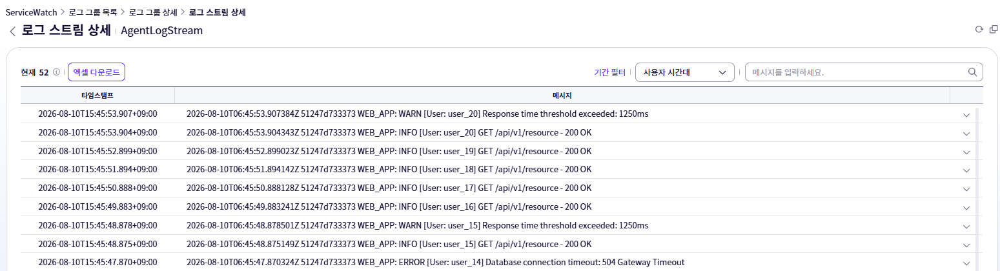

### 5.3.5 [다차원 로그 분석] 키워드 검색, 시간 필터 및 로그 이벤트 상세 분석
1. **키워드 필터링 검색**:
   - 검색창에 `WEB_APP`을 입력하여 시뮬레이션된 웹 애플리케이션 로그만 필터링되는지 확인합니다.
   - 검색창에 `ERROR` 또는 `504`를 입력하여 특정 장애 등급의 에러 로그만 선별 탐색되는지 검증합니다.
2. **로그 이벤트 상세 분석**:
   - 필터링된 로그 라인을 클릭하여 수집 타임스탬프(UTC), 로그 소스, 메시지 원문 파싱 정보를 상세히 분석합니다.
   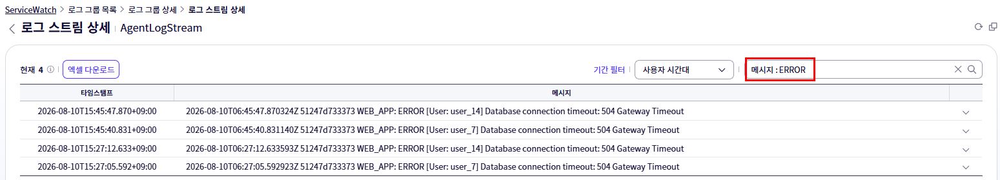

### 5.3.6 Agent 중지
```bash
./servicewatch-agent-manager-linux-amd64 -action stop -dir . -collector ./otelcontribcol_linux_amd64
```

#### Agent 실습 체크포인트
- [ ] `hol5-vm-agent` 네임스페이스로 Agent 수집 지표가 정상 검색되는가?
- [ ] `hol5-vm-applog-group` > `agentlogstream`에서 실시간 로그 이벤트 인입을 관찰했는가?
- [ ] `WEB_APP` 및 `ERROR` 키워드 필터링을 통해 특정 에러 로그만 정상 탐색되는가?

## 5.4 정리하기
- OpenTelemetry 기반 ServiceWatch Agent를 `web-ide`에 배포하여 VM 커스텀 지표 및 파일 로그 수집 파이프라인을 구축했습니다.
- ServiceWatch 로그 그룹/스트림을 통해 실시간 로그 이벤트 모니터링 및 다차원 검색/필터링 분석을 완벽히 마스터했습니다.

---

# 6. Trail 감사 체계 및 End-to-End 장애 대응 시나리오 실습

## 6.1 학습목표
- Logging & Audit API 감사 로그를 Object Storage에 영구 보존하고 로그파일 검증(Digest)을 수행하는 Trail을 배포할 수 있다.
- Firewall 트래픽 감사 로그를 활성화하여 Object Storage와 연동하고 보안 로그 필드를 분석할 수 있다.
- VPC/Security Group 변경 사항을 감지하는 실시간 이벤트 규칙을 수립할 수 있다.
- ServiceWatch 로그 패턴(Log Pattern) 기능으로 로그를 사용자 정의 지표로 전환하고, 해당 지표에 경보를 설정할 수 있다.
- 클라우드 전 영역의 상태를 감시하는 E2E(End-to-End) 싱글 뷰 대시보드를 생성하여 모니터링을 일원화한다.

## 6.2 들어가기

### 6.2.1 Logging & Audit와 Trail 보안 메커니즘
SCP 콘솔 작업 및 API 액션 이력은 규정상 기본 90일간 저장 및 조회 가능합니다. 그러나 침해 사고 분석 및 보안 컴플라이언스를 준수하기 위해서는 **Trail** 서비스를 사용하여 아래와 같이 장기 보존해야 합니다.

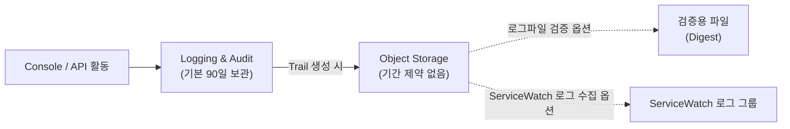

- **Digest 파일 검증**: Trail 생성 시 "로그파일 검증" 옵션을 사용으로 설정하면, 수집된 로그 파일에 대한 무결성 검증용 Digest 파일이 별도로 생성됩니다. 감사자는 이를 활용해 보관된 감사 로그의 무단 수정 및 삭제 여부를 확인할 수 있습니다.
- **90일 vs Trail의 차이**: Logging & Audit은 기본 제공되는 단기 조회 저장소이고, Trail은 Object Storage에 영구 보관하고 감사 지표와 연계하는 감사 체계입니다.

### 6.2.2 Firewall 로깅 및 Network 자원 관찰 3요소
SCP 네트워크 자원의 관찰 영역은 성격이 다른 3가지로 나뉩니다.
- **성능 지표(Metrics)**: Internet Gateway, VPN 등의 트래픽량 (ServiceWatch 지표)
- **이벤트(Events)**: VPC/Subnet 등 네트워크 자원의 생성·변경·삭제 (ServiceWatch 이벤트 규칙)
- **보안 로그**: Firewall/Security Group의 트래픽 허용·차단 기록 (Object Storage에 CSV 저장)

### 6.2.3 로그 패턴(Log Pattern): 저장된 로그를 지표로 바꾸기
 ServiceWatch의 **로그 패턴** 기능은 텍스트 형태의 로그 데이터 내 특정 문자열 매칭 건수를 실계 시간 지표로 변환해 주는 강력한 기능입니다. 이를 통해 텍스트 로그 내 `ERROR` 발생 건수 등에 대해 경보 정책을 설정할 수 있습니다.


## 6.3 따라하기

> 📋 **사전 준비**
> - 로그 저장용 Object Storage 버킷을 생성할 수 있는 권한이 있어야 합니다 (통합 공용 버킷명 예: `hol5-log-bucket-<MY_ID>`).
> - IAM에서 역할(Role)을 생성할 수 있는 권한이 있어야 합니다.

### 6.3.1 네트워크 보안 로깅(Firewall & Security Group) 활성화 및 인프라 이벤트 규칙 구성

본 실습은 네트워크 경계 방화벽(Firewall)과 호스트 방화벽(Security Group)의 패킷 흐름 로그를 통합 수집하고, 인프라 변경 시 실시간으로 알림을 수신하는 이벤트 규칙을 구성하여 검증합니다.
진행 순서는 **① Firewall 로그 설정 → ② Security Group 로그 설정 → ③ 이벤트 규칙 설정 및 실증 검증**으로 진행됩니다.

---

#### 1. 본인의 6자리 고유 식별자(ID) 발급 및 통합 로그 보관용 Object Storage 버킷 생성
1. **고유 ID 발급**:
   - Object Storage 버킷 이름은 리전 전체에서 유일해야 합니다.
   - 웹 브라우저에서 **[Short Unique ID Generator (shortunique.id)](https://shortunique.id/)** 에 접속하거나 `web-ide` 터미널에서 `openssl rand -hex 3` 명령을 실행하여 **6자리 소문자 ID**를 발급받습니다. (예: `a3f8c1`)
2. **통합 버킷 생성**:
   - **서비스 → Storage → Object Storage → [버킷 생성]**
   - **버킷명**: `hol5-log-bucket-<MY_ID>` (예: `hol5-log-bucket-a3f8c1`)
   - **접근 제어**: `Private`
   > 💡 **통합 버킷 활용 안내**: 본 실습에서 생성하는 `hol5-log-bucket-<MY_ID>` 버킷은 Firewall 로그, Security Group 로그, 그리고 6.3.3절의 Logging & Audit Trail 감사 로그를 단일 버킷에서 통합 관리·보존하는 중앙 스토리지로 사용합니다.

---

#### 2. Firewall 로그 설정 및 검증 (Firewall Logging)
1. **Firewall 로깅 저장소 매핑**:
   - **서비스 → Management → Network Logging → Firewall Logging** 메뉴로 이동합니다.
   - **[로그 저장소 설정]**을 클릭하고, 로그 저장 버킷으로 방금 생성한 **`hol5-log-bucket-<MY_ID>`**를 지정하여 저장합니다.
2. **Firewall 상품에서 로깅 활성화**:
   - **서비스 → Networking → Firewall** 메뉴로 이동하여 1장에서 생성된 실습 대상 방화벽(예: `FW_vpc-webide-hol5`)을 선택합니다.
   - 상세 페이지에서 **로그 저장 여부(로깅 여부)**를 **[사용]**으로 변경하고 저장합니다.
   > ⚠️ **순서 주의**: Firewall Logging에서 저장소 버킷을 먼저 매핑한 후 방화벽 상세에서 로그 저장을 [사용]으로 활성화해야 로그 적재 파이프라인이 정상 가동됩니다.
3. **방화벽 트래픽 유발 및 로그 확인**:
   - `web-ide` 터미널에서 외부 인터넷 요청을 발생시켜 방화벽 허용/차단 패킷 로그를 유발합니다:
     ```bash
     curl -I https://www.google.com
     ```
   - **로그 확인 (약 5분 대기)**:
     1. **서비스 → Storage → Object Storage**에서 `hol5-log-bucket-<MY_ID>` 버킷으로 이동합니다.
     2. **[폴더 리스트]** 탭을 클릭하여 **`/ LOG / FW`** 경로로 이동합니다.
     3. 적재된 방화벽 CSV 로그 파일의 체크박스를 선택하고 **[다운로드]**하여 로컬 PC에서 엽니다.
     4. **8개 주요 필드 구조 확인**:
        ```csv
        eventtimestamp,action,policyname,proto,srcip,srcport,dstip,dstport
        2026-08-26T03:00:03.992Z,accept,fda201b4e0f14884abb8bbe2827db2d4,6,211.33.40.145,13464,192.168.0.199,80
        2026-08-26T03:00:05.848Z,deny,,6,104.218.161.86,15672,192.168.0.199,9001
        ```
        - `eventtimestamp`: 이벤트 발생 일시 (UTC)
        - `action`: 패킷 처리 결과 (`accept`: 허용, `deny`: 차단)
        - `policyname`: 일치한 정책 ID (기본 차단 시 빈 문자열)
        - `proto` / `srcip` / `srcport` / `dstip` / `dstport`: 5-tuple 네트워크 패킷 정보

---

#### 3. Security Group 로그 설정 및 검증 (Security Group Logging)
1. **Security Group 로깅 저장소 매핑**:
   - **서비스 → Management → Network Logging → Security Group Logging** 메뉴로 이동합니다.
     *(또는 **서비스 → Networking → VPC**에서 대상 VPC 선택 후 **[로그 관리]** 탭의 Security Group 항목)*
   - **[로그 저장소 설정]**을 클릭하고, 로그 저장 버킷으로 동일한 공용 버킷 **`hol5-log-bucket-<MY_ID>`**를 지정하여 저장합니다.
2. **Security Group 상품에서 로깅 활성화**:
   - **서비스 → Networking → Security Group** 메뉴로 이동합니다.
   - 1장에서 생성한 `web-ide` 보안 그룹(`sg-webide-hol5`) 또는 K8s 노드풀 보안 그룹(`tf-k8s-SG-hol5`)을 선택합니다.
   - [상세 정보] 페이지에서 **로그 저장 여부(로깅 여부)**를 **[사용]**으로 변경하고 저장합니다.
3. **보안 그룹 트래픽 유발 및 로그 확인**:
   - `web-ide` 터미널에서 보안 그룹 규칙을 통과하는 네트워크 트래픽을 유발합니다:
     ```bash
     # 내부 또는 외부 트래픽 호출을 통한 보안 그룹 인바운드/아웃바운드 로그 생성
     curl -s -k https://192.168.0.1 || true
     curl -I https://www.samsung.com
     ```
   - **로그 확인 (약 5분 대기)**:
     1. **서비스 → Storage → Object Storage**에서 `hol5-log-bucket-<MY_ID>` 버킷으로 이동합니다.
     2. **[폴더 리스트]** 탭을 클릭하여 **`/ LOG`** 경로로 이동합니다.
     3. 방화벽 로그 폴더인 **`FW`**와 보안 그룹 로그 폴더인 **`SG`**가 버킷 내에 나란히 자동 생성된 것을 확인합니다.
     
        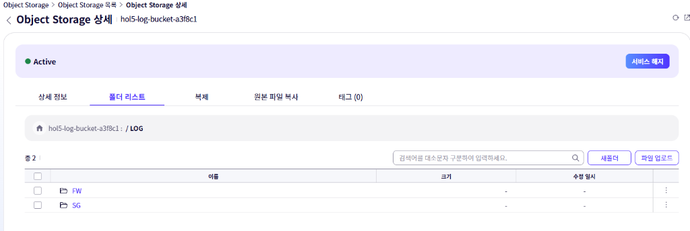

     4. **`SG`** 폴더 하위로 이동하여 생성된 보안 그룹 CSV 로그 파일을 다운로드하고, 시간, 허용/차단(`accept`/`deny`), 출발지/목적지 IP 및 포트가 정상 기록되었는지 확인합니다.

---

#### 4. VPC 및 Security Group 이벤트 규칙 생성 (ServiceWatch Event Rules)
ServiceWatch 이벤트 규칙은 인프라 자원의 생성·수정·삭제 등 구성 변경 라이프사이클 이벤트를 실시간 탐지하여 담당자에게 즉시 알림을 발송합니다. VPC와 Security Group은 각각 독립된 이벤트 소스이므로 2개의 규칙으로 생성합니다.

1. **VPC 이벤트 규칙 생성 (`vpcalleventrule`)**:
   - **서비스 경로**: **ServiceWatch → 이벤트 → 이벤트 규칙 목록 → [이벤트 규칙 생성]**
   - **기본 정보**: 규칙명 **`vpcalleventrule`** 입력
   - **이벤트 패턴 설정**:
     - **이벤트 소스**: **`VPC`**
     - **이벤트 유형**: **`Public IP`**
       > 💡 **이벤트 유형 설정 안내**: SCP 공식 문서에 따르면 ServiceWatch의 이벤트 소스 `VPC`는 단일 리소스가 아닌 `VPC`, `Subnet`, `Public IP`, `Internet Gateway` 등 세부 자원 유형으로 세분화되어 있습니다. 콘솔 UI에서 이벤트 유형으로 **`Public IP`**를 선택합니다.
     - **적용 이벤트**: **`모든 이벤트`** (또는 `Public IP 생성 완료`, `Public IP 삭제 완료`)
     - **대상 자원**: **`모든 자원`**
   - **알림 설정**: 본인의 이메일 주소를 수신처로 지정한 후 **[생성]**을 클릭합니다.

2. **Security Group 이벤트 규칙 생성 (`sgalleventrule`)**:
   - **[이벤트 규칙 생성]**을 다시 클릭합니다.
   - **기본 정보**: 규칙명 **`sgalleventrule`** 입력
   - **이벤트 패턴 설정**:
     - **이벤트 소스**: **`Security Group`**
     - **이벤트 유형**: **`Security Group`**
     - **적용 이벤트**: **`모든 이벤트`**
     - **대상 자원**: **`모든 자원`**
   - **알림 설정**: 본인의 이메일 주소를 수신처로 지정한 후 **[생성]**을 클릭합니다.
   > 💡 **로깅 vs 이벤트 규칙 구분**: 앞선 2~3단계의 로깅(Network Logging)은 네트워크 패킷 단위 트래픽을 Object Storage에 저장하는 기능이며, 본 4단계의 이벤트 규칙은 자원의 형상 변경(생성/삭제/규칙 추가 등)을 실시간 감지하여 알림을 보내는 관제 기능입니다.

---

#### 5. 이벤트 규칙 실시간 동작 검증 시나리오 및 원복
생성한 이벤트 규칙(`vpcalleventrule`, `sgalleventrule`)이 실제 인프라 변경 시 정상적으로 이벤트를 감지하고 알림을 발송하는지 2가지 시나리오로 실증 검증합니다.

##### 시나리오 A: VPC Public IP 자원 라이프사이클 이벤트 검증 (`vpcalleventrule`)
> 🔍 **공식 문서 기반 동작 원리**:
> - SCP 공식 사용자 가이드에 따르면, VPC 본체(`VPC` 유형)의 단순 설명(Description)이나 태그 텍스트 수정은 포털 메타데이터 변경에 해당하여 제어평면 라이프사이클 이벤트(`VPC 업데이트 완료`)를 이벤트 버스로 발행하지 않습니다.
> - 따라서 VPC 소스 하위의 **`Public IP` 예약(생성) 및 반납(삭제)**을 통해 실시간 `Public IP 생성 완료` / `Public IP 삭제 완료` 이벤트를 가장 안전하고 확실하게 검증합니다.

1. **테스트 이벤트 유발 (Public IP 예약/생성)**:
   - **서비스 → Networking → VPC** 메뉴로 이동합니다.
   - 좌측 메뉴(또는 VPC 화면)에서 **Public IP**를 클릭하고 **[Public IP 예약]** 버튼을 클릭합니다.
   - **예약 정보 입력**:
     - **구분**: `Internet Gateway` (기본값)
     - **Availability Zone**: 실습 리전의 AZ 선택 (기본값)
     - **설명**: `event-test` 입력
   - 요약 정보 확인 후 **[생성]**을 클릭합니다. (약 5~10초 내 생성 완료)
2. **실시간 검증**:
   <!-- - **콘솔 확인**: **ServiceWatch → 이벤트 → 이벤트 히스토리** 메뉴로 이동하여 `Public IP 생성 완료` 이벤트가 정상 기록되었는지 확인합니다. -->
   - **이메일 확인**: 등록한 본인의 이메일 수신함에서 `[ServiceWatch]` 알림 메일이 도착했는지 확인합니다. (이벤트 상세에 발급된 Public IP 정보 포함)
3. **자원 원복 (Public IP 반납/삭제)**:
   - **서비스 → Networking → VPC → Public IP** 목록 페이지로 이동합니다.
   - 방금 생성한 테스트용 Public IP(`event-test`)를 선택하고 **[Public IP 반납]**을 클릭합니다.
   - 팝업창에서 확인을 누르면 Public IP가 즉시 삭제(반납) 처리되며, 추가 비용이 발생하지 않습니다.
   - *(※ 반납 시에도 `vpcalleventrule`에 의해 `Public IP 삭제 완료` 이벤트가 추가 기록되고 메일이 발송되는 것을 추가로 확인할 수 있습니다.)*

##### 시나리오 B: Security Group 규칙 변경 감지 및 알림 검증 (`sgalleventrule`)
1. **테스트 이벤트 유발**:
   - **서비스 → Networking → Security Group** 메뉴로 이동하여 실습 대상 보안 그룹(예: `sg-webide-hol5`)을 선택합니다.
   - **[규칙 추가]** 버튼을 클릭하고 임시 인바운드 규칙을 추가합니다:
     - 대상주소 : `192.168.0.1`
     - 프로토콜: `TCP`
     - 포트: `9999`
     - 방향: `Inbound`
     - 설명: `event-test`
   - **[완료]**을 클릭하여 규칙을 적용합니다.
2. **실시간 검증**:
   <!-- - **콘솔 확인**: **ServiceWatch → 이벤트 → 이벤트 히스토리** 메뉴로 이동합니다. 방금 실행한 Security Group 규칙 추가 변경 이벤트가 실시간으로 수집되었는지 확인합니다. -->
   - **이메일 확인**: 등록한 본인의 이메일 수신함에서 `[ServiceWatch]` 알림 메일이 도착했는지 확인합니다. 메일 본문에 변경된 보안 그룹 ID와 이벤트 상세 내역이 포함되어 있습니다.
3. **자원 원복 (정리)**:
   - 보안 그룹 상세 페이지에서 방금 추가한 임시 인바운드 규칙(`TCP 9999`)을 체크하고 **[삭제]**합니다.
   - 규칙 삭제 시에도 `sgalleventrule`에 의해 삭제 이벤트가 추가로 발생하고 알림 메일이 전송되는 것을 추가로 확인할 수 있습니다.

> 🏁 **6.3.1 완료 체크포인트**:
> - [ ] Firewall 로그와 Security Group 로그가 `hol5-log-bucket-<MY_ID>` 버킷에 각각 CSV 파일로 적재되었는가?
> - [ ] `vpcalleventrule`(VPC - Public IP)과 `sgalleventrule`(Security Group) 이벤트 규칙이 정상 등록되었는가?
> - [ ] Public IP 예약 및 임시 보안 그룹 규칙 추가 시 ServiceWatch 이벤트 히스토리와 이메일 알림이 정상 작동했는가?
> - [ ] 테스트용 임시 Public IP 반납 및 보안 그룹 규칙을 모두 원래대로 원복했는가?

### 6.3.2 Trail 생성을 위한 IAM 권한 정책 및 역할 설정

SCP Trail 서비스에서 수집된 감사 로그를 **ServiceWatch 로그 그룹으로 안전하게 전송**하기 위해 권한 정책(Policy)을 먼저 생성한 뒤 위임 역할(Role)에 연결합니다. (Object Storage 저장은 플랫폼 기본 권한으로 자동 처리됩니다.)

1. **권한 정책(Permissions Policy) 생성 (선행)**:
   - **서비스 경로**: **서비스 → Management → IAM → 정책 → [정책 생성]**
   - **기본 정보**:
     - **정책명**: `trail-to-servicewatch-policy`
     - **설명**: `Trail 감사 로그를 ServiceWatch 로그 그룹으로 전송하기 위한 권한 정책`
   - **정책 작성 (아래 두 가지 방법 중 원하는 방식을 선택하여 진행)**:

     **[방법 A] 시각적 편집기 (콘솔 UI 직접 선택 방식)**
     - **서비스**: `ServiceWatch` 검색 후 선택
     - **액션(Action)**: Create 하위리스트에 아래 2개 항목을 체크합니다.
       - `CreateBulkServiceLogEvents` (대량 서비스 로그 이벤트 생성)
       - `CollectLogGroupLogStream` (로그 그룹 로그 스트림 수집)
     - **리소스(Resource)**: `모든 자원`
     - **인증 유형**: `모든 안중`
     - **적용 IP**: `모든 IP`

     **[방법 B] JSON 편집기 직접 입력 방식**
     - 편집기 상단에서 **[JSON 모드]** 탭을 클릭하고 아래 JSON 정책 본문을 붙여넣습니다:
       ```json
       {
         "Version": "2024-07-01",
         "Statement": [
           {
             "Sid": "VisualEditor0",
             "Effect": "Allow",
             "Action": [
               "servicewatch:CreateBulkServiceLogEvents",
               "servicewatch:CollectLogGroupLogStream"
             ],
             "Resource": [
               "*"
             ]
           }
         ]
       }
       ```
   - **[저장]** 버튼을 클릭하여 정책 생성을 완료합니다.

2. **역할(Role) 생성 및 정책 연결**:
   - **서비스 경로**: **서비스 → Management → IAM → 역할 → [역할 생성]**
   - **역할명**: `audit-trail-role`
   - **설명**: `Logging & Audit Trail에서 ServiceWatch로 감사 로그를 전송하기 위한 위임 역할`
   - **수행 주체 설정**:
     - 구분: **`서비스`**
     - Value: **`loggingaudit.samsungsdscloud.com`** 
   - **권한 정책 연결**: 정책 목록에서 방금 생성한 **`trail-to-servicewatch-policy`** 를 검색하여 선택(체크)합니다.
   - **[저장]** 버튼을 클릭하여 역할 생성을 완료합니다.
   > 💡 **생성 순서 안내**: 역할(Role) 생성 화면에서 권한 정책을 바로 매핑할 수 있도록 정책을 먼저 생성한 후 역할을 생성하는 순서로 진행합니다.

### 6.3.3 Logging & Audit Trail 생성

1. **서비스 경로**: **서비스 → Management → Logging & Audit → Trail → [Trail 생성]**

2. **서비스 정보 입력 (화면 항목별 설정)**:
   - **Trail 명 \***: `hol5-audit-trail`
   - **대상 리전 \***: `전체` (기본값)
   - **대상 자원 유형 \***: `전체` (기본값)
   - **대상 사용자 \***: `전체` (기본값)
   - **저장 버킷 리전 \***: `kr-west1` (기본값)
   - **저장 버킷 \***: 6.3.1에서 생성한 공용 버킷 **`hol5-log-bucket-<MY_ID>`**
   - **저장 형식 \***: **`JSON`**
   - **로그파일 검증**: **`사용`**
     > 💡 **로그파일 검증**: 로그파일 검증을 사용으로 설정하면 동일 버킷에 Digest 파일이 생성됩니다.
   - **ServiceWatch 로그 수집**: **`사용`** → 자동 생성된 로그 그룹명을 화면에서 확인하고 메모한다(예시와 다를 수 있음)
     - **IAM 역할**: 6.3.2에서 생성한 **`audit-trail-role`**
       *(※ Logging & Audit 서비스가 위임받은 역할 권한으로 ServiceWatch 로그 그룹에 감사 이벤트를 실시간 전송합니다.)*
   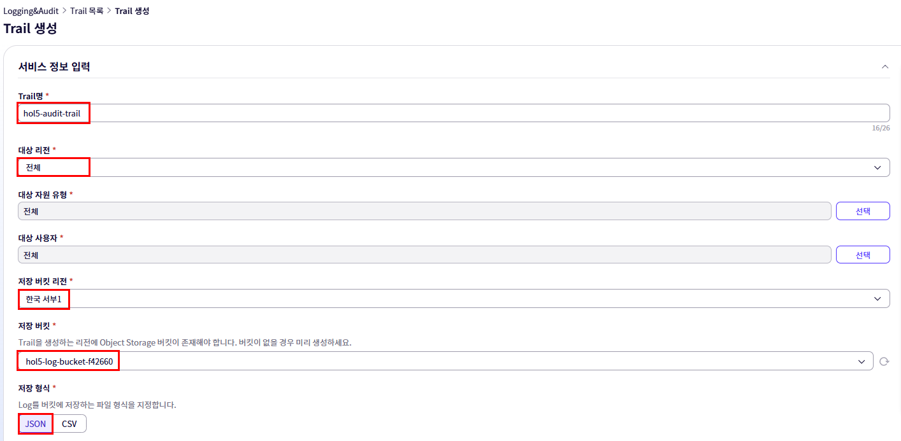
   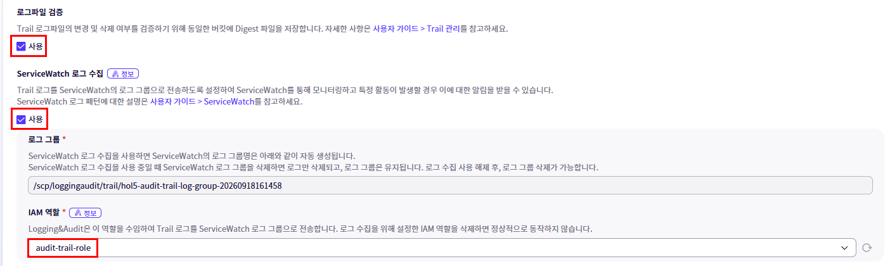

3. **[생성]** 버튼을 클릭하여 Trail 생성을 완료하고 감사 로그 적재 및 ServiceWatch 연동을 시작합니다.
   > 💡 **참고사항 (공식 문서 기준 로그 전송 및 저장 주기)**:
   > - **ServiceWatch 로그 그룹 전송 소요 시간**: Trail은 **활성화(Active)된 이후에 발생한 신규 활동**부터 수집하며, IAM 위임 역할을 통해 ServiceWatch API로 전송되는 내부 버퍼링으로 인해 **약 5분~10분 정도의 지연 시간**이 소요됩니다.
   > - **Object Storage 적재 주기**: SCP 공식 가이드에 명시된 바와 같이, Trail에 저장되는 이벤트 로그는 **1시간 단위 배치(Batch)로 Object Storage에 저장**됩니다. 따라서 Trail 생성 직후에는 버킷에 파일이 바로 나타나지 않는 것이 정상 동작입니다.

### 6.3.4 Digest 파일 및 실시간 감사 로그 확인

> 💡 **참고사항: 실습 중 감사 로그 전송 확인 및 강제 유발 팁**
> - **감사 로그가 바로 보이지 않는 경우**: Trail은 생성 시점 이전의 작업(IAM 정책 생성 등)은 소급 수집하지 않으므로, Trail 생성 후 아무런 활동이 없으면 전송할 이벤트가 없습니다.
> - **감사 로그 즉시 유발하기**:
>   1. **Trail 상태 제어**: Trail 상세 페이지에서 상단의 **[중지(Stop)] → [시작(Start)]**을 클릭하면 Trail 상태 변경 자체가 최우선 감사 이벤트로 즉시 기록되어 파이프라인을 작동시킵니다.
>   2. **가벼운 자원 변경**: 보안 그룹 설명 변경, Public IP 예약 등 간단한 콘솔 조작을 수행합니다.
> - **1차 실시간 검증 ([활동 내역] 메뉴)**: **Management → Logging & Audit → [활동 내역]** 메뉴로 이동하면 사용자의 API 활동이 1~2분 내에 가장 먼저 인덱싱되므로, 플랫폼이 내 작업을 정상 수집 중인지 가장 빠르게 확인할 수 있습니다.

1. **ServiceWatch에서 실시간 감사 로그 확인 (약 5~10분 대기 또는 유발 후 확인)**:
   - **서비스 → Management → ServiceWatch → 로그 → 로그 그룹** 메뉴로 이동합니다.
   - 6.3.3에서 **메모해 둔 Trail 로그 그룹**을 클릭하고 내부 로그 스트림으로 진입합니다.
   - Trail 생성 이후 수행한 활동(Trail 중지/시작, 자원 변경 등)이 JSON 포맷으로 수집되어 표시되는 것을 확인합니다.
     *(※ 전송 파이프라인 버퍼링으로 인해 최초 수집까지 약 5~10분이 소요될 수 있습니다.)*

2. **Object Storage 버킷 내 로그 및 Digest 폴더 확인 (1시간 주기 배치 적재)**:
   - **서비스 → Storage → Object Storage**로 이동하여 **`hol5-log-bucket-<MY_ID>`** 버킷을 클릭합니다.
   - 공식 문서에 따라 Trail 로그 및 로그파일 검증(Digest) 파일은 **1시간 단위로 일괄 적재**됩니다.
   - [폴더 리스트]에서 감사 로그가 보관되는 **`hol5-audit-trail/`** 폴더와 함께 **`digest/`** 경로에 파일이 생성되는 아키텍처 구조를 확인합니다.
   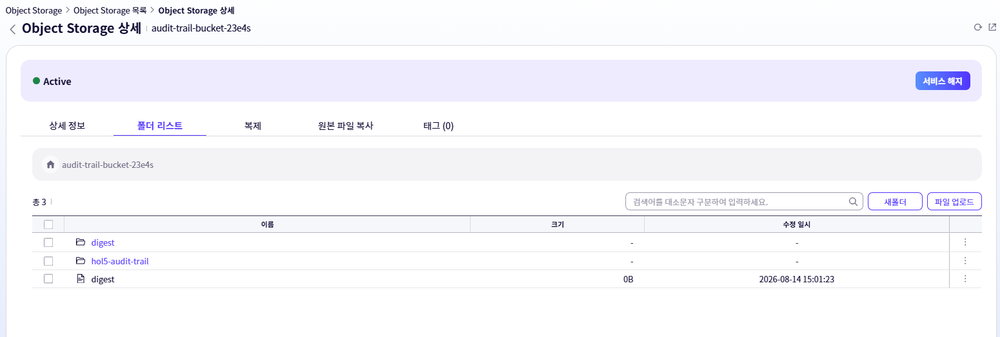
   > ⏱️ **배치 주기 안내**: 실습 환경에서 즉시 파일이 생성되지 않더라도, Trail이 `Active` 상태이고 로그파일 검증이 `사용`으로 설정되어 있다면 1시간 주기에 맞춰 자동으로 폴더와 Digest 파일이 생성·적재됩니다.

<!--
### 6.3.5 로그 패턴 기반 감사 지표 변환 및 보안 관찰성 실습 (향후 재개 예정)

보안 감사 로그에 주요 감사 이벤트(Trail 설정 변경, IAM 역할 위임, 자원 생성/삭제 등)가 감지될 때 ServiceWatch **로그 패턴(Log Pattern)**을 활용하여 비구조화 텍스트 로그를 실시간 **사용자 정의 지표(Metric)**로 변환하고 보안 관찰성을 확보하는 실습을 진행합니다.

1. **감사 로그 패턴 및 사용자 정의 지표 생성**:
   - **서비스 경로**: **서비스 → Management → ServiceWatch → 로그 → 로그 그룹 목록**으로 이동하여 6.3.3에서 **메모해 둔 Trail 로그 그룹**을 클릭합니다.
   - **[로그 패턴]** 탭을 선택하고 **[로그 패턴 생성]** 버튼을 클릭합니다.

   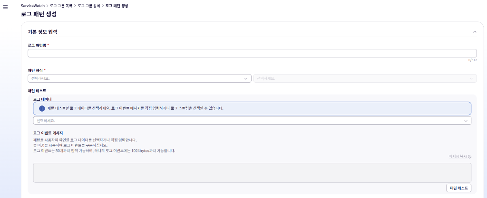

   **① 기본 정보 입력**
   - **로그 패턴명 \***: `audit-trail-event-pattern`
   - **패턴 형식 \*** 설정:
     - **1번째 드롭다운**: **`직접 입력`** 선택
     - **2번째 드롭다운**: **`JSON 형식 패턴`** 선택
     - **3번째 입력창 (패턴 식)**: **`{ $.resource_type = "trail" }`** (또는 `{ $.status = "Success" }`) 입력
     > 💡 **패턴 식(Pattern Expression) 매칭 원리**: Logging & Audit Trail에서 ServiceWatch로 전송되는 감사 로그 JSON 레코드 중 `resource_type`이 `"trail"`인 감사 이벤트를 실시간 필터링하여 감지합니다.
   
   - **패턴 테스트 (실시간 사전 검증)**:
     - **로그 데이터**: 드롭다운에서 실제 수집된 감사 로그 스트림(예: `2026082704Z_log(3)` 등)을 선택합니다.
     - **[패턴 테스트]** 버튼을 클릭하여 하단에 매칭 결과(일치)가 정상 출력되는 것을 확인합니다.

   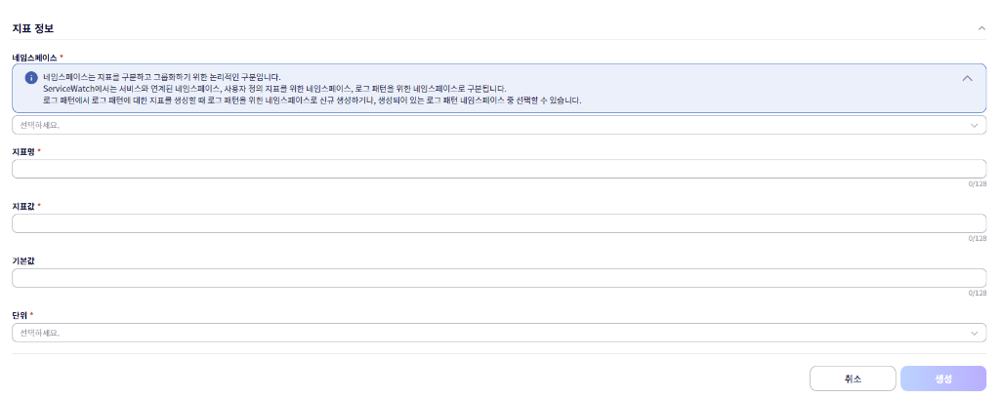

   **② 지표 정보**
   - **네임스페이스 \***: `신규 생성` 선택 후 **`hol5-audit-metric`** 입력
     > 💡 **네임스페이스**: 수집된 지표를 논리적으로 분류하기 위한 최상위 카테고리입니다. 신규 생성 시 `hol5-audit-metric`을 직접 타이핑하여 입력합니다.
   - **지표명 \***: **`TrailAuditEventCount`** 입력
   - **지표값 \***: **`1`** 입력 (패턴 일치 이벤트 1건 발생 시 지표 카운트 1 증가)
   - **기본값**: **`0`** 입력 (패턴과 일치하지 않는 주기에는 지표 값 0 유지)
   - **단위 \***: 드롭다운에서 **`Count`** (또는 `개` / `None`) 선택
   - 하단의 **[생성]** 버튼을 클릭하여 로그 패턴 및 지표 변환 규칙 생성을 완료합니다.

2. **보안 감사 다계층 관찰성(Log Pattern vs Event Rule) 체계 이해**:
   - **로그 패턴 지표 (`TrailAuditEventCount`)**: 감사 로그의 유입량과 특정 유형의 설정 변경 발생 빈도를 시계열 지표로 수치화하여 트렌드 분석 및 6.3.6 통합 대시보드 시각화에 활용합니다.
   - **실시간 보안 이벤트 알림 (ServiceWatch Event Rules)**: VPC/보안그룹 변경 등 즉각적인 대응이 필요한 보안 제어 평면 이벤트는 6.3.1 (5)에서 설정한 **`vpcalleventrule`** 및 **`sgalleventrule`**을 통해 실시간 알림(Email/SMS)으로 즉시 전달받는 다계층 보안 관찰성을 구성합니다.

3. **동작 검증 (E2E 감사 로그 인입 및 지표 변환 확인)**:
   - **서비스 → Management → Logging & Audit → Trail**로 이동하여 `hol5-audit-trail`의 설정을 조회/수정하거나 콘솔에서 감사 활동을 유발합니다.
   - **검증 흐름 확인**:
     1. **감사 로그 인입**: 사용자 작업이 Logging & Audit Trail을 통해 **메모해 둔 Trail 로그 그룹**으로 실시간 전송됩니다.
     2. **로그 패턴 매칭 & 지표 산출**: ServiceWatch 로그 패턴이 `{ $.resource_type = "trail" }`을 실시간 감지하여 `TrailAuditEventCount` 지표 값이 `1`로 상승합니다.
     3. **통합 관찰성 반영**: 변환된 감사 지표가 6.3.6의 통합 모니터링 대시보드 및 서비스 지표 뷰에 실시간 반영되는 것을 확인합니다.
-->

<!--
### 6.3.6 통합 장애 감시 대시보드 구축 (참조용)
실습 과정에서 수립된 전체 인프라 자원의 핵심 상태를 단일 뷰에서 즉시 감시할 수 있도록, 4장에서 생성한 `hol5-custom-dashboard`를 아래의 종합 모니터링 매트릭스로 재구성합니다.

- **목표 대시보드명**: `hol5-custom-dashboard` (또는 `production-observability` 신규 구축)

> 💡 **위젯 선택 안내**: Widget 1~5는 4장 및 5장에서 생성/설정한 자원들을 선택하며, Widget 6~8(Load Balancer, Object Storage, Internet Gateway)은 1장 및 3장에서 프로비저닝된 인프라 자원을 해당 네임스페이스에서 선택하여 매핑합니다.

- **위젯 배치 정보 (4x2 그리드 규격)**:

| 위젯 ID | 자원 및 네임스페이스 | 핵심 모니터링 지표 | 집계 및 설명 |
| :--- | :--- | :--- | :--- |
| **Widget 1** | Virtual Server | `CPU Usage` | 평균 (VM 가부하 모니터링) |
| **Widget 2** | `hol5-vm-agent` | `system.memory.utilization` | 평균 (Agent 수집 VM 메모리 모니터링 ※ Virtual Server 기본 메트릭에는 메모리가 없으므로 5장 Agent 네임스페이스 지정) |
| **Widget 3** | File Storage | `total_byte` | 최대 (NFS 실제 사용 바이트 관찰) |
| **Widget 4** | MariaDB DBaaS | `CPU Usage` | 평균 (데이터베이스 CPU 점유) |
| **Widget 5** | MariaDB DBaaS | `Connection usage` | 최대 (DB 연결 사용률 포화도 모니터링) |
| **Widget 6** | Load Balancer | `LB Current Connections` | 합계 (현재 유지 중인 연결 수) |
| **Widget 7** | Object Storage | `object_byte` | 최대 (Firewall 로그 보존 용량, Bytes) |
| **Widget 8** | Internet Gateway | `Network In Total Bytes_Internet` | 평균 (인터넷 인바운드 트래픽 관찰) |

- **대시보드 레이아웃 설정**: 
  - 각 위젯들을 드래그 앤 드롭하여 4x2 형태로 한눈에 들어오게 배치하고 **[대시보드 저장]**을 완료합니다.
-->

#### 실습 체크포인트
- [ ] Trail 감사 로그가 `hol5-log-bucket-<MY_ID>` 및 ServiceWatch 로그 그룹에 연동 저장되는가?
- [ ] ServiceWatch 이벤트 규칙(`vpcalleventrule`, `sgalleventrule`)을 통해 네트워크/보안 제어 평면 변경 이벤트 감지 및 실시간 알림이 구성되었는가?
- [ ] 로그파일 검증 옵션을 활성화하여 동일 버킷 내 digest/ 경로에 Digest 파일이 생성된 것을 확인했는가?

## 6.4 정리하기
- Firewall 로그 및 Logging & Audit API 감사 로그를 ServiceWatch 로그 그룹과 Object Storage로 안전하게 연동 저장했습니다.
- ServiceWatch 이벤트 규칙을 통해 VPC 및 보안 그룹과 같은 핵심 보안 자원의 변경 활동을 실시간으로 감지하고 알림을 전달받는 체계를 구축했습니다.
- Logging & Audit Trail의 로그파일 검증 기능을 활용하여 동일 버킷에 Digest 파일이 생성되는 구조를 확인하고, 클라우드 보안 컴플라이언스를 충족하는 감사 보존 체계를 완성했습니다.

---

# 7. Prometheus와 Grafana를 활용한 Kubernetes Engine 심화 모니터링

## 7.1 학습목표
- SCP Kubernetes Engine(SKE) 환경에서 Helm을 사용해 `kube-prometheus-stack`을 성공적으로 설치할 수 있다.
- 3장에서 구축한 Gateway API(HTTPRoute)를 재사용해 Grafana/Prometheus/Alertmanager를 별도 LoadBalancer 없이 sslip.io 도메인으로 노출할 수 있다.
- Grafana 데이터 소스를 정의하고, 오픈소스 커뮤니티 대시보드 ID를 활용해 시각화 뷰를 구축할 수 있다.
- PromQL(Prometheus Query Language)을 사용해 다차원 파드 자원 사용량을 추적하고 커스텀 경보 룰을 적용할 수 있다.
- Alertmanager의 라우팅 규칙으로 경보 심각도별 알림 채널을 분리할 수 있다.

## 7.2 들어가기

### 7.2.1 SKE 환경에서의 Prometheus 모니터링 모델
Kubernetes는 파드의 스케줄링과 라이프사이클이 유동적으로 변화합니다. ServiceWatch는 SKE 노드나 클러스터 수준의 정적 지표를 제공하기에 적합하지만, 파드 내 애플리케이션 지표(예: JVM GC, API Response Quantiles)를 수집하기 위해서는 대상 파드의 `/metrics` 주소를 Pull(Scrape) 방식으로 가져오는 Prometheus 스택이 필수적입니다.

**ServiceWatch와 Prometheus의 핵심적인 차이는 메트릭 수집 주체와 전송 메커니즘(Push vs. Pull)에 있습니다.**

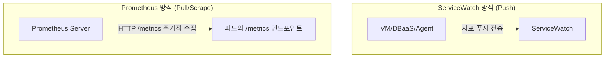

- **Push 방식 (ServiceWatch)**: 관찰 대상 자원(VM, DBaaS, Agent 등)이 모니터링 수집 엔드포인트로 지표를 직접 전달하는 방식입니다. 주로 클라우드 플랫폼에 등록된 관리형 인프라 자원의 표준 지표 수집에 적합합니다.
- **Pull/Scrape 방식 (Prometheus)**: Prometheus 서버가 관찰 대상의 `/metrics` 엔드포인트를 주기적으로 호출하여 지표를 가져오는 방식입니다. `/metrics` 인터페이스만 노출되어 있다면 컨테이너 애플리케이션 및 오픈소스 소프트웨어 등 다양한 대상을 유연하게 수집할 수 있어 확장성이 뛰어납니다.

### 7.2.2 Prometheus 아키텍처 핵심 구성요소
`kube-prometheus-stack`을 설치하기 전에, 앞으로 다룰 리소스 이름들이 각각 무슨 역할인지 먼저 짚고 갑니다.

| 구성요소 | 역할 |
| :--- | :--- |
| Prometheus Server | 지표를 스크랩해 저장하는 시계열 DB(TSDB) + 질의 엔진 |
| Exporter | 대상 시스템의 상태를 `/metrics` 형식으로 변환해 노출 (예: Node Exporter) |
| Alertmanager | Prometheus가 평가한 경보를 라우팅·그룹핑·억제 후 채널로 전달 |
| Prometheus Operator | Kubernetes CRD로 위 구성요소들을 선언적으로 관리하는 컨트롤러 |
| `ServiceMonitor` / `PodMonitor` | "어떤 Service/Pod를 스크랩할지" 선언하는 CRD |
| `PrometheusRule` | 경보/녹화 규칙을 선언하는 CRD (7.3.3에서 실습) |

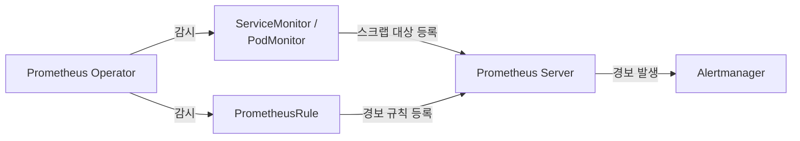

> 🔑 **7.3.1의 values.yaml에서 본 `serviceMonitorSelectorNilUsesHelmValues: false`가 하는 일**: "Operator가 아무 네임스페이스의 `ServiceMonitor`든 자동으로 찾아서 등록하라"는 뜻입니다. `true`로 두면 Helm이 지정한 것만 인식해 커스텀 `ServiceMonitor`가 무시됩니다.

### 7.2.3 PromQL 핵심 문법 미리보기
7.3.3에서 실행할 10개 쿼리는 몇 가지 문법 패턴의 조합입니다. 아래 표로 각 조각의 의미를 먼저 익히면 쿼리를 "암기"가 아니라 "조립"할 수 있습니다.

| 문법 조각 | 의미 | 예시 |
| :--- | :--- | :--- |
| `metric_name{label="value"}` | 특정 라벨 조건으로 필터링 | `kube_pod_status_phase{phase="Pending"}` |
| `rate(counter[5m])` | 5분간 초당 증가율(카운터형 지표 전용) | `rate(node_cpu_seconds_total[5m])` |
| `sum by (label) (...)` | 특정 라벨 기준으로 합산 | `sum by (namespace) (kube_pod_info)` |
| `topk(N, ...)` | 값이 가장 큰 상위 N개 | `topk(5, ...)` |
| `increase(counter[구간])` | 구간 동안의 누적 증가량 | `increase(kube_pod_container_status_restarts_total[30m])` |
| `histogram_quantile(0.95, ...)` | 히스토그램에서 P95 같은 분위수 계산 | 응답 지연 분석 |

> 💬 **`rate`와 `increase`의 차이**: `rate`는 "초당 속도"(그래프 비교에 유리), `increase`는 "그 구간 동안 총 몇 번 늘었는가"(재시작 횟수처럼 절대 건수가 중요할 때)입니다.  
> 💬 **`histogram_quantile` (P95 지연 분석)**: 단순 평균이 가려버리는 극소수 사용자의 병목을 감지하기 위해 **"전체 요청 중 95%가 겪은 최대 지연 시간(P95)"**을 버킷(`le`)의 증가율(`rate`)을 합산(`sum by (le)`)하여 산출하는 함수입니다.

## 7.3 따라하기

> 📋 **사전 준비**
> - 2장에서 배포한 Kubernetes 클러스터에 `kubectl cluster-info`, `kubectl get nodes`가 정상 동작해야 합니다.
> - `helm` CLI가 `web-ide`에 설치되어 있어야 합니다 (1.3.8에서 사전 설치 확인).
> - 워커 노드가 최소 3대(각 4 vCPU/8GB 이상 권장)여야 Prometheus/Grafana/Alertmanager 파드가 안정적으로 스케줄링됩니다.
> - 3장에서 만든 `hol5-main-gateway`(Gateway API)와 PUBLIC NAT IP(3.3.7에서 확인)를 그대로 재사용합니다. Grafana/Prometheus/Alertmanager를 위해 **별도의 LoadBalancer를 새로 만들지 않고**, 기존 Gateway에 HTTPRoute만 추가로 연결합니다.

### 7.3.1 kube-prometheus-stack Helm 차트 배포
1. **작업 디렉토리 및 네임스페이스 준비**:
   - Web-IDE 웹 터미널을 열고 Prometheus 배포 매니페스트 및 설정 파일을 관리할 작업 디렉토리를 생성하고 이동합니다.
     ```bash
     mkdir -p ~/prometheus && cd ~/prometheus
     ```
   - Helm 리포지토리를 추가하고 최신 차트 정보를 갱신한 후, `monitoring` 네임스페이스를 생성합니다.
     ```bash
     helm repo add prometheus-community https://prometheus-community.github.io/helm-charts
     helm repo update
     kubectl create namespace monitoring
     ```
2. **StorageClass 확인**:
   - SKE 클러스터에 프로비저닝된 StorageClass 목록을 확인합니다.
     ```bash
     kubectl get storageclass
     ```
   - SKE 기본 제공 고성능 Block Storage인 **`bs-ssd` (SSD, ReadWriteOnce, 볼륨 확장 지원)**를 확인합니다.
   - 고빈도 시계열 쓰기가 발생하는 Prometheus 및 Alertmanager TSDB뿐만 아니라 Grafana의 설정 및 대시보드 저장소까지 **모두 `bs-ssd` 블록 스토리지로 통일**하여 안정성과 무결성을 확보합니다.

> ⚠️ **주의: Prometheus TSDB의 NFS 스토리지 미지원 및 블록 스토리지(`bs-ssd`) 표준 사용**
> - **Prometheus 공식 문서의 NFS 미지원 규정**: Prometheus 공식 문서([Storage](https://prometheus.io/docs/prometheus/latest/storage/))에서는 NFS 등 네트워크 파일시스템을 TSDB 저장소로 사용하는 것을 **공식적으로 미지원(Not Supported)**으로 명시하고 있습니다. NFS의 부분적 POSIX 호환성과 쓰기 캐시 불일치로 인해 WAL(Write-Ahead Log) 손상 및 컴팩션(Compaction) 실패 등 복구 불가능한 데이터 손상(Unrecoverable Corruption)이 발생할 수 있습니다.
> - **블록 스토리지(`bs-ssd`) 전면 통일**: 고빈도 I/O 무결성이 필수인 **Prometheus/Alertmanager TSDB**와 대시보드 메타데이터를 저장하는 **Grafana** 모두 SKE 기본 블록 스토리지인 **`bs-ssd` (ReadWriteOnce, 볼륨 확장 지원)** StorageClass로 일관되게 구성합니다. 이로써 NFS 파일 잠금 결함이나 복잡한 StorageClass 치환 없이 안정적인 관찰성 인프라를 운영할 수 있습니다.

3. **볼륨 연동용 values.yaml 작성**:
   - SKE에서 영구 볼륨(PV)을 프로비저닝하여 시계열 데이터(TSDB)와 Grafana 설정을 유지하도록 `kube-prometheus-stack-values.yaml`을 생성하고 구성합니다. 모든 볼륨에 SKE 기본 블록 스토리지인 `bs-ssd`를 사용하므로 별도의 StorageClass 치환 없이 바로 작성할 수 있습니다.
     ```bash
     code-server kube-prometheus-stack-values.yaml
     ```
   - **values 파일 설정 내용**:
     ```yaml
     prometheus:
       prometheusSpec:
         retention: 15d
         storageSpec:
           volumeClaimTemplate:
             spec:
               storageClassName: bs-ssd
               accessModes: ["ReadWriteOnce"]
               resources:
                 requests:
                   storage: 30Gi
         # Operator가 커스텀 ServiceMonitor를 자동으로 감지하도록 설정
         serviceMonitorSelectorNilUsesHelmValues: false
         podMonitorSelectorNilUsesHelmValues: false
         ruleSelectorNilUsesHelmValues: false
     alertmanager:
       alertmanagerSpec:
         storage:
           volumeClaimTemplate:
             spec:
               storageClassName: bs-ssd
               accessModes: ["ReadWriteOnce"]
               resources:
                 requests:
                   storage: 5Gi
     grafana:
       adminPassword: "ChangeMe123!"
       persistence:
         enabled: true
         type: pvc
         storageClassName: bs-ssd
         size: 5Gi
       service:
         type: ClusterIP  # 별도 LB를 만들지 않고 3장의 Gateway API(HTTPRoute)로 외부 노출
       defaultDashboardsTimezone: Asia/Seoul
     nodeExporter:
       enabled: true
     kubeStateMetrics:
       enabled: true
     ```
4. **Helm 차트 배포 실행**:
   - 3.3.3에서 Envoy Gateway를 `--version v1.7.1`로 고정한 것과 마찬가지로, 회차별 차트 버전 불일치로 인한 재현성 문제를 방지하기 위해 Kubernetes 1.31과 호환성이 검증된 `--version 65.5.0`을 지정하여 배포합니다.
     ```bash
     helm install kps prometheus-community/kube-prometheus-stack \
       --version 65.5.0 \
       -n monitoring \
       -f kube-prometheus-stack-values.yaml
     ```
5. **기동 및 PVC 바인딩 확인**:
   ```bash
   # 모든 Pod가 Running 및 1/1 READY 상태가 될 때까지 확인합니다.
   kubectl get pods -n monitoring
   # 프로비저닝된 PVC들(Prometheus/Alertmanager/Grafana 모두 bs-ssd)이 Bound 되었는지 확인합니다.
   kubectl get pvc -n monitoring
   ```

> 🔧 **트러블슈팅**
> - **PVC가 `Pending`에 머무름**: `kubectl describe pvc <이름> -n monitoring`으로 이벤트를 확인합니다. SKE 클러스터에 `bs-ssd` StorageClass가 정상 등록되어 있는지(`kubectl get storageclass`), 워커 노드의 블록 스토리지 CSI 드라이버가 정상 동작하는지 확인합니다.
> - **Pod가 `Pending`에 머무름**: `kubectl describe pod <이름> -n monitoring`으로 `Insufficient cpu/memory` 여부를 확인합니다. 워커 노드 스펙이 사전 준비 기준(4 vCPU/8GB 이상 × 3대)에 못 미치면 `resources.requests`를 낮추거나 노드 풀을 늘려야 합니다.
> - **Pod가 `CrashLoopBackOff`**: `kubectl logs <파드명> -n monitoring --previous`로 직전 종료 원인을 확인합니다.

#### 체크포인트
- [ ] `helm list -n monitoring`에서 `kps`가 `deployed` 상태인가?
- [ ] Prometheus/Alertmanager/Grafana PVC가 모두 `Bound` 상태인가?
- [ ] 모든 Pod가 `Running`이고 `READY`가 예: `2/2`처럼 전부 준비되었는가?

### 7.3.2 Gateway API(HTTPRoute)를 통한 Grafana/Prometheus 접속 및 대시보드 Import
Grafana를 위해 별도의 LoadBalancer를 새로 만드는 대신, **3장에서 이미 구축한 `hol5-main-gateway`**에 HTTPRoute만 추가로 연결합니다. Gateway의 `allowedRoutes.namespaces.from: All` 설정(3.3.5) 덕분에 `monitoring` 네임스페이스의 HTTPRoute도 문제없이 붙습니다. 같은 공인 IP 하나로 `web-ide`, Grafana, Prometheus를 모두 sslip.io 서브도메인으로 구분해 접속할 수 있습니다.

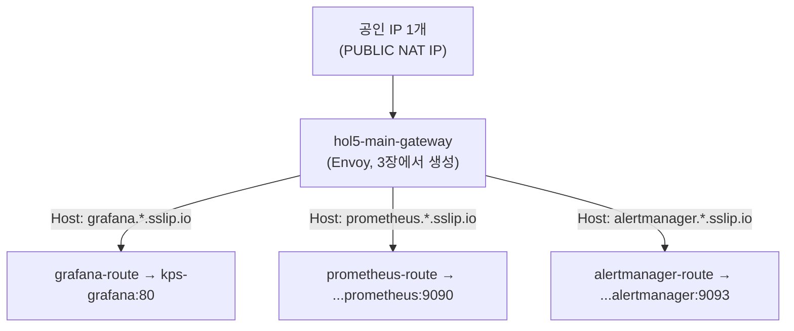

> 🔑 **핵심 아이디어**: LoadBalancer는 서비스마다 하나씩 만들면 IP도, 비용도 그만큼 늘어납니다. Gateway API는 **하나의 IP를 Host 헤더로 구분**해 여러 서비스에 나눠주므로, 신규 서비스가 늘어나도 HTTPRoute만 추가하면 됩니다.

1. **PUBLIC NAT IP 재확인**: 3.3.7에서 메모해 둔 Load Balancer의 `PUBLIC NAT IP`를 다시 확인합니다(예: `123.45.67.89`).
2. **HTTPRoute 작성**: 아래 파일을 작성합니다. `<PUBLIC-NAT-IP>`를 실제 IP로 치환합니다.
   ```bash
   code-server monitoring-httproute.yaml
   ```
   ```yaml
   apiVersion: gateway.networking.k8s.io/v1
   kind: HTTPRoute
   metadata:
     name: grafana-route
     namespace: monitoring
   spec:
     parentRefs:
       - name: hol5-main-gateway
         namespace: envoy-gateway-system
     hostnames:
       - "grafana.<PUBLIC-NAT-IP>.sslip.io"
     rules:
       - backendRefs:
           - name: kps-grafana
             port: 80
   ---
   apiVersion: gateway.networking.k8s.io/v1
   kind: HTTPRoute
   metadata:
     name: prometheus-route
     namespace: monitoring
   spec:
     parentRefs:
       - name: hol5-main-gateway
         namespace: envoy-gateway-system
     hostnames:
       - "prometheus.<PUBLIC-NAT-IP>.sslip.io"
     rules:
       - backendRefs:
           - name: kps-kube-prometheus-stack-prometheus
             port: 9090
   ---
   apiVersion: gateway.networking.k8s.io/v1
   kind: HTTPRoute
   metadata:
     name: alertmanager-route
     namespace: monitoring
   spec:
     parentRefs:
       - name: hol5-main-gateway
         namespace: envoy-gateway-system
     hostnames:
       - "alertmanager.<PUBLIC-NAT-IP>.sslip.io"
     rules:
       - backendRefs:
           - name: kps-kube-prometheus-stack-alertmanager
             port: 9093
   ```
3. **적용 및 연결 확인**:
   ```bash
   kubectl apply -f monitoring-httproute.yaml
   kubectl get httproute -n monitoring
   ```
   - `PARENTREFS`가 `hol5-main-gateway`로, 각 라우트에 `hostnames`가 올바르게 표시되는지 확인합니다.
4. **접속 테스트(curl)**: DNS 전파를 기다릴 필요 없이 sslip.io는 즉시 해석되므로 바로 확인 가능합니다.
   ```bash
   curl -I http://grafana.<PUBLIC-NAT-IP>.sslip.io
   curl -I http://prometheus.<PUBLIC-NAT-IP>.sslip.io
   ```
   - `HTTP/1.1 200 OK`와 `server: envoy` 헤더가 보이면 정상입니다. (Grafana는 로그인 페이지로 리다이렉트되어 `302`가 나올 수도 있습니다.)
5. **Grafana 포털 로그인**:
   - 웹 브라우저에서 `http://grafana.<PUBLIC-NAT-IP>.sslip.io`로 접속합니다.
   - 계정: `admin` / 패스워드: `ChangeMe123!`을 입력하고 접속한 후 즉시 새로운 암호를 지정합니다.
6. **대시보드 Import 진행**:
   - Grafana 메뉴에서 **Dashboards → New → Import**로 이동합니다.
   - `Import via grafana.com` 필드에 아래의 ID들을 입력하여 순차적으로 로드하고, Prometheus 데이터 소스를 설정해 생성합니다.
     - **`1860`**: Node Exporter Full (쿠버네티스 워커 노드의 하드웨어 지표 감시)
     - **`15757`**: Kubernetes / Views / Global (클러스터 CPU/Mem/네트워크 대역폭 종합 관찰)
     - **`15758`**: Kubernetes / Views / Namespaces (네임스페이스 단위 워크로드 분석)
      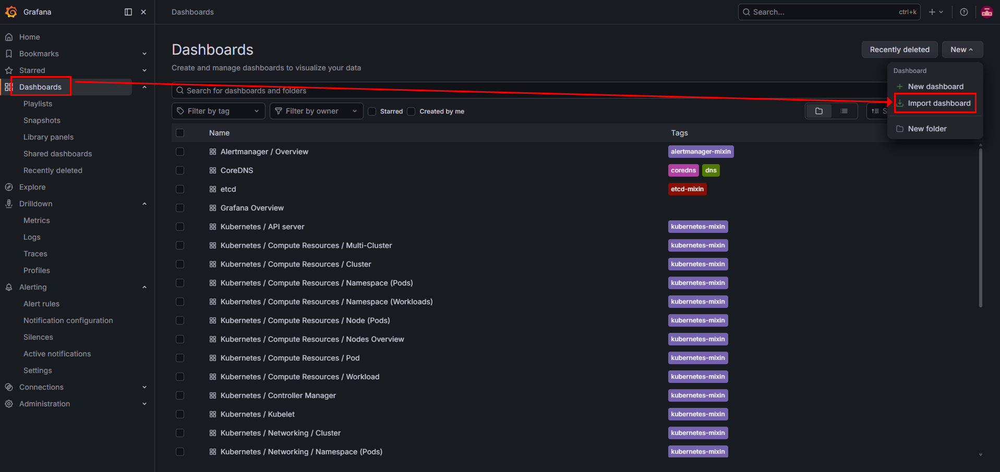
      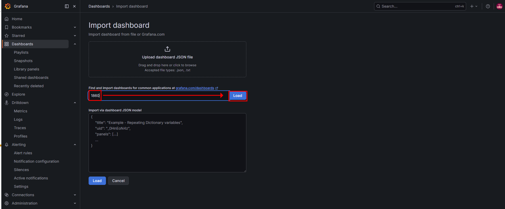


> 💡 이제부터 7장/8장에서 필요한 Prometheus UI(`Alerts` 탭 등)와 Alertmanager UI도 `kubectl port-forward` 없이 각각 `http://prometheus.<PUBLIC-NAT-IP>.sslip.io`, `http://alertmanager.<PUBLIC-NAT-IP>.sslip.io`로 바로 접속할 수 있습니다.


> 🔧 **트러블슈팅**
> - **`curl`이 404를 반환**: `hostnames`에 지정한 도메인과 실제 요청 Host 헤더가 다른 경우입니다. `<PUBLIC-NAT-IP>`를 오타 없이 치환했는지, `curl` 명령의 URL과 HTTPRoute의 `hostnames` 값이 정확히 일치하는지 확인합니다.
> - **`curl`이 응답 없음(Timeout)**: 3.3.9에서 확인한 로드밸런서 헬스체크가 여전히 Healthy인지 재확인합니다. Grafana/Prometheus 서비스 추가와는 무관하게 기존 Gateway/LB 자체가 살아있어야 합니다.
> - **HTTPRoute는 있는데 502**: 대상 Pod가 아직 `Running`이 아닐 수 있습니다(`kubectl get pods -n monitoring`). 1~2분 후 재시도합니다.
> - **여러 HTTPRoute 간 충돌**: `kubectl describe httproute <이름> -n monitoring`의 `Status` 섹션에서 `Accepted: True`인지 확인합니다. `False`이면 `parentRefs`의 이름/네임스페이스 오타를 의심합니다.

#### 체크포인트
- [ ] `kubectl get httproute -n monitoring`에서 3개 라우트 모두 `Accepted: True`인가?
- [ ] `http://grafana.<PUBLIC-NAT-IP>.sslip.io`로 Grafana 로그인 화면에 접속되는가?
- [ ] 초기 비밀번호를 변경했는가?
- [ ] 3개 커뮤니티 대시보드가 모두 Import되어 실시간 데이터를 표시하는가?
- [ ] `http://prometheus.<PUBLIC-NAT-IP>.sslip.io`, `http://alertmanager.<PUBLIC-NAT-IP>.sslip.io`도 각각 접속되는가?


### 7.3.3 PromQL 쿼리 탐색 및 경보 룰 설정
1. **Explore 탭에서 PromQL 실행**:
   - Grafana 좌측 사이드바의 **Explore**를 클릭하고 Prometheus 데이터 소스를 선택한 뒤, 아래 10개 쿼리를 하나씩 복사하여 쿼리창에 붙여넣고 **[Run query]**를 실행하며 각 쿼리가 어떤 운영 질문에 답하는지 확인합니다.
     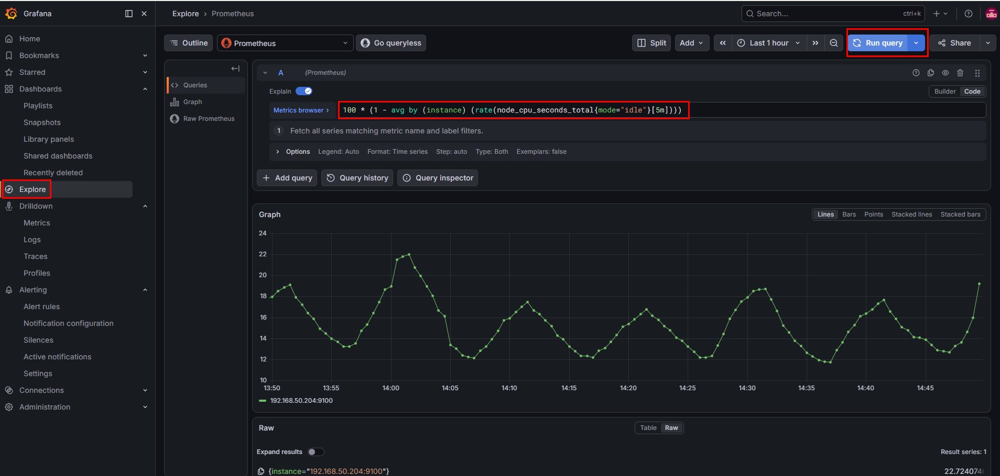

     **① 스크랩 대상 가동 여부 (전체 타깃의 Up/Down 상태)**
     ```promql
     up
     ```

     **② 노드별 CPU 사용률 (%)**
     ```promql
     100 * (1 - avg by (instance) (rate(node_cpu_seconds_total{mode="idle"}[5m])))
     ```

     **③ 노드별 메모리 사용률 (%)**
     ```promql
     100 * (1 - node_memory_MemAvailable_bytes / node_memory_MemTotal_bytes)
     ```

     **④ 네임스페이스별 Pod 수**
     ```promql
     sum by (namespace) (kube_pod_info)
     ```

     **⑤ 네임스페이스별 메모리 워킹셋 사용량 합계 (Bytes)**
     ```promql
     sum by (namespace) (container_memory_working_set_bytes{container!="",container!="POD"})
     ```

     **⑥ 컨테이너 CPU 사용 상위 5개 (최근 5분 초당 평균값 기준)**
     ```promql
     topk(5, sum by (namespace, pod, container) (rate(container_cpu_usage_seconds_total{container!="",container!="POD"}[5m])))
     ```

     **⑦ 컨테이너 메모리 워킹셋 상위 5개**
     ```promql
     topk(5, sum by (namespace, pod, container) (container_memory_working_set_bytes{container!="",container!="POD"}))
     ```

     **⑧ 컨테이너 재시작 합계 (최근 30분 내)**
     ```promql
     sum by (namespace, pod) (increase(kube_pod_container_status_restarts_total[30m]))
     ```

     **⑨ Pending 상태 Pod 목록**
     ```promql
     kube_pod_status_phase{phase="Pending"} == 1
     ```

     **⑩ PVC 사용률 (%)**
     ```promql
     100 * (kubelet_volume_stats_used_bytes / kubelet_volume_stats_capacity_bytes)
     ```
2. **PrometheusRule 리소스 적용**:
   - **선언적 경보 관리(Declarative Alerting) 개념**:
     전통적인 모니터링 환경에서는 서버 설정 파일(`prometheus.yml`)을 직접 수정하고 프로세스를 재시작(Reload)해야 했습니다. 반면 Kubernetes 환경의 Prometheus Operator는 **`PrometheusRule` 커스텀 리소스(CRD)**를 통해 개발자나 운영자가 애플리케이션 매니페스트와 동일한 방식으로 경보 조건을 선언형(YAML)으로 작성·배포할 수 있도록 지원합니다. Operator가 클러스터 내 `PrometheusRule`을 실시간 감시(Watch)하여 서버 재시작 없이 Prometheus 엔진에 동적으로 룰을 반영합니다.
   - **실습 시나리오 (CrashLoopBackOff 조기 탐지)**:
     파드의 대표적인 장애 전조 증상인 메모리 부족(OOM), 설정 오류, 무한 재기동(CrashLoopBackOff) 등의 문제를 선제적으로 파악하기 위해, 최근 15분 동안 파드 내 컨테이너가 3회 이상 재시작된 파드를 실시간 탐지하는 경보 룰(`high-pod-restart.yaml`)을 작성합니다.
   - `high-pod-restart.yaml` 파일 생성:
     ```bash
     code-server high-pod-restart.yaml
     ```
   - **매니페스트 설정 내용**:
     ```yaml
     apiVersion: monitoring.coreos.com/v1
     kind: PrometheusRule
     metadata:
       name: high-pod-restart
       namespace: monitoring
       labels:
         release: kps
     spec:
       groups:
         - name: pod.rules
           rules:
             - alert: PodFrequentlyRestarting
               expr: changes(kube_pod_container_status_restarts_total[15m]) >= 3
               for: 5m
               labels:
                 severity: warning
               annotations:
                 summary: "Pod {{ $labels.namespace }}/{{ $labels.pod }} 재시작 빈번"
                 description: "컨테이너 {{ $labels.container }}가 최근 15분간 3회 이상 재시작되었습니다."
     ```

   > 💡 **PrometheusRule 매니페스트 핵심 필드 상세 설명**:
   > 
   > | 필드명 | 설정값 | 역할 및 기술적 의미 |
   > | :--- | :--- | :--- |
   > | **`metadata.labels.release`** | `kps` | **필수 매핑 라벨**: 7.3.1에서 배포한 Helm 릴리스명(`kps`)과 일치해야 Prometheus Operator가 이 룰을 감지하여 Prometheus Server에 자동으로 등록합니다. |
   > | **`groups[].name`** | `pod.rules` | 논리적으로 연관된 룰들을 묶는 그룹명입니다. 동일 그룹 내 룰들은 정의된 평가 주기(`evaluation_interval`, 기본 1분)마다 순차 실행됩니다. |
   > | **`rules[].alert`** | `PodFrequentlyRestarting` | 경보가 발생했을 때 부여되는 **고유 경보명(Alert Name)**입니다. Prometheus Alerts 및 Alertmanager 대시보드에 노출됩니다. |
   > | **`rules[].expr`** | `changes(...) >= 3` | **경보 발화 조건식 (PromQL)**: 최근 15분 동안 파드 내 컨테이너 재시작 카운터 변경 횟수가 3회 이상인지 정수 단위로 정확히 평가합니다. (※ `increase()`는 구간 경계를 부동소수점으로 외삽(extrapolation)하여 3회 발생 시에도 2.9 또는 3.1로 계산되어 발화 시점이 흔들릴 수 있으므로, 재시작 횟수와 같은 정수 카운트 평가에는 값 변화 횟수를 정수로 반환하는 `changes()`가 적합합니다.) |
   > | **`rules[].for`** | `5m` | **지속 대기 시간 (오경보 방지)**: 조건식(`expr`)이 참(True)이 된 직후 즉시 알림을 보내지 않고, **5분 동안 조건이 계속 유지되는지 검증**합니다. 일시적인 일회성 재시작으로 인한 알림 피로도(Alert Fatigue)를 방지하는 플래핑(Flapping) 방지 장치입니다. |
   > | **`rules[].labels`** | `severity: warning` | 경보에 부여되는 메타데이터 라벨입니다. Alertmanager가 알림을 Slack, Email, PagerDuty 등 심각도별 수신 채널로 라우팅하는 핵심 분기 기준이 됩니다. |
   > | **`rules[].annotations`** | `summary`, `description` | 사람이 식별하기 쉬운 안내 메시지 템플릿입니다. `{{ $labels.namespace }}`, `{{ $labels.pod }}`, `{{ $labels.container }}` 변수를 통해 장애 대상 자원의 정보가 동적으로 치환되어 전달됩니다. |

   ```mermaid
   stateDiagram-v2
       [*] --> Inactive: 정상 상태 (조건 미충족)
       Inactive --> Pending: expr 조건 충족 (재시작 >= 3회)
       Pending --> Inactive: 5분 이내 조건 해제 (일시적 스파이크)
       Pending --> Firing: for 5m 지속 유지 완료
       Firing --> Inactive: 파드 안정화 및 재시작 중단
       note right of Firing
           Alertmanager로 경보 전송
           -> 라우팅 규칙에 따라 이메일/채널 발송
       end note
   ```

   - 아래 명령으로 쿠버네티스 클러스터에 룰을 적용합니다.
     ```bash
     kubectl apply -f high-pod-restart.yaml
     ```
   - **적용 확인**: 브라우저에서 `http://prometheus.<PUBLIC-NAT-IP>.sslip.io/#/alerts` 메뉴로 이동하여 **`PodFrequentlyRestarting`** 룰이 정상 등록되어 **[Inactive]** (녹색) 상태로 대기 중인지 확인합니다.

     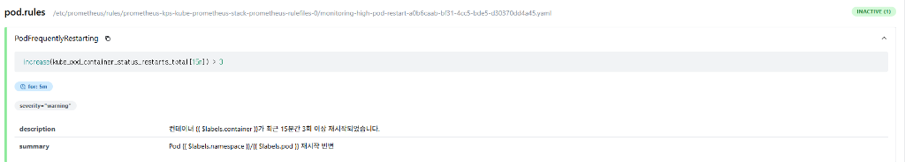

     > 💡 **Inactive 상태에서 `{{ $labels... }}`가 그대로 표시되는 이유**:
     > - **`Inactive` 상태 (규칙 템플릿 정의 조회 시)**: 현재 조건을 만족하는 장애 파드가 0개이므로, 프로메테우스는 변수가 바인딩되지 않은 원본 템플릿 표현식(`{{ $labels.namespace }}/{{ $labels.pod }}`)을 그대로 표시합니다.
     > - **`Pending` / `Firing` 상태 (실제 장애 발생 시)**: 장애가 발생한 파드의 레이블(`namespace="default"`, `pod="crash-test-pod"`, `container="failing-container"`)이 동적으로 주입되어 **`Pod default/crash-test-pod 재시작 빈번`**과 같이 실제 값으로 치환되어 출력됩니다.

   - **[장애 유발 및 경보 발화 검증 실습 (CrashLoopBackOff Fault Injection)]**:
     방금 등록한 `PodFrequentlyRestarting` 경보 룰이 실제 파드 장애 상황에서 정상적으로 감지 및 상태 전이(`Inactive` → `Pending` → `Firing`)되는지 실증 검증하기 위해, 의도적으로 반복 충돌(CrashLoopBackOff)을 유발하는 테스트 파드를 배포합니다.

     **① 장애 유발 파드 매니페스트(`crash-test-pod.yaml`) 작성**:
     ```bash
     code-server crash-test-pod.yaml
     ```
     ```yaml
     apiVersion: v1
     kind: Pod
     metadata:
       name: crash-test-pod
       namespace: default
       labels:
         app: crash-test
     spec:
       containers:
         - name: failing-container
           image: busybox:latest
           command: ["/bin/sh", "-c", "echo 'Container starting...'; sleep 5; echo 'Container crashing!'; exit 1"]
       restartPolicy: Always
     ```

     **② 테스트 파드 배포 및 재시작 카운트 모니터링**:
     ```bash
     kubectl apply -f crash-test-pod.yaml
     kubectl get pods crash-test-pod -w
     ```
     - 파드가 `Running` → `Error` → `CrashLoopBackOff` 상태로 전이되며 `RESTARTS` 횟수가 1, 2, 3회 이상 증가하는 것을 실시간 관찰합니다.

     **③ Prometheus Alerts 웹 UI에서 실시간 경보 상태 전이 확인**:
     - 브라우저에서 `http://prometheus.<PUBLIC-NAT-IP>.sslip.io/#/alerts` 화면을 새로고침합니다.
     - `RESTARTS >= 3`이 달성되면 **`PodFrequentlyRestarting`** 룰이 **[Inactive (녹색)]**에서 **[Pending (황색)]**으로 전환되고, 5분 지속 후 **[Firing (적색)]** 상태로 완전히 발화되는 라이프사이클을 확인합니다.

     **④ 테스트 자원 정리 (경보 정상 해제 확인)**:
     ```bash
     kubectl delete pod crash-test-pod
     ```
     - 파드가 삭제되면 PromQL 평가 조건이 해소되어 경보 상태가 다시 **[Inactive (녹색)]**으로 자동 복구(Resolved)되는 것을 확인합니다.

3. **Alertmanager 라우팅 설정(선택)**:
   - ServiceWatch의 경보 정책과 달리, Alertmanager는 `severity` 등 레이블 기준으로 알림 채널을 분리하는 라우팅 규칙을 지원합니다. (본 항목은 SCP 고유 기능이 아닌 오픈소스 Alertmanager/kube-prometheus-stack 표준 기능입니다.)
   - ⚠️ **주의 (YAML 병합 주의)**: 파일 끝에 `alertmanager:` 최상위 키를 새로 붙여넣으면 Helm이 앞서 7.3.1에서 정의한 `alertmanagerSpec.storage`(PVC 5Gi) 설정을 경고 없이 덮어써서 삭제(Overwrite)해 버립니다. 반드시 기존 `alertmanager:` 블록 내부에 **`alertmanagerSpec`과 나란히 `config:`를 들여쓰기하여 병합**해야 합니다.
   - `kube-prometheus-stack-values.yaml` 파일 편집:
     ```bash
     code-server kube-prometheus-stack-values.yaml
     ```
   - `alertmanager:` 영역을 아래 완성형 블록으로 업데이트합니다 (7.3.1에서 지정한 `bs-ssd` StorageClass 설정 유지):
     ```yaml
     alertmanager:
       alertmanagerSpec:
         storage:
           volumeClaimTemplate:
             spec:
               storageClassName: bs-ssd
               accessModes: ["ReadWriteOnce"]
               resources:
                 requests:
                   storage: 5Gi
       config:
         global:
           resolve_timeout: 5m
           smtp_smarthost: "<SMTP 서버>:587"
           smtp_from: "alert@example.com"
         route:
           receiver: "default-email"
           group_by: ["alertname", "namespace"]
           group_wait: 30s
           group_interval: 5m
           repeat_interval: 4h
           routes:
             - receiver: "critical-email"
               matchers:
                 - severity = "critical"
         receivers:
           - name: "default-email"
             email_configs:
               - to: "<본인 이메일>"
                 send_resolved: true
           - name: "critical-email"
             email_configs:
               - to: "<본인 이메일>"
                 send_resolved: true
     ```
   - **사전 검증 및 업그레이드 반영**:
     ```bash
     # 1) 스토리지 설정 유지 및 템플릿 정상 렌더링 사전 검증 (Dry-run)
     helm upgrade kps prometheus-community/kube-prometheus-stack \
       -n monitoring \
       -f kube-prometheus-stack-values.yaml \
       --dry-run

     # 2) 실제 클러스터에 업그레이드 반영
     helm upgrade kps prometheus-community/kube-prometheus-stack \
       -n monitoring \
       -f kube-prometheus-stack-values.yaml
     ```
   - 확인: 브라우저에서 `http://alertmanager.<PUBLIC-NAT-IP>.sslip.io`(7.3.2에서 연결한 HTTPRoute)로 접속해 Alertmanager UI의 **Status → Config** 메뉴로 라우팅 트리가 반영되었는지 확인합니다. (HTTPRoute 연결 전이라면 대신 `kubectl port-forward -n monitoring svc/kps-kube-prometheus-stack-alertmanager 9093`을 사용해도 됩니다.)
   

#### 체크포인트
- [ ] Explore에서 PromQL 쿼리를 10개 모두 실행했는가?
- [ ] PrometheusRule이 정상 로드되었는가?
- [ ] (선택) Alertmanager 라우팅 설정이 반영되었는가?

## 7.4 정리하기
- SKE 클러스터 상에 영구 볼륨 기반의 Prometheus & Grafana 엔지니어링 환경을 구축하고, PromQL 쿼리와 선언적 경보 리소스(CRD) 동작을 검증했습니다.
- 서비스마다 개별 LoadBalancer를 만드는 대신, 3장의 Gateway API에 HTTPRoute를 추가하는 방식으로 Grafana/Prometheus/Alertmanager를 하나의 공인 IP·sslip.io 도메인 체계 아래로 통합했습니다.
- Alertmanager 라우팅 설정으로 경보 심각도에 따라 알림 채널을 분리하는 방법을 확인했습니다.

---

# 8. ServiceWatch와 Prometheus의 상호 보완적 활용 전략

## 8.1 학습목표
- SCP 플랫폼 수준의 ServiceWatch 서비스와 Kubernetes 내부 중심의 Prometheus 스택의 관찰 경계를 수립할 수 있다.
- 경보 중복 피로도를 줄이고, 단일 운영 동선을 위한 대시보드 하이퍼링크 설정을 구성할 수 있다.

## 8.2 들어가기

### 8.2.1 관찰 경계 수립 및 경보 분담 매트릭스
모든 모니터링 지표에 대해 두 시스템에 중복으로 경보를 걸어두면 알림 노이즈가 발생합니다. 아래의 모니터링 분담 매트릭스를 준수하여 설정을 단순화합니다.

| 모니터링 대상 | ServiceWatch 담당 | Prometheus 담당 | 판정 이유 |
| :--- | :--- | :--- | :--- |
| **VPC, IGW, VPN 상태** | **O** | X | SCP 플랫폼 API로 수집해야 하는 고유 영역 |
| **비-K8s Virtual Server** | **O** | X | SCP 가상 서버 하이퍼바이저 수준 지표 |
| **SKE 워커 노드 CPU/Mem** | X | **O** | K8s 스케줄링 현황과 파드 집계 연계 필요 |
| **파드 재시작 / HPA 메트릭** | X | **O** | Kubernetes 클러스터 내부의 동적 리소스 정보 |
| **DBaaS (MariaDB) 지표** | **O** | X | SCP DBaaS 전용 지표 수집 기능 활용 |
| **공유 스토리지 용량** | **O** | X | File Storage 자원 고유 지표 모니터링 지원 |

표를 외우기보다, 새로운 자원이 생겼을 때 아래 질문 흐름으로 즉시 판단할 수 있으면 충분합니다.


> 🔑 **한 줄 요약**: "K8s 안쪽"이거나 "직접 만든 코드"는 Prometheus, "SCP가 관리해주는 인프라/서비스"는 ServiceWatch.

## 8.3 따라하기

> 📋 **사전 준비**
> - 4장의 ServiceWatch 경보들과 7장의 PrometheusRule(`PodFrequentlyRestarting`)이 모두 남아 있어야 8.3.3 워크시트를 채울 수 있습니다.
> - Grafana에 관리자 계정으로 로그인 가능해야 합니다(7.3.2).

### 8.3.1 인프라와 K8s 영역의 경보 분담 설정
1. **VM 경보 일원화**: SKE 워커 노드가 배포된 Virtual Server 인스턴스에 대해서는 ServiceWatch의 CPU 경보 설정을 비활성화하거나 대상에서 제외합니다. 대신 PrometheusRule에서 kube-prometheus-stack 표준 Recording Rule인 `instance:node_cpu_utilisation:rate5m`(또는 7.3.3의 2번 노드 CPU 쿼리 식)을 활용한 경보로 통일합니다.
   - 참고: 4장에서 만든 `vm-cpu-high-alert`는 SKE 워커 노드가 아닌 `web-ide`(비-K8s Virtual Server)를 대상으로 하므로 8.2.1 매트릭스상 그대로 유지하는 것이 맞습니다. 실제로 비활성화해야 할 대상은 "SKE 워커 노드로 쓰이는 VM에 개별로 걸린 ServiceWatch 경보"가 있을 경우로 한정됩니다.
2. **DBaaS 경보 유지**: 데이터베이스 연결 과부하 및 Slow Query 임계 감시는 데이터베이스 고유 영역이므로 ServiceWatch의 MariaDB 알림 설정을 주 경보 채널로 유지합니다.

#### 체크포인트
- [ ] SKE 워커 노드 자체에 중복으로 걸린 ServiceWatch 경보가 없는가?
- [ ] `web-ide`처럼 비-K8s 대상의 ServiceWatch 경보는 그대로 유지되고 있는가?

### 8.3.2 Grafana에 ServiceWatch 대시보드 링크 연동
운영자가 Grafana 화면을 주 모니터링 도구로 사용하면서, 필요한 경우 SCP 플랫폼 수준의 인프라 모니터링 콘솔로 바로 접근할 수 있도록 링크를 제공합니다.

1. **Grafana Link 추가**:
   - Grafana 대시보드 화면 우측 상단의 **[Dashboard settings]** (톱니바퀴 아이콘)을 클릭합니다.
   - 좌측 메뉴의 **Links**를 선택하고 **[Add dashboard link]**를 클릭합니다.
   - **Link 유형**: `Link` 선택
   - **Title**: `SCP ServiceWatch Console`
   - **URL**: SCP의 ServiceWatch 서비스 대시보드 콘솔 주소를 입력합니다.
     - 예: `https://console.e.samsungsdscloud.com/servicewatch/dashboard`
   - **Open in new tab**: `True`로 설정하고 저장합니다.
    
    
    

2. **동선 확인**: Grafana 대시보드 우측 상단에 표시되는 링크를 클릭하여 새 창으로 SCP ServiceWatch 콘솔이 올바르게 호출되는지 검증합니다.

#### 체크포인트
- [ ] Grafana 대시보드에 `SCP ServiceWatch Console` 링크가 표시되는가?
- [ ] 링크 클릭 시 새 탭으로 정상 이동하는가?

### 8.3.3 경보 중복 점검 워크시트
8.2.1의 분담 매트릭스가 실제로 지켜지고 있는지, 지금까지 만든 경보를 직접 나열해 점검합니다. 추상적 원칙을 눈으로 확인하는 마지막 실습입니다.

1. **ServiceWatch → 경보 → 경보 정책 목록**과 Prometheus UI(`http://prometheus.<PUBLIC-NAT-IP>.sslip.io`)의 **Alerts** 탭을 각각 열어 아래 표를 직접 채웁니다.

| 경보/룰 이름 | 생성 위치(장) | 담당 도구 | 8.2.1 매트릭스와 일치하는가? |
| :--- | :--- | :--- | :--- |
| `vm-cpu-high-alert` | 4장 | ServiceWatch | |
| `fs-storage-byte-alert` | 4장 | ServiceWatch | |
| `mariadb-cpu-alert` | 4장 | ServiceWatch | |
| `mariadb-conn-alert` | 4장 | ServiceWatch | |
| `PodFrequentlyRestarting` | 7장 | Prometheus | |

2. **중복 여부 확인**: 동일한 대상(예: SKE 워커 노드 CPU)에 대해 ServiceWatch와 Prometheus 양쪽에 경보가 걸려 있지 않은지 확인합니다. 만약 SKE 워커 노드로 쓰이는 Virtual Server에 남아있는 세부 모니터링/경보가 있다면 8.3.1에 따라 제거합니다.
3. **누락 여부 확인**: 8.2.1 매트릭스에서 "O"로 표시된 항목 중 실제 경보가 만들어지지 않은 것이 있는지 확인하고, 있다면 어느 장의 실습으로 보완할지 논의합니다.

## 8.4 정리하기
- 두 도구 간의 경보 설계 규칙을 구체화하고, 하이퍼링크 연계를 통해 통합 모니터링 동선을 확보했습니다.

---

# 9. 실습 자원 삭제 및 정리

## 9.1 학습목표
- 실습 완료 후 비용 과금이 지속되는 것을 방지하기 위해, 생성된 모니터링 정책과 가상 자원들을 안전하게 삭제할 수 있다.

## 9.2 따라하기
> 💡 **정리 순서 주의**: Helm/Terraform 정리 명령은 모두 `web-ide` 터미널에서 실행합니다. 따라서 **`web-ide` Virtual Server는 반드시 가장 마지막에 삭제**해야 하며, 그 전에 web-ide를 먼저 지워버리면 이후 단계를 수행할 터미널 자체가 사라지므로 순서를 반드시 지켜야 합니다.

### 9.2.1 모니터링 비활성화 및 경보·로그 정리
1. **사용자 정의 대시보드 제거**:
   - **서비스 → Management → ServiceWatch → 대시보드** 메뉴로 이동합니다.
   - 4.3.2에서 생성한 사용자 정의 대시보드 **`hol5-custom-dashboard`**를 선택하고 **[삭제]**를 진행합니다.
   - *(※ ServiceWatch 대시보드는 50개 이하 지표 참조 시 월 3개까지 무료이나, 51개 이상 지표 참조 또는 추가 대시보드는 과금되므로 불필요한 대시보드를 즉시 회수합니다.)*
2. **경보 정책 제거**: 
   - **ServiceWatch → 경보 → 경보 정책 목록**으로 이동합니다.
   - 4장에서 생성한 `vm-cpu-high-alert`, `fs-storage-byte-alert`, `mariadb-conn-alert`, `mariadb-cpu-alert` (총 4개)를 모두 선택하고 **[삭제]**를 진행합니다.
3. **이벤트 규칙 제거**:
   - **ServiceWatch → 이벤트 → 이벤트 규칙 목록**으로 이동합니다.
   - 6.3.1에서 생성한 `vpcalleventrule`, `sgalleventrule`을 선택하고 **[삭제]**합니다.
4. **ServiceWatch 로그 그룹 2개 삭제 (과금 방지)**:
   > ⚠️ **과금 주의**: ServiceWatch 로그는 매월 5GB 초과 저장 시 유료 과금됩니다. 실습 중 에이전트 및 감사 로그 수집을 위해 생성된 로그 그룹을 반드시 삭제해야 합니다. (로그 그룹 삭제 시 내부 로그 스트림 및 연동 설정도 함께 일괄 정리됩니다.)
   - **서비스 → Management → ServiceWatch → 로그 → 로그 그룹** 메뉴로 이동합니다.
   - 5.3.3에서 생성한 가상 서버 로그 그룹 **`hol5-vm-applog-group`**을 선택하고 **[삭제]**합니다.
   - 6.3.3에서 Trail 연동으로 자동 생성된 **메모해 둔 Trail 로그 그룹**을 선택하고 **[삭제]**합니다.
5. **세부 모니터링 해제**:
   - **서비스 → Compute → Virtual Server**에서 `web-ide`를 선택하고 모니터링 설정을 **[기본 모니터링(5분)]**으로 복구합니다. (※ File Storage 및 MariaDB는 기본 1분 수집이므로 별도 해제 절차가 없습니다.)

### 9.2.2 Kubernetes 모니터링 스택 및 헬름 차트 제거
> `web-ide`가 아직 살아있는 지금 단계에서 먼저 진행합니다.

1. **Helm 차트 uninstall**:
   - Web-IDE 터미널에서 7장의 프로메테우스 작업 디렉토리로 이동한 후 릴리스를 삭제합니다.
     ```bash
     cd ~/prometheus
     helm uninstall kps -n monitoring
     ```
2. **영구 볼륨 클레임(PVC) 및 네임스페이스 수동 삭제**:
   - Helm uninstall 실행 시 데이터 유실 방지를 위해 PVC는 자동 삭제되지 않으므로 아래 명령으로 수동 제거해야 합니다.
     ```bash
     kubectl delete pvc -n monitoring --all
     kubectl delete namespace monitoring
     ```
   - `monitoring` 네임스페이스를 삭제하면 7.3.2에서 만든 `grafana-route`/`prometheus-route`/`alertmanager-route` HTTPRoute도 함께 삭제됩니다. Grafana/Prometheus/Alertmanager는 `ClusterIP`였으므로(7.3.1) **별도로 회수해야 할 전용 Load Balancer가 없습니다.**
3. **Gateway 접속 확인**:
   - `curl -I http://grafana.<PUBLIC-NAT-IP>.sslip.io`가 이제 `404`(라우트 없음) 또는 응답 없음으로 바뀌었는지 확인해, HTTPRoute가 정상적으로 정리되었는지 검증합니다.
4. **Envoy Gateway 및 Gateway 리소스 제거 (필수)**:
   > ⚠️ **주의**: `hol5-main-gateway`와 그 Load Balancer(및 `FW_LB_tfPUBSUBhol5` Firewall)는 3장에서 Helm과 `kubectl apply`로 생성한 자원으로, **Terraform이 관리하지 않습니다.** 다음 9.2.4의 `terraform destroy`는 이 자원들을 정리하지 않으므로, Load Balancer가 Terraform 관리 Subnet/Security Group을 계속 점유한 채 남아 `terraform destroy`가 의존성 충돌로 실패하거나 Load Balancer/Firewall이 고아 자원으로 남아 과금이 지속될 수 있습니다. **반드시 여기서 먼저 제거합니다.**
   - 3장에서 게이트웨이 매니페스트(`gateway.yaml`, `gatewayclass.yaml`, `envoyproxy.yaml`)를 작성했던 디렉토리로 이동하여 리소스 및 릴리스를 일괄 삭제합니다.
     ```bash
     cd ~/gateway
     kubectl delete -f gateway.yaml
     kubectl delete -f gatewayclass.yaml
     kubectl delete -f envoyproxy.yaml
     helm uninstall eg -n envoy-gateway-system
     kubectl delete namespace envoy-gateway-system
     ```
   - **서비스 → Networking → Load Balancer**에서 Envoy Gateway가 생성했던 Load Balancer가 목록에서 사라졌는지 확인합니다. 잔존 시 수동으로 삭제합니다.
   - **서비스 → Networking → Firewall**에서 `FW_LB_tfPUBSUBhol5` Firewall이 함께 삭제되었는지 확인합니다. 잔존 시 수동으로 삭제합니다.
5. **Security Group 잔여 규칙 확인 및 정리**:
   > ⚠️ **주의 (Security Group 잔여 규칙)**: SKE 공식 가이드에 따르면, Load Balancer 생성 시 어노테이션이나 플랫폼에 의해 Security Group에 자동으로 주입된 인바운드 규칙(NodePort, 서비스 포트 등)은 **Load Balancer나 Service를 삭제하더라도 자동으로 삭제되지 않습니다.** 이러한 규칙이 남아 있으면 9.2.4의 `terraform destroy` 실행 시 보안 그룹 삭제 실패나 의존성 충돌을 일으킬 수 있습니다.
   - **서비스 → Networking → Security Group** 메뉴로 이동합니다.
   - Kubernetes 노드 풀 보안 그룹(`tf-k8s-SG-hol5`) 및 실습용 보안 그룹의 상세 페이지로 이동합니다.
   - 3장에서 Envoy Gateway/Load Balancer 연동 시 추가되었던 인바운드 규칙(예: 서비스 포트 또는 임시 노드포트 등)이 잔존하는지 확인하고, 해당 규칙을 수동 삭제합니다.

### 9.2.3 Trail 및 로그 스토리지 정리
1. **Trail 삭제**:
   - **서비스 → Management → Logging & Audit → Trail**로 이동하여 `hol5-audit-trail` Trail을 중지(Inactive)한 후 삭제합니다.
2. **네트워크 보안 로깅(Firewall & Security Group) 연동 해제 및 Object Storage 버킷 삭제 (정합성 준수)**:
   > ⚠️ **필수: SCP 가이드 정합성 순서 준수**
   > SCP 공식 가이드에 명시된 바와 같이, *"로그 저장소 설정은 로그 저장 대상이 없는 경우에 변경할 수 있습니다. 로그 저장소 버킷을 변경하려면 먼저 미사용으로 설정을 변경하세요."* 따라서 반드시 아래 4단계 순서대로 해제 및 삭제를 진행해야 오류 및 정합성 깨짐 없이 정상 회수됩니다.
   - **Step 1 (방화벽 및 보안 그룹 로그 저장 해제)**:
     - **방화벽 해제**: **서비스 → Networking → Firewall** 메뉴로 이동하여 6.3.1에서 로깅을 활성화했던 방화벽 규칙 상세에서 **로그 저장 여부**를 **[미사용]**으로 변경합니다.
     - **보안 그룹 해제**: **서비스 → Networking → Security Group** 메뉴로 이동하여 6.3.1에서 로깅을 활성화했던 보안 그룹 상세에서 **로그 저장 여부**를 **[미사용]**으로 변경합니다. (로그 저장 대상을 먼저 0개로 만듭니다.)
   - **Step 2 (Network Logging 저장소 매핑 해제)**:
     - **Firewall Logging**: **서비스 → Management → Network Logging → Firewall Logging**에서 **[로그 저장소 설정]**을 클릭하고 로그 저장 여부를 **[미사용]**으로 변경(또는 버킷 매핑 해제)하여 저장합니다.
     - **Security Group Logging**: **서비스 → Management → Network Logging → Security Group Logging**에서 **[로그 저장소 설정]**을 클릭하고 로그 저장 여부를 **[미사용]**으로 변경(또는 버킷 매핑 해제)하여 저장합니다.
   - **Step 3 (Object Storage 버킷 내부 비우기)**:
     - **서비스 → Storage → Object Storage**로 이동합니다.
     - 공용 로그 버킷(`hol5-log-bucket-<MY_ID>`)을 클릭하여 진입합니다.
     - **[객체]** 탭에서 적재된 모든 로그 파일과 디렉토리(방화벽 로그, Trail 감사 로그, Digest 파일 등)를 전체 선택하고 **[삭제]**하여 버킷을 완전히 비웁니다.
   - **Step 4 (버킷 자원 최종 삭제)**:
     - 버킷 내부가 완전히 비워진 상태에서 버킷 목록으로 돌아와 `hol5-log-bucket-<MY_ID>` 버킷을 선택하고 **[삭제]**합니다.
3. **Trail IAM 역할 및 정책 삭제**:
   - **서비스 → Management → IAM → 역할**에서 6.3.2에서 생성한 `audit-trail-role` 역할을 삭제합니다.
   - *(선택)* **서비스 → Management → IAM → 정책**에서 6.3.2에서 생성한 `trail-to-servicewatch-policy` 사용자 정의 정책을 삭제합니다.
4. **Trail 로그 그룹 삭제 확인**:
   - 9.2.1-4에서 Trail 로그 그룹이 이미 삭제되었는지 확인하고, 만약 목록에 남아있다면 **서비스 → Management → ServiceWatch → 로그 → 로그 그룹**에서 최종 삭제합니다.

### 9.2.4 Terraform 인프라 삭제
2장에서 `terraform apply`로 생성한 Kubernetes 클러스터, VPC/Subnet, NFS 파일 스토리지 및 MariaDB(DBaaS)는 Terraform이 관리하므로 콘솔에서 개별 삭제하지 않고 **`terraform destroy`**로 일괄 반환합니다.

> ⚠️ **사전 확인**: 9.2.2의 4~5번 단계(Envoy Gateway/Load Balancer 및 Security Group 잔여 규칙 정리)가 완료되지 않은 상태에서 `terraform destroy`를 실행하면 Load Balancer가 점유 중인 Subnet/Security Group 삭제가 실패할 수 있습니다.

1. Web-IDE 터미널에서 프로젝트 디렉토리로 이동합니다.
   ```bash
   cd ~/scp-v2-terraform-hol4
   ```
2. 삭제될 리소스 목록을 미리 확인합니다.
   ```bash
   terraform plan -destroy
   ```
3. 실제 인프라를 삭제합니다.
   ```bash
   terraform destroy
   ```
   - 프롬프트에 `yes`를 입력하여 진행하며, `Destroy complete!` 메시지와 함께 Kubernetes 클러스터/VPC/NFS 스토리지 및 MariaDB 인스턴스가 모두 삭제되었는지 콘솔에서 확인합니다.

### 9.2.5 web-ide 및 1장 수동 구축 인프라 자원 최종 회수
> ⚠️ **주의**: 위 9.2.2~9.2.4 단계를 모두 마친 뒤 마지막으로 진행합니다. 자원 간의 의존성(Dependency)이 있으므로 반드시 아래 순서대로 삭제를 진행해야 오류 없이 정상적으로 정리됩니다.

1. **Virtual Server 삭제**:
   - **서비스 → Compute → Virtual Server**에서 실습용 가상 서버 `web-ide`를 중지 후 **[삭제]**합니다.
2. **Public IP 반납**:
   - **서비스 → Networking → Public IP**로 이동하여 `web-ide` 서버에 연결되었던 Public IP를 선택하고 **[반납(삭제)]**합니다.
3. **Keypair 삭제**:
   - **서비스 → Compute → Virtual Server → Keypair** 메뉴에서 1장에서 생성한 `mykey-hol5`를 선택하고 **[삭제]**합니다.
4. **Security Group 삭제**:
   - **서비스 → Networking → Security Group**으로 이동하여 1장에서 생성한 `pubsub-sg-hol5`를 선택하고 **[삭제]**합니다.
5. **Subnet 삭제**:
   - **서비스 → Networking → VPC → Subnet**으로 이동하여 `pubsubhol5` 서브넷을 선택하고 **[삭제]**합니다.
6. **Firewall 규칙 및 Firewall 삭제**:
   - **서비스 → Networking → Firewall**에서 `FW_IGW_vpc-webide-hol5`를 선택하여 등록된 인바운드/아웃바운드 규칙을 삭제한 후 방화벽을 해제/삭제합니다.
7. **Internet Gateway 삭제**:
   - **서비스 → Networking → VPC → Internet Gateway**로 이동하여 `vpc-webide-hol5`에 연결된 Internet Gateway를 연결 해제(Detach)한 후 **[삭제]**합니다.
8. **VPC 삭제**:
   - **서비스 → Networking → VPC**로 이동하여 1장에서 수동 생성한 `vpc-webide-hol5`를 최종 **[삭제]**합니다.
9. **IAM 인증키 삭제**:
   - **마이페이지 → 인증키 관리**로 이동하여 2.3.1에서 Terraform 및 API 연동용으로 발급받았던 Access Key / Secret Key를 **[삭제(폐기)]**합니다.

## 9.3 정리하기

실습 완료 후 불필요한 비용 과금 및 리소스 충돌을 방지하기 위해 모든 관찰성 설정과 클라우드 인프라 자원을 회수했습니다. 아래의 **최종 잔여 자원 점검 체크리스트**를 통해 SCP 콘솔에서 잔존 자원이 없는지 최종 확인합니다.

### 최종 잔여 자원 점검 체크리스트

| 카테고리 | 서비스 메뉴 | 점검 대상 자원 | 정상 상태 | 확인 여부 |
| :--- | :--- | :--- | :--- | :---: |
| **Management** | ServiceWatch → 대시보드 | `hol5-custom-dashboard` | 목록에 없음 (삭제 완료) | [ ] |
| | ServiceWatch → 경보 정책 | `vm-cpu-high-alert` 등 4개 경보 | 목록에 없음 (삭제 완료) | [ ] |
| | ServiceWatch → 이벤트 규칙 | `vpcalleventrule`, `sgalleventrule` | 목록에 없음 (삭제 완료) | [ ] |
| | ServiceWatch → 로그 그룹 | `hol5-vm-applog-group`, Trail 로그 그룹 | 목록에 없음 (과금 방지) | [ ] |
| | Logging & Audit → Trail | `hol5-audit-trail` | 목록에 없음 (삭제 완료) | [ ] |
| | IAM → 역할 / 정책 | `audit-trail-role`, `trail-to-servicewatch-policy` | 목록에 없음 (삭제 완료) | [ ] |
| **Storage** | Object Storage | `hol5-log-bucket-<MY_ID>` | 버킷 삭제 완료 | [ ] |
| | File Storage | 2장에서 생성한 NFS 스토리지 | 삭제 완료 (`terraform destroy`) | [ ] |
| **Database** | MariaDB | `tf-mariadb-hol5` (DBaaS) | 삭제 완료 (`terraform destroy`) | [ ] |
| **Container** | Kubernetes Engine (SKE) | `tf-ske-cluster-hol5` 및 Node Pool | 삭제 완료 (`terraform destroy`) | [ ] |
| **Networking** | Load Balancer | Envoy Gateway 연동 LB | 목록에 없음 (수동 삭제 완료) | [ ] |
| | Firewall | `FW_LB_tfPUBSUBhol5`, `FW_IGW_vpc-webide-hol5` | 삭제 완료 | [ ] |
| | Network Logging → Firewall Logging | 로그 저장소 버킷 매핑 | `미사용` 상태 | [ ] |
| | Security Group | `pubsub-sg-hol5`, `tf-k8s-SG-hol5` 잔여 규칙 | 삭제 완료 | [ ] |
| | Public IP | `web-ide` 및 LB 공인 IP | 반납 완료 (목록에 없음) | [ ] |
| | VPC / Subnet / IGW | `vpc-webide-hol5`, `tf-vpc-hol5`, Subnet, IGW | 삭제 완료 | [ ] |
| **Compute** | Virtual Server | `web-ide` 및 SKE 워커 노드 VM | 삭제 완료 | [ ] |
| | Virtual Server → Keypair | `mykey-hol5` | 삭제 완료 | [ ] |
| **인증키** | 마이페이지 → 인증키 관리 | 실습용 API Access Key / Secret Key | 삭제(폐기) 완료 | [ ] |

---